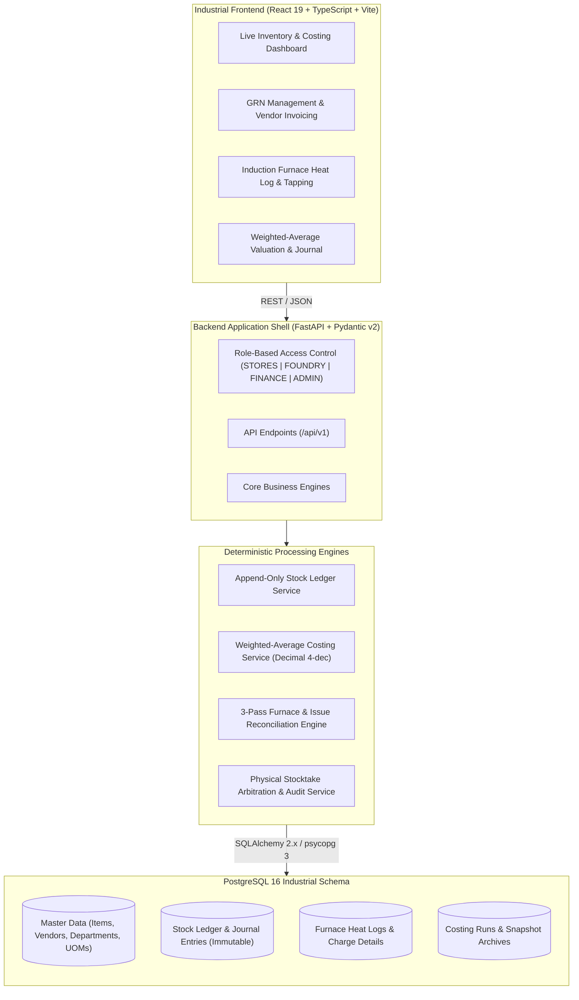

<div align="center">

<!-- Hero Banner with Dynamic Gradient Animation -->


<!-- Dynamic Animated Typing Header -->
<a href="https://github.com/DarshanCat/material-cost-system-with-AI">
  
</a>

<p align="center">
  <a href="#-key-capabilities"></a>
  <a href="#-system-architecture"></a>
  <a href="#-technology-stack"></a>
  <a href="#-technology-stack"></a>
  <a href="#-testing--verification"></a>
  <a href="#-audit--evidence-governance"></a>
</p>

---

### 🏭 Purpose-Built for Industrial Metallurgy & SG Iron Foundries
**Vijay Spheroidals Pvt. Ltd. (VSPL)** operates high-volume Induction Furnaces producing specialized Spheroidal Graphite (SG) and Ductile Iron castings. This system replaces fragmented spreadsheets with an immutable, auditable, high-precision ERP engine.

</div>

---

## ⚡ Key Capabilities & Technical Innovations

<table>
  <tr>
    <td width="50%">
      <h3>💎 Arbitrary-Precision Costing</h3>
      <ul>
        <li>Uses Python <code>Decimal</code> with <code>ROUND_HALF_UP</code> to 4 decimal places (<code>NUMERIC(14, 4)</code>).</li>
        <li>Eliminates IEEE 754 floating-point cumulative drift in multi-crore raw material runs.</li>
        <li><strong>Strict Costing Baseline:</strong> Configurable cutoff baseline (<code>COSTING_START_DATE = 2026-10-12</code>).</li>
      </ul>
    </td>
    <td width="50%">
      <h3>🔒 Append-Only Immutable Ledger</h3>
      <ul>
        <li>Double-entry financial semantics for physical inventory (GRN, Issue, Waste, Adjustment).</li>
        <li><strong>Non-Negotiable:</strong> Stock ledger entries and quantities are strictly append-only; historical postings are never updated or deleted.</li>
        <li>Live closing balances dynamically derived via deterministic window aggregations.</li>
      </ul>
    </td>
  </tr>
  <tr>
    <td width="50%">
      <h3>🔥 Furnace Heat Log & Mass-Balance</h3>
      <ul>
        <li>Reconciles induction furnace heat logs against material issue dockets.</li>
        <li>Tracks charge composition (Pig Iron, CRCA Scrap, Foundry Returns, Inoculants, FeSi, FeMn, Mg).</li>
        <li>Calculates liquid metal cost per kg tapped ($\text{Cost/kg}$) and individual cast part material cost.</li>
      </ul>
    </td>
    <td width="50%">
      <h3>🤖 AI-Assisted Migration & Anomaly Detection</h3>
      <ul>
        <li>Multi-pass reconciliation engine matching raw material names against canonical aliases.</li>
        <li>Automated detection of negative ledger balances, unpriced GRN receipts, and date anomalies.</li>
        <li>Cryptographic audit trail with SHA-256 evidence hashing across all historical migrations.</li>
      </ul>
    </td>
  </tr>
</table>

---

## 🏗 System Architecture



---

## 📊 Phase-by-Phase Engineering Status

| Phase | Milestone | Scope & Deliverables | Status |
| :---: | :--- | :--- | :---: |
| **01** | **Foundation & Shell** | Clean Hexagonal Architecture, FastAPI, React 19, Docker setup |  |
| **02** | **Master Data & Workflows** | 741 Items taxonomy, Vendor masters, 4-eye Item Approval Workflow |  |
| **03** | **Material Transactions** | GRN receiving, Multi-line Issues, Waste Dispositions, GST validation |  |
| **04** | **Append-Only Ledger** | Double-entry journal, Physical audit arbitration, Blind stocktakes |  |
| **05** | **Furnace Heat Engine** | Induction furnace heat logging, Scrap aliases, 3-Pass issue reconciliation |  |
| **06** | **Weighted-Average Costing** | Arbitrary-precision costing, Zero-stock restart, Heat/Part cost modeling |  |
| **07** | **Migration & Audit Gate** | Stage 3A Evidence Intake, 82-Day Void governance, Cryptographic freeze |  |

---

## 🧮 Costing Mathematical Formulations

<details>
<summary><b>Click to expand mathematical rules & tie-breaking hierarchy</b></summary>

### 1. Cumulative Weighted-Average Unit Cost (WAUC)
For any receipt transaction at timestamp $t$ with quantity $Q_{\text{recv}}$ and net ex-GST unit purchase rate $R_{\text{recv}}$:

$$\text{WAUC}_t = \frac{\left( Q_{\text{prior}} \times \text{WAUC}_{\text{prior}} \right) + \left( Q_{\text{recv}} \times R_{\text{recv}} \right)}{Q_{\text{prior}} + Q_{\text{recv}}}$$

### 2. Zero-Stock Rate Restart
If physical balance drops to zero ($Q_{\text{prior}} = 0$), the next inbound receipt restarts the effective rate without historical dilution:

$$\text{WAUC}_t = R_{\text{recv}} \quad \text{when } Q_{\text{prior}} = 0$$

### 3. Deterministic Same-Day Transaction Ordering
When multiple inventory transactions occur on the same calendar day, processing order is strictly guaranteed by:

$$\text{Sequence Priority} = \begin{cases} 
1 & \text{Opening Balance} \\ 
2 & \text{Goods Receipt Note (GRN)} \\ 
3 & \text{Material Issue (Stores $\rightarrow$ Foundry)} \\ 
4 & \text{Waste / Scrap Disposition} \\ 
5 & \text{Physical Audit Adjustment} 
\end{cases} \quad \longrightarrow \text{Tie-break by Primary Key ID ASC}$$

### 4. Liquid Metal & Part Costing
- **Liquid Metal Cost per kg Tapped:**
  $$\text{Cost/kg} = \frac{\sum_{i=1}^{n} \left( M_i \times \text{WAUC}_i \right)}{\text{Total Liquid Metal Tapped (kg)}}$$
- **Individual Cast Part Material Cost:**
  $$\text{Part Material Cost} = \text{Unit Cast Weight (kg)} \times \text{Cost/kg}$$

</details>

---

## 🛠 Technology Stack

```
Frontend:          React 19  •  TypeScript 5  •  Vite  •  Tailwind CSS  •  Lucide Icons
Backend:           Python 3.11+ / 3.14  •  FastAPI  •  Pydantic v2  •  Starlette
ORM & Migration:   SQLAlchemy 2.x  •  Alembic  •  psycopg 3 (PostgreSQL driver)
Database:          PostgreSQL 16  •  SQLite (In-Memory Fast Unit Testing)
DevOps & Tooling:  Docker  •  PowerShell Core  •  Pytest  •  Git Cryptographic Tagging
```

---

## 🚀 Quick Start Guide

### 1. Clone Repository & Setup Prerequisites
```powershell
# Clone the repository
git clone https://github.com/DarshanCat/material-cost-system-with-AI.git
cd "material-cost-system-with-AI"

# Prerequisites check:
# Python 3.11+ (python --version)
# Node.js 18+  (node --version)
# PostgreSQL 15+ (psql --version)
```

### 2. Automated Environment Initialization
```powershell
# Run the automated environment setup script
.\scripts\setup-env.ps1
```

### 3. Start Backend Development Server
```powershell
# Starts FastAPI server on http://127.0.0.1:8000
.\scripts\run-backend.ps1
```
* **Interactive OpenAPI Swagger Docs:** [http://127.0.0.1:8000/docs](http://127.0.0.1:8000/docs)
* **System Health Endpoint:** [http://127.0.0.1:8000/api/v1/health](http://127.0.0.1:8000/api/v1/health)

### 4. Start Industrial Frontend Application
```powershell
# In a separate PowerShell terminal
.\scripts\run-frontend.ps1
```
* **Frontend Web Application:** [http://localhost:5173](http://localhost:5173)

---

## 🧪 Testing & Verification

The suite incorporates strict regression assertions across unit models, decimal costing precision, and multi-line reconciliation:

```powershell
# Run full automated test suite
pytest
```
```text
============================= test session starts =============================
collected 68 items
backend/tests/test_config.py ...                                         [  4%]
backend/tests/test_costing_audit.py ...                                  [  8%]
backend/tests/test_excel_import.py ...                                   [ 13%]
backend/tests/test_grn.py ...                                            [ 17%]
backend/tests/test_health.py .....                                       [ 25%]
backend/tests/test_heat_costing.py ....                                  [ 30%]
backend/tests/test_heat_import.py .                                      [ 32%]
backend/tests/test_heats.py ...                                          [ 36%]
backend/tests/test_inventory_valuation.py .....                          [ 44%]
backend/tests/test_issues.py ..                                          [ 47%]
backend/tests/test_item_requests_workflow.py .....                       [ 54%]
backend/tests/test_ledger_issues.py ..                                   [ 57%]
backend/tests/test_ledger_posting.py ..                                  [ 60%]
backend/tests/test_master_data.py ....                                   [ 66%]
backend/tests/test_material_aliases.py ...                               [ 70%]
backend/tests/test_opening_balances.py .                                 [ 72%]
backend/tests/test_part_costing.py ...                                   [ 76%]
backend/tests/test_physical_audits.py .                                  [ 77%]
backend/tests/test_reconciliation.py ...                                 [ 82%]
backend/tests/test_reconciliation_isolation.py .                         [ 83%]
backend/tests/test_vendors.py ...                                        [ 88%]
backend/tests/test_waste.py .                                            [ 89%]
backend/tests/test_weighted_average_costing.py .......                   [100%]
============================== 68 passed in 7.28s ==============================
```

---

## 📜 Regulatory Audit & Evidence Governance

All historical migrations adhere to strict ISO/Indian Accounting Standard (Ind AS 2) requirements:
- **Zero Synthetic Data Rule:** No simulated records are ever inserted into unrecorded periods.
- **Double-Blind Stocktaking:** Physical counts require two independent tally sheets before system reconciliation.
- **Cryptographic Evidence Sealing:** Every source spreadsheet digest is cataloged under SHA-256 in [`docs/reports/`](file:///c:/VSPL_MM/Material%20managment%20system/docs/reports/).

---

<div align="center">

<!-- Footer Banner -->


<p align="center">
  <b>VSPL Material Management & Costing System</b> • Vijay Spheroidals Pvt. Ltd.<br>
  <i>Designed for Mission-Critical Metallurgy & Manufacturing Cost Control</i>
</p>

</div>
