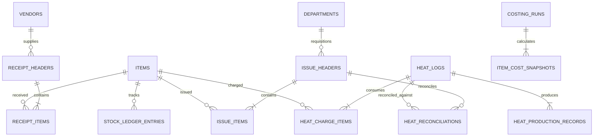

# VSPL Material Management & Costing System — Database Design Specification

## 1. Design Principles & Guidelines

1. **Relational Integrity via PostgreSQL:**
   - Full ACID transaction compliance.
   - Foreign key constraints with explicit index generation.
   - Enforced uniqueness constraints on natural business keys (e.g., Item Code, GRN Number, Heat Number).
2. **Numeric Precision Standard:**
   - **Financial/Rate Fields:** `NUMERIC(18, 4)` (e.g., INR unit rate per kg/piece).
   - **Stock & Charge Quantities:** `NUMERIC(18, 4)` (supporting precise kilogram and fraction quantities).
   - **Costing Denominators & Weight Ratios:** `NUMERIC(18, 6)`.
   - **Prohibition:** IEEE 754 binary floating-point (`FLOAT`, `DOUBLE PRECISION`) is strictly forbidden for currency and inventory balances to eliminate rounding drift.
3. **Temporal and Audit Consistency:**
   - Database server time stored in UTC with explicit timezone (`TIMESTAMP WITH TIME ZONE`).
   - Business accounting dates stored as ISO `DATE` fields (`YYYY-MM-DD`).
   - All ledger tables inherit `created_at`, `created_by`, and `version` fields.

---

## 2. Proposed Future Entities & Schema Architecture

### 2.1 Master Data Entities (Phase 2)

#### `items` (Item Master ~ 741 items)
- `id` (UUID / BIGINT PRIMARY KEY)
- `item_code` (VARCHAR(50) UNIQUE NOT NULL) — e.g., `RM-PIG-01`, `FA-FESI-75`
- `description` (VARCHAR(255) NOT NULL)
- `category` (VARCHAR(50) NOT NULL) — `RAW_MATERIAL`, `FERRO_ALLOY`, `CONSUMABLE`, `RETURN_SCRAP`, `BORING`, `GATING`
- `uom` (VARCHAR(20) NOT NULL) — `KG`, `MT`, `NOS`, `LTR`
- `reorder_level` (NUMERIC(18, 4) DEFAULT 0)
- `minimum_stock` (NUMERIC(18, 4) DEFAULT 0)
- `approval_status` (VARCHAR(20) DEFAULT 'APPROVED') — `PENDING`, `APPROVED`, `REJECTED`
- `is_active` (BOOLEAN DEFAULT TRUE)
- `created_at`, `updated_at` (TIMESTAMPTZ)

#### `vendors` (Vendor Master)
- `id` (UUID / BIGINT PRIMARY KEY)
- `vendor_code` (VARCHAR(50) UNIQUE NOT NULL)
- `vendor_name` (VARCHAR(255) NOT NULL)
- `gst_number` (VARCHAR(20) NULL)
- `contact_email`, `phone` (VARCHAR(100))
- `is_approved` (BOOLEAN DEFAULT TRUE)

#### `departments` (Plant Units)
- `id` (INT PRIMARY KEY)
- `code` (VARCHAR(30) UNIQUE NOT NULL)
- `name` (VARCHAR(100) NOT NULL) — `Foundry`, `Machine Shop`, `Maintenance`, `General/Stores`, `Packing`, `Quality`, `F3 HMC`, `F3 CNC`

---

### 2.2 Material Transactions (Phase 3)

#### `receipt_headers` (Goods Receipt Notes / Inward Slips)
- `id` (BIGINT PRIMARY KEY)
- `grn_number` (VARCHAR(50) UNIQUE NOT NULL)
- `vendor_id` (BIGINT REFERENCES vendors(id) NULL) — NULL for internal transfers
- `source_origin` (VARCHAR(50) NOT NULL) — `EXTERNAL_VENDOR`, `VSPL_INTERNAL`, `SEGREGATION_YARD`
- `invoice_or_dc_number` (VARCHAR(100) NOT NULL)
- `receipt_date` (DATE NOT NULL)
- `received_by_user_id` (VARCHAR(50) NOT NULL)
- `created_at` (TIMESTAMPTZ NOT NULL)

#### `receipt_items`
- `id` (BIGINT PRIMARY KEY)
- `receipt_header_id` (BIGINT REFERENCES receipt_headers(id) ON DELETE RESTRICT)
- `item_id` (BIGINT REFERENCES items(id) ON DELETE RESTRICT)
- `received_quantity` (NUMERIC(18, 4) NOT NULL CHECK (received_quantity > 0))
- `unit_rate_ex_gst` (NUMERIC(18, 4) NOT NULL CHECK (unit_rate_ex_gst >= 0))
- `heat_or_batch_number` (VARCHAR(100) NULL)
- `remarks` (TEXT NULL)

#### `issue_headers` (Material Issue Slips)
- `id` (BIGINT PRIMARY KEY)
- `issue_slip_number` (VARCHAR(50) UNIQUE NOT NULL)
- `department_id` (INT REFERENCES departments(id))
- `issue_date` (DATE NOT NULL)
- `issued_by_user_id` (VARCHAR(50) NOT NULL)
- `authorized_by_user_id` (VARCHAR(50) NOT NULL)
- `status` (VARCHAR(20) DEFAULT 'POSTED')

#### `issue_items`
- `id` (BIGINT PRIMARY KEY)
- `issue_header_id` (BIGINT REFERENCES issue_headers(id))
- `item_id` (BIGINT REFERENCES items(id))
- `issued_quantity` (NUMERIC(18, 4) NOT NULL CHECK (issued_quantity > 0))
- `purpose_or_work_order` (VARCHAR(100) NULL)

---

### 2.3 Live Inventory Ledger (Phase 4)

#### `stock_ledger_entries` (Append-Only Transaction Log)
- `id` (BIGINT PRIMARY KEY)
- `item_id` (BIGINT REFERENCES items(id) NOT NULL)
- `entry_date` (DATE NOT NULL)
- `entry_timestamp` (TIMESTAMPTZ NOT NULL)
- `transaction_type` (VARCHAR(30) NOT NULL) — `RECEIPT`, `ISSUE`, `PHYSICAL_AUDIT_ADJUSTMENT`, `SCRAP_RETURN`
- `quantity_change` (NUMERIC(18, 4) NOT NULL) — Positive for inward, negative for outward
- `unit_cost` (NUMERIC(18, 4) NOT NULL) — Recorded cost at time of transaction
- `total_cost` (NUMERIC(18, 4) NOT NULL)
- `running_quantity` (NUMERIC(18, 4) NOT NULL)
- `reference_document_type` (VARCHAR(50) NOT NULL) — e.g. `GRN`, `ISSUE_SLIP`, `AUDIT_SHEET`
- `reference_document_id` (VARCHAR(100) NOT NULL)
- `created_by` (VARCHAR(50) NOT NULL)

> **IMMUTABILITY RULE:**
> No `UPDATE` or `DELETE` triggers or queries may be executed against `stock_ledger_entries`.

---

### 2.4 Heat Log and Reconciliation (Phase 5)

#### `heat_logs` (Induction Furnace Melts)
- `id` (BIGINT PRIMARY KEY)
- `heat_number` (VARCHAR(50) UNIQUE NOT NULL)
- `furnace_id` (VARCHAR(20) NOT NULL) — e.g., `FURNACE_A`, `FURNACE_B`
- `heat_date` (DATE NOT NULL)
- `shift` (VARCHAR(10) NOT NULL) — `SHIFT_1`, `SHIFT_2`, `SHIFT_3`
- `metallurgist_name` (VARCHAR(100) NOT NULL)
- `total_charge_weight_kg` (NUMERIC(18, 4) NOT NULL)
- `liquid_metal_tapped_kg` (NUMERIC(18, 4) NOT NULL)
- `melting_loss_percentage` (NUMERIC(8, 4) NOT NULL)

#### `heat_charge_items`
- `id` (BIGINT PRIMARY KEY)
- `heat_log_id` (BIGINT REFERENCES heat_logs(id))
- `item_id` (BIGINT REFERENCES items(id))
- `charged_weight_kg` (NUMERIC(18, 4) NOT NULL)
- `percentage_of_charge` (NUMERIC(8, 4) NOT NULL)

> **RECONCILIATION SEPARATION:**
> Rows in `heat_charge_items` are metallurgical log entries. They do NOT alter stock balances in `stock_ledger_entries`. Ledger movement occurs solely via `issue_items`.

---

### 2.5 Costing Engine (Phase 6)

#### `costing_runs`
- `id` (BIGINT PRIMARY KEY)
- `run_date` (DATE NOT NULL)
- `baseline_start_date` (DATE DEFAULT '2026-10-12')
- `period_start` (DATE NOT NULL)
- `period_end` (DATE NOT NULL)
- `status` (VARCHAR(20) NOT NULL)

#### `item_cost_snapshots`
- `id` (BIGINT PRIMARY KEY)
- `costing_run_id` (BIGINT REFERENCES costing_runs(id))
- `item_id` (BIGINT REFERENCES items(id))
- `weighted_average_unit_cost` (NUMERIC(18, 4) NOT NULL)
- `total_valuation` (NUMERIC(18, 4) NOT NULL)

---

## 3. Migration Strategy (Alembic)

1. **Deterministic Versioning:** All schema changes must be codified as forward Alembic revisions in `backend/migrations/versions/`.
2. **Pre-flight Health Checks:** Migrations must check connection parameters before attempting execution.
3. **Zero Production Mutation:** Automated scripts strictly target local and development databases. Direct migration runs on production require DBA authorization and manual verification.
