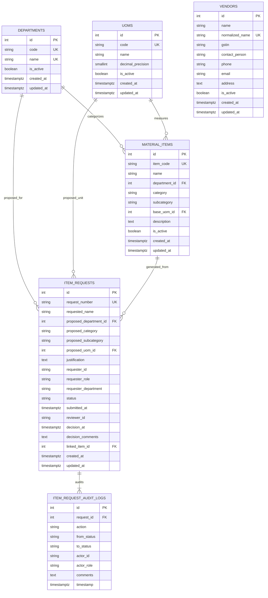

# VSPL Material Management & Costing System — Database Design Specification

## 1. Design Principles & Guidelines

1. **Relational Integrity via PostgreSQL:**
   - Full ACID transaction compliance.
   - Foreign key constraints with explicit index generation and cascading policies.
   - Enforced database-level uniqueness constraints on business keys (`item_code`, `normalized_name`, `request_number`, `code`, `name`).
2. **Numeric Precision Standard:**
   - **Financial/Rate Fields:** `NUMERIC(18, 4)` (e.g., INR unit rate per kg/piece).
   - **Stock & Charge Quantities:** `NUMERIC(18, 4)` (supporting precise kilogram and fraction quantities).
   - **Costing Denominators & Weight Ratios:** `NUMERIC(18, 6)`.
   - **Prohibition:** IEEE 754 binary floating-point (`FLOAT`, `DOUBLE PRECISION`) is strictly forbidden for currency and inventory balances to eliminate rounding drift.
3. **Temporal and Audit Consistency:**
   - Database server time stored in UTC with explicit timezone (`TIMESTAMP WITH TIME ZONE`).
   - Business accounting dates stored as ISO `DATE` fields (`YYYY-MM-DD`).
   - All master data and audit tables inherit `created_at` and `updated_at` timestamps via `TimestampMixin`.

---

## 2. Implemented Schema Architecture (Phase 2 Master Data & Approvals)

---

## 3. Entity Definitions & Specifications

### 3.1 `departments` (Plant Units)
Represents the eight plant departments in the foundry:
- `id` (INT PRIMARY KEY, autoincrement)
- `code` (VARCHAR(20) UNIQUE NOT NULL, index) — `FDY`, `MSP`, `MNT`, `GNS`, `PKG`, `QLT`, `HMC`, `CNC`
- `name` (VARCHAR(100) UNIQUE NOT NULL) — `Foundry`, `Machine Shop`, `Maintenance`, `General/Stores`, `Packing`, `Quality`, `F3 HMC`, `F3 CNC`
- `is_active` (BOOLEAN DEFAULT TRUE NOT NULL)
- `created_at`, `updated_at` (TIMESTAMPTZ NOT NULL)

### 3.2 `uoms` (Controlled Measurement Units)
Enforces quantity decimal precision per unit:
- `id` (INT PRIMARY KEY, autoincrement)
- `code` (VARCHAR(20) UNIQUE NOT NULL, index) — `KG`, `MT`, `NOS`, `LTR`, `MTR`, `BAG`, `SET`
- `name` (VARCHAR(100) NOT NULL)
- `decimal_precision` (SMALLINT NOT NULL) — `4` for KG/MT, `0` for NOS/BAG/SET, `3` for LTR, `2` for MTR
- `is_active` (BOOLEAN DEFAULT TRUE NOT NULL)
- `created_at`, `updated_at` (TIMESTAMPTZ NOT NULL)

### 3.3 `material_items` (Material Item Master ~ 741 items scope)
Stores the master item catalog:
- `id` (INT PRIMARY KEY, autoincrement)
- `item_code` (VARCHAR(50) UNIQUE NOT NULL, index) — Format: `DEPT-CATEGORY-SERIAL` (e.g. `FDY-RM-016`)
- `name` (VARCHAR(255) NOT NULL, index)
- `department_id` (INT REFERENCES departments(id) NOT NULL)
- `category` (VARCHAR(50) NOT NULL) — `RAW_MATERIAL`, `ALLOY`, `CONSUMABLE`, `RETURN`, `BORING`, `GATING`
- `subcategory` (VARCHAR(50) NULL)
- `base_uom_id` (INT REFERENCES uoms(id) NOT NULL)
- `description` (TEXT NULL)
- `is_active` (BOOLEAN DEFAULT TRUE NOT NULL)
- `created_at`, `updated_at` (TIMESTAMPTZ NOT NULL)

### 3.4 `vendors` (Vendor Master)
Stores external vendors and suppliers:
- `id` (INT PRIMARY KEY, autoincrement)
- `name` (VARCHAR(255) NOT NULL)
- `normalized_name` (VARCHAR(255) UNIQUE NOT NULL, index) — Lowercase, stripped punctuation, collapsed whitespace
- `gstin` (VARCHAR(15) NULL, index) — Optional, 15-character Indian GST format validated upon submission
- `address` (TEXT NULL)
- `contact_person` (VARCHAR(100) NULL)
- `phone` (VARCHAR(50) NULL)
- `email` (VARCHAR(100) NULL)
- `is_active` (BOOLEAN DEFAULT TRUE NOT NULL)
- `created_at`, `updated_at` (TIMESTAMPTZ NOT NULL)

### 3.5 `item_requests` (Requisition Workflow State Machine)
Tracks the lifecycle of new item proposals:
- `id` (INT PRIMARY KEY, autoincrement)
- `request_number` (VARCHAR(50) UNIQUE NOT NULL, index) — Format: `REQ-YYYYMMDD-XXXX`
- `requested_name` (VARCHAR(255) NOT NULL)
- `proposed_department_id` (INT REFERENCES departments(id) NOT NULL)
- `proposed_category` (VARCHAR(50) NOT NULL)
- `proposed_subcategory` (VARCHAR(50) NULL)
- `proposed_uom_id` (INT REFERENCES uoms(id) NOT NULL)
- `justification` (TEXT NOT NULL)
- `requester_id` (VARCHAR(100) NOT NULL, index)
- `requester_role` (VARCHAR(50) NOT NULL)
- `requester_department` (VARCHAR(100) NOT NULL)
- `status` (VARCHAR(20) NOT NULL, index) — `DRAFT`, `SUBMITTED`, `APPROVED`, `REJECTED`, `CANCELLED`
- `submitted_at` (TIMESTAMPTZ NULL)
- `reviewer_id` (VARCHAR(100) NULL)
- `decision_at` (TIMESTAMPTZ NULL)
- `decision_comments` (TEXT NULL)
- `linked_item_id` (INT REFERENCES material_items(id) NULL)
- `created_at`, `updated_at` (TIMESTAMPTZ NOT NULL)

### 3.6 `item_request_audit_logs` (Immutable Requisition Audit Log)
- `id` (INT PRIMARY KEY, autoincrement)
- `request_id` (INT REFERENCES item_requests(id) NOT NULL, index)
- `action` (VARCHAR(50) NOT NULL) — `CREATED`, `UPDATED`, `SUBMITTED`, `APPROVED`, `REJECTED`, `CANCELLED`
- `from_status` (VARCHAR(20) NULL)
- `to_status` (VARCHAR(20) NOT NULL)
- `actor_id` (VARCHAR(100) NOT NULL)
- `actor_role` (VARCHAR(50) NOT NULL)
- `comments` (TEXT NULL)
- `timestamp` (TIMESTAMPTZ NOT NULL)

---

## 4. Phase 3 Transaction & Inward/Outward Schema Specifications

### 4.1 Goods Receipt Notes (`grn_headers` & `grn_line_items`)
- `grn_headers`:
  - `id` (INT PK autoincrement)
  - `grn_number` (VARCHAR(50) UNIQUE NOT NULL, index) — Format `GRN-YYYYMMDD-XXXX`
  - `receipt_date` (DATE NOT NULL, index)
  - `source_type` (VARCHAR(30) NOT NULL) — `EXTERNAL_VENDOR`, `INTERNAL_VSPL`, `SEGREGATION_YARD`
  - `vendor_id` (INT FK vendors(id) NULL, index)
  - `vendor_invoice_no` (VARCHAR(100) NULL)
  - `invoice_date` (DATE NULL)
  - `reference_document` (VARCHAR(100) NULL)
  - `notes` (TEXT NULL)
  - `status` (VARCHAR(20) NOT NULL DEFAULT 'DRAFT', index) — `DRAFT`, `SUBMITTED`, `APPROVED`, `CANCELLED`
  - `created_by` (VARCHAR(100) NOT NULL), `created_at`, `updated_at` (TIMESTAMPTZ NOT NULL)
  - Index: `ix_grn_vendor_invoice` on `(vendor_id, vendor_invoice_no, invoice_date)`
- `grn_line_items`:
  - `id` (INT PK autoincrement)
  - `grn_id` (INT FK grn_headers(id) ON DELETE CASCADE NOT NULL)
  - `line_number` (INT NOT NULL)
  - `material_item_id` (INT FK material_items(id) NOT NULL)
  - `uom_id` (INT FK uoms(id) NOT NULL)
  - `quantity` (NUMERIC(15, 4) NOT NULL)
  - `rate_ex_gst` (NUMERIC(15, 2) NULL) — Stored pre-GST; mandatory for external raw materials
  - `gst_percent` (NUMERIC(5, 2) NULL)
  - `remarks` (TEXT NULL)

### 4.2 Material Issue Slips (`material_issue_headers` & `material_issue_line_items`)
- `material_issue_headers`:
  - `id` (INT PK autoincrement)
  - `issue_slip_number` (VARCHAR(50) UNIQUE NOT NULL, index) — Format `ISS-YYYYMMDD-XXXX`
  - `issue_date` (DATE NOT NULL, index)
  - `issuing_department_id` (INT FK departments(id) NOT NULL, index)
  - `receiving_department_id` (INT FK departments(id) NOT NULL, index)
  - `heat_reference_number` (VARCHAR(50) NULL, index) — Standard format `H-XXXXXX-XXXX`
  - `notes` (TEXT NULL)
  - `status` (VARCHAR(20) NOT NULL DEFAULT 'DRAFT', index)
  - `created_by` (VARCHAR(100) NOT NULL), `created_at`, `updated_at` (TIMESTAMPTZ NOT NULL)
  - Index: `ix_issue_slip_date_recv` on `(issue_slip_number, issue_date, receiving_department_id)`
- `material_issue_line_items`:
  - `id` (INT PK autoincrement)
  - `issue_id` (INT FK material_issue_headers(id) ON DELETE CASCADE NOT NULL)
  - `line_number` (INT NOT NULL)
  - `material_item_id` (INT FK material_items(id) NOT NULL)
  - `uom_id` (INT FK uoms(id) NOT NULL)
  - `quantity` (NUMERIC(15, 4) NOT NULL)
  - `remarks` (TEXT NULL)

### 4.3 Scrap & Waste Dispositions (`waste_disposition_headers` & `waste_disposition_line_items`)
- `waste_disposition_headers`:
  - `id` (INT PK autoincrement)
  - `waste_number` (VARCHAR(50) UNIQUE NOT NULL, index) — Format `WST-YYYYMMDD-XXXX`
  - `disposition_date` (DATE NOT NULL, index)
  - `waste_type` (VARCHAR(50) NOT NULL, index) — `BORINGS`, `GATINGS_RUNNERS`, `RETURNS`, `REJECTED_CASTINGS`, `SLAG`, `OTHER_SCRAP`
  - `disposition_type` (VARCHAR(50) NOT NULL, index) — `INTERNAL_RECOVERY`, `SCRAP_OUTWARD`, `INSPECTION_HOLD`
  - `source_department_id` (INT FK departments(id) NOT NULL, index)
  - `destination_notes` (VARCHAR(255) NULL)
  - `notes` (TEXT NULL)
  - `status` (VARCHAR(20) NOT NULL DEFAULT 'DRAFT', index)
  - `created_by` (VARCHAR(100) NOT NULL), `created_at`, `updated_at` (TIMESTAMPTZ NOT NULL)
- `waste_disposition_line_items`:
  - `id` (INT PK autoincrement)
  - `waste_id` (INT FK waste_disposition_headers(id) ON DELETE CASCADE NOT NULL)
  - `line_number` (INT NOT NULL)
  - `material_item_id` (INT FK material_items(id) NOT NULL)
  - `uom_id` (INT FK uoms(id) NOT NULL)
  - `quantity` (NUMERIC(15, 4) NOT NULL)
  - `reason` (VARCHAR(255) NULL)
  - `remarks` (TEXT NULL)

### 4.4 Append-Only Stock Ledger (`stock_ledger_entries`)
- `stock_ledger_entries`:
  - `id` (INT PK autoincrement)
  - `entry_number` (VARCHAR(50) UNIQUE NOT NULL, index) — Format `LED-YYYYMMDD-XXXX`
  - `material_item_id` (INT FK material_items(id) NOT NULL, index)
  - `movement_type` (VARCHAR(50) NOT NULL, index) — `OPENING_BALANCE`, `INWARD_RECEIPT`, `INTERNAL_INWARD`, `OUTWARD_ISSUE`, `SCRAP_OUTWARD`, `INTERNAL_RECOVERY`, `PHYSICAL_AUDIT_ADJUSTMENT`, `REVERSAL`
  - `quantity_delta` (NUMERIC(15, 4) NOT NULL) — Signed decimal delta (+ inward/recovery, - outward/scrap, +/- audit adjustment)
  - `uom_id` (INT FK uoms(id) NOT NULL)
  - `source_document_type` (VARCHAR(50) NOT NULL, index) — `OPENING_BALANCE`, `GRN`, `ISSUE`, `WASTE`, `PHYSICAL_AUDIT`, `MANUAL_REVERSAL`
  - `source_document_id` (INT NOT NULL, index)
  - `source_line_id` (INT NULL, index)
  - `source_document_number` (VARCHAR(50) NOT NULL, index)
  - `department_id` (INT FK departments(id) NULL, index)
  - `transaction_date` (DATE NOT NULL, index)
  - `batch_number` (VARCHAR(100) NULL)
  - `unit_rate` (NUMERIC(15, 2) NULL)
  - `notes` (TEXT NULL)
  - `created_by` (VARCHAR(100) NOT NULL)
  - `created_at` (TIMESTAMPTZ NOT NULL, index)
  - `is_reversal` (BOOLEAN DEFAULT FALSE NOT NULL, index)
  - `reversal_of_entry_id` (INT FK stock_ledger_entries(id) NULL, index)
  - `reversal_reason` (TEXT NULL)
  - **Constraint:** `UNIQUE(source_document_type, source_line_id)` guarantees idempotency for line-item postings.

### 4.5 Physical Inventory Audits (`physical_audit_headers`, `physical_audit_lines`, `physical_audit_audit_logs`)
- `physical_audit_headers`:
  - `id` (INT PK autoincrement)
  - `audit_number` (VARCHAR(50) UNIQUE NOT NULL, index) — Format `AUD-YYYYMMDD-XXXX`
  - `audit_date` (DATE NOT NULL, index)
  - `department_id` (INT FK departments(id) NOT NULL, index)
  - `status` (VARCHAR(20) NOT NULL DEFAULT 'DRAFT', index) — `DRAFT`, `SUBMITTED`, `APPROVED`, `CANCELLED`
  - `notes` (TEXT NULL)
  - `created_by` (VARCHAR(100) NOT NULL), `created_at`, `updated_at` (TIMESTAMPTZ NOT NULL)
  - `approved_by` (VARCHAR(100) NULL), `approved_at` (TIMESTAMPTZ NULL)
- `physical_audit_lines`:
  - `id` (INT PK autoincrement)
  - `audit_id` (INT FK physical_audit_headers(id) ON DELETE CASCADE NOT NULL)
  - `material_item_id` (INT FK material_items(id) NOT NULL)
  - `uom_id` (INT FK uoms(id) NOT NULL)
  - `system_quantity_at_cutoff` (NUMERIC(15, 4) NOT NULL)
  - `physical_quantity` (NUMERIC(15, 4) NOT NULL)
  - `variance_quantity` (NUMERIC(15, 4) NOT NULL) — Calculated as `physical_quantity - system_quantity_at_cutoff`
  - `variance_reason` (VARCHAR(255) NULL)
  - `remarks` (TEXT NULL)
- `physical_audit_audit_logs`:
  - Full audit trail logging action, state transitions, actor ID, comments, and timestamps.

---

## 5. Migration Architecture & History

- **Revision `001_phase2_master_data` (`backend/migrations/versions/001_phase2_master_data.py`):**
  - Upgrades schema by creating the 6 Phase 2 master tables, unique constraints, foreign keys, and indexes.
  - Idempotent seed function `app.db.seed.seed_reference_data` populates the 8 departments and standard UOMs.
- **Revision `002_phase3_material_entry` (`backend/migrations/versions/002_phase3_material_entry.py`):**
  - Creates 6 transaction tables and 3 audit log tables: `grn_headers`, `grn_line_items`, `grn_audit_logs`, `material_issue_headers`, `material_issue_line_items`, `issue_audit_logs`, `waste_disposition_headers`, `waste_disposition_line_items`, and `waste_audit_logs`.
  - Enforces `NUMERIC(15, 4)` and `NUMERIC(15, 2)` types, date columns, cascade deletion on line items, and audit traceability.
- **Revision `003_phase4_stock_ledger` (`backend/migrations/versions/003_phase4_stock_ledger.py`):**
  - Creates `stock_ledger_entries`, `physical_audit_headers`, `physical_audit_lines`, and `physical_audit_audit_logs`.
  - Enforces composite unique constraint `uq_stock_ledger_source_line` on `(source_document_type, source_line_id)` for idempotent posting.
  - Adds foreign key relationship `fk_stock_ledger_reversal` for traceable compensating reversal movements.

