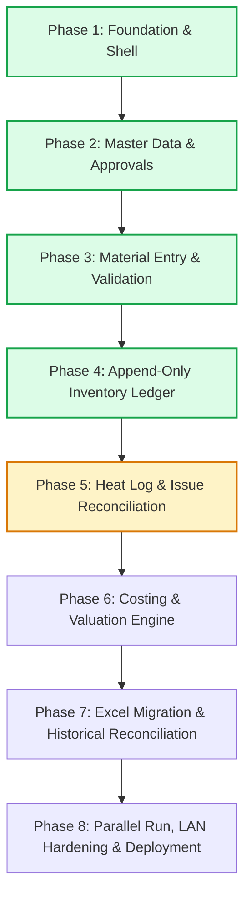

# VSPL Material Management & Costing System — Implementation Roadmap

This roadmap defines the engineering execution strategy across eight controlled phases for Vijay Spheroidals Pvt. Ltd. (VSPL).

---

## Roadmap Overview

---

## Detailed Phase Status

### Phase 1: Architectural Foundation & Development Shell
* **Status:** **COMPLETE**
* **Summary:** FastAPI backend, SQLAlchemy 2.x declarative base, Alembic migrations, React ERP shell, pytest suite, Vite build verification, and system documentation.

---

### Phase 2: Master Data & Approval Workflows
* **Status:** **COMPLETE**
* **Summary:**
  - Material Item Master schema (`material_items`) supporting ~741 items scope.
  - Item code convention: `DEPT-CATEGORY-SERIAL` (e.g. `FDY-RM-016`).
  - Department Master (`departments`) seeded idempotently with 8 plant units.
  - Controlled UOM Master (`uoms`) with explicit quantity decimal precision (KG=4, NOS=0, LTR=3).
  - Vendor Master (`vendors`) with normalized search deduplication and optional 15-character GSTIN validation.
  - Complete Requisition State Machine (`item_requests` & `item_request_audit_logs`) enforcing `DRAFT` $\rightarrow$ `SUBMITTED` $\rightarrow$ `APPROVED` / `REJECTED` / `CANCELLED`.
  - Separation of duties: Strict self-approval prevention and mandatory rejection reason.
  - Full REST API endpoints and interactive React ERP interface with modals, search, and pagination.
  - 20 automated unit and integration tests passing.

---

### Phase 3: Material Entry & Inward/Outward Validation
* **Status:** **COMPLETE**
* **Deliverables:**
  - Goods Receipt Note (GRN) logging with mandatory unit rate excluding GST for raw materials and separated tax rates.
  - Sourcing for external vendors, internal VSPL movements, and segregation yard returns.
  - Departmental Material Issue Slips with furnace heat allocation tracking (`H-102603-3721`).
  - Scrap and waste disposition logging across foundry categories (borings, gatings, returns, rejected castings).
  - Duplicate detection engine with hard document constraints and soft invoice audit flags.
  - Decimal precision and suspect entry heuristic engine.
  - Atomic All-or-Nothing Excel Import Engine with preview and zero partial commits on errors.
  - 29 automated Pytest tests passing and full frontend ERP views operational.

---

### Phase 4: Append-Only Live Inventory Ledger
* **Status:** **COMPLETE (Current Deliverable)**
* **Deliverables:**
  - Immutable stock ledger table design (`stock_ledger_entries`) with zero `UPDATE`/`DELETE` API endpoints.
  - Derived balance calculation engine (`SUM(quantity_delta)`) with distinct operational states: `UNINITIALIZED`, `IN_STOCK`, `OUT_OF_STOCK`, `NEGATIVE_STOCK`.
  - Point-in-time balance reconstruction using historical cutoff parameters.
  - Source-to-ledger transactional posting on transaction approval:
    - Approved GRN creates `INWARD_RECEIPT` or `INTERNAL_INWARD` ($+\Delta$).
    - Approved Issue Slip creates `OUTWARD_ISSUE` ($-\Delta$).
    - Approved Waste Slip creates `SCRAP_OUTWARD` ($-\Delta$), `INTERNAL_RECOVERY` ($0\Delta$), or non-movement hold.
  - Database-enforced idempotency via `UNIQUE(source_document_type, source_line_id)` preventing duplicate journal entries.
  - Traceable compensating `REVERSAL` journal movements linking to `reversal_of_entry_id` with mandatory supervisor justification.
  - Configurable negative stock prevention (`settings.ALLOW_NEGATIVE_STOCK = False`): blocks issues and reversals resulting in negative balances, and strictly blocks issuing uninitialized materials.
  - Baseline Opening Balance import engine for the **12 October 2026** cutoff with preview validation and atomic multi-item posting.
  - Physical Stock Audit workflow (`physical_audit_headers` / `physical_audit_lines`) calculating system cutoff balance, recording physical counts, and posting signed `PHYSICAL_AUDIT_ADJUSTMENT` entries upon approval.
  - Interactive industrial ERP frontend views: Live Inventory Dashboard, Opening Balance Manager, and Physical Audit Reconciliation.
  - Comprehensive automated Pytest suite (35/35 passing) covering posting, immutability, reversal, uninitialized stock, and audit adjustments.

---

### Phase 5: Heat Log & Requisition Reconciliation
* **Status:** **UPCOMING (Next Step)**
* **Deliverables:**
  - Induction furnace Heat Log entry (Heat number, date, shift, furnace ID, metallurgist).
  - Detailed charge mix logging (Pig iron, Steel scrap, Returns, FeSi, FeMn, Inoculants, Mg treatment).
  - Finished parts cast and good vs rejected casting counts.
  - **Issue-to-Heat Reconciliation Module:** Compares raw materials issued to Foundry against logged furnace charges.
  - Variance reporting: Identifies melting loss, spillages, and unreported material usage without fabricating stock adjustments.

---

### Phase 6: Costing Engine & Valuation
* **Status:** **QUEUED**
* **Deliverables:**
  - Formal implementation of the Weighted-Average Costing engine.
  - Strict costing start date enforcement: **12 October 2026**.
  - Arbitrary-precision financial calculations using `Decimal/Numeric`.
  - Heat Cost calculation: Total metal charge cost divided by liquid metal tapped / good casting weight.
  - Unit Part Cost calculation for automotive and engineering castings.
  - Dedicated automated test harness with extensive parameterized test fixtures for costing algorithms.

---

### Phase 7: Excel Migration & Historical Reconciliation
* **Status:** **QUEUED**
* **Deliverables:**
  - High-integrity data migration pipeline for approximately **12,280 historical records**.
  - Comprehensive pre-import validation: column headers, type checking, duplicate detection.
  - Traceable staging tables and import discrepancy logs.
  - Historical reconciliation report comparing legacy spreadsheet totals with newly migrated ledger balances.

---

### Phase 8: Parallel Run, Security Hardening & Plant LAN Deployment
* **Status:** **QUEUED**
* **Deliverables:**
  - Production authentication system (JWT / OAuth2 / LDAP).
  - Production security hardening and plant LAN deployment.
  - Parallel run with existing Excel processes for validation and user sign-off.
