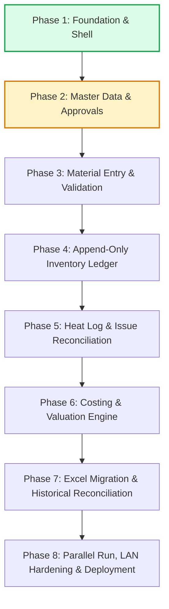

# VSPL Material Management & Costing System — Implementation Roadmap

This roadmap defines the engineering execution strategy across eight controlled phases for Vijay Spheroidals Pvt. Ltd. (VSPL).

---

## Roadmap Overview

---

## Detailed Phase Breakdown

### Phase 1: Architectural Foundation & Development Shell
* **Status:** **COMPLETE (Current Deliverable)**
* **Scope:**
  - Modern project structure (`backend/`, `frontend/`, `docs/`, `scripts/`).
  - FastAPI backend configured with Pydantic settings, CORS, and health endpoints.
  - SQLAlchemy 2.x declarative base and Alembic migration framework.
  - React + TypeScript + Vite industrial ERP frontend shell with desktop-first navigation.
  - Diagnostic endpoints with live database connectivity verification gates.
  - Automated test harness (pytest unit tests, TypeScript compile, Vite build verification).
  - Complete documentation suite.

---

### Phase 2: Master Data & Approval Workflows
* **Status:** **UPCOMING (Recommended Next Step)**
* **Deliverables:**
  - Cataloging and schema definition for the **741 material items**.
  - Categorization hierarchy: Raw Materials, Ferro Alloys, Consumables, Returns, Borings, Gatings.
  - Master UOM definitions with decimal precision validation rules.
  - Department Master: Foundry, Machine Shop, Maintenance, General/Stores, Packing, Quality, F3 HMC, F3 CNC.
  - Vendor Master management with GSTIN validation.
  - Item Creation and Approval Workflow: Stores/Purchase requests item creation; Admin/Management approves.
  - Automated unit and integration tests for master data integrity.

---

### Phase 3: Material Entry & Inward/Outward Validation
* **Status:** **QUEUED**
* **Deliverables:**
  - Goods Receipt Note (GRN) logging with mandatory unit rate excluding GST for raw materials.
  - Handling of internal inward movements (VSPL segregation yard returns) with distinct origin tags.
  - Material Issue Slips per department with role-based requisition and authorization.
  - Scrap and waste disposition logging (borings, rejected castings, runner/riser returns).
  - Duplicate detection engine: composite checking on `(vendor, invoice_no, item)` and batches.
  - Strict input validation preventing silent column skips and catching decimal-entry anomalies.

---

### Phase 4: Append-Only Live Inventory Ledger
* **Status:** **QUEUED**
* **Deliverables:**
  - Immutable stock ledger table design (`stock_ledger_entries`).
  - Enforced business rule: Zero stock depletion without an authorized Issue transaction.
  - Strict prohibition of `UPDATE` and `DELETE` operations on transaction history.
  - Opening balance ledger entries as of the baseline cutoff.
  - Physical stock audit reconciliation workflow generating signed `ADJUSTMENT` journal entries.
  - Real-time stock balance queries by department and warehouse location.

---

### Phase 5: Heat Log & Requisition Reconciliation
* **Status:** **QUEUED**
* **Deliverables:**
  - Induction furnace Heat Log entry (Heat number, date, shift, furnace ID, metallurgist).
  - Detailed charge mix logging (Pig iron, Steel scrap, Returns, FeSi, FeMn, Inoculants, Mg treatment).
  - Finished parts cast and good vs rejected casting counts.
  - **Issue-to-Heat Reconciliation Module:** Compares raw materials issued to Foundry against logged furnace charges.
  - Variance reporting: Identifies melting loss, spillages, and unreported material usage without fabricating stock adjustments.

---

### Phase 6: Costing Engine & Valuation
* **Status:** **QUEUED**
* **Deliverables:**
  - Formal implementation of the Weighted-Average Costing engine.
  - Strict costing start date enforcement: **12 October 2026**.
  - Arbitrary-precision financial calculations using `Decimal/Numeric`.
  - Heat Cost calculation: Total metal charge cost divided by liquid metal tapped / good casting weight.
  - Unit Part Cost calculation for automotive and engineering castings.
  - Dedicated automated test harness with extensive parameterized test fixtures for costing algorithms.

---

### Phase 7: Excel Migration & Historical Reconciliation
* **Status:** **QUEUED**
* **Deliverables:**
  - High-integrity data migration pipeline for approximately **12,280 historical records**.
  - Comprehensive pre-import validation: column headers, type checking, duplicate detection.
  - Traceable staging tables and import discrepancy logs.
  - Historical reconciliation report comparing legacy spreadsheet totals with newly migrated ledger balances.

---

### Phase 8: Parallel Run, Security Hardening & Plant LAN Deployment
* **Status:** **QUEUED**
* **Deliverables:**
  - Production authentication system (JWT / OAuth2 / Session tokens).
  - Role-Based Access Control (RBAC) middleware enforcing permissions at the API route layer.
  - Deployment configuration for plant on-premise server (systemd / Windows Service / Docker).
  - On-premise network restriction to factory LAN IP ranges.
  - Parallel run with existing Excel processes for validation and user sign-off.
  - Comprehensive operational training and user manuals.
