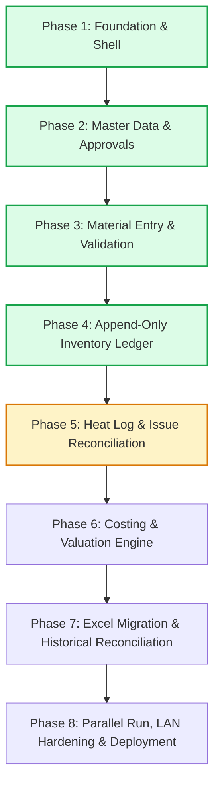

# VSPL Material Management & Costing System — Implementation Roadmap

This roadmap defines the engineering execution strategy across eight controlled phases for Vijay Spheroidals Pvt. Ltd. (VSPL).

---

## Roadmap Overview

---

## Detailed Phase Status

### Phase 1: Architectural Foundation & Development Shell
* **Status:** **COMPLETE**
* **Summary:** FastAPI backend, SQLAlchemy 2.x declarative base, Alembic migrations, React ERP shell, pytest suite, Vite build verification, and system documentation.

---

### Phase 2: Master Data & Approval Workflows
* **Status:** **COMPLETE**
* **Summary:**
  - Material Item Master schema (`material_items`) supporting ~741 items scope.
  - Item code convention: `DEPT-CATEGORY-SERIAL` (e.g. `FDY-RM-016`).
  - Department Master (`departments`) seeded idempotently with 8 plant units.
  - Controlled UOM Master (`uoms`) with explicit quantity decimal precision (KG=4, NOS=0, LTR=3).
  - Vendor Master (`vendors`) with normalized search deduplication and optional 15-character GSTIN validation.
  - Complete Requisition State Machine (`item_requests` & `item_request_audit_logs`) enforcing `DRAFT` $\rightarrow$ `SUBMITTED` $\rightarrow$ `APPROVED` / `REJECTED` / `CANCELLED`.
  - Separation of duties: Strict self-approval prevention and mandatory rejection reason.
  - Full REST API endpoints and interactive React ERP interface with modals, search, and pagination.
  - 20 automated unit and integration tests passing.

---

### Phase 3: Material Entry & Inward/Outward Validation
* **Status:** **COMPLETE**
* **Deliverables:**
  - Goods Receipt Note (GRN) logging with mandatory unit rate excluding GST for raw materials and separated tax rates.
  - Sourcing for external vendors, internal VSPL movements, and segregation yard returns.
  - Departmental Material Issue Slips with furnace heat allocation tracking (`H-102603-3721`).
  - Scrap and waste disposition logging across foundry categories (borings, gatings, returns, rejected castings).
  - Duplicate detection engine with hard document constraints and soft invoice audit flags.
  - Decimal precision and suspect entry heuristic engine.
  - Atomic All-or-Nothing Excel Import Engine with preview and zero partial commits on errors.
  - 29 automated Pytest tests passing and full frontend ERP views operational.

---

### Phase 4: Append-Only Live Inventory Ledger
* **Status:** **COMPLETE**
* **Deliverables:**
  - Immutable stock ledger table design (`stock_ledger_entries`) with zero `UPDATE`/`DELETE` API endpoints.
  - Derived balance calculation engine (`SUM(quantity_delta)`) with distinct operational states: `UNINITIALIZED`, `IN_STOCK`, `OUT_OF_STOCK`, `NEGATIVE_STOCK`.
  - Point-in-time balance reconstruction using historical cutoff parameters.
  - Source-to-ledger transactional posting on transaction approval:
    - Approved GRN creates `INWARD_RECEIPT` or `INTERNAL_INWARD` ($+\Delta$).
    - Approved Issue Slip creates `OUTWARD_ISSUE` ($-\Delta$).
    - Approved Waste Slip creates `SCRAP_OUTWARD` ($-\Delta$), `INTERNAL_RECOVERY` ($0\Delta$), or non-movement hold.
  - Database-enforced idempotency via `UNIQUE(source_document_type, source_line_id)` preventing duplicate journal entries.
  - Traceable compensating `REVERSAL` journal movements linking to `reversal_of_entry_id` with mandatory supervisor justification.
  - Configurable negative stock prevention (`settings.ALLOW_NEGATIVE_STOCK = False`): blocks issues and reversals resulting in negative balances, and strictly blocks issuing uninitialized materials.
  - Baseline Opening Balance import engine for the **12 October 2026** cutoff with preview validation and atomic multi-item posting.
  - Physical Stock Audit workflow (`physical_audit_headers` / `physical_audit_lines`) calculating system cutoff balance, recording physical counts, and posting signed `PHYSICAL_AUDIT_ADJUSTMENT` entries upon approval.
  - Interactive industrial ERP frontend views: Live Inventory Dashboard, Opening Balance Manager, and Physical Audit Reconciliation.
  - Comprehensive automated Pytest suite (35/35 passing) covering posting, immutability, reversal, uninitialized stock, and audit adjustments.

---

### Phase 5: Heat Log & Requisition Reconciliation
* **Status:** **COMPLETE (Current Deliverable)**
* **Deliverables:**
  - Induction furnace Heat Log entry (`heat_headers`, `heat_charge_lines`, `heat_parts_produced`) capturing heat number, furnace ID, date, shift, operator, charges, and parts produced.
  - Heat reference normalization: bidirectional matching between `102603-3721` and `H-102603-3721`.
  - Material Alias Master (`material_aliases`, `material_alias_audit_logs`) mapping raw descriptions (e.g. `CRC Scrap-Low High MN`) to canonical items without mutating source records.
  - Deterministic 3-Pass Reconciliation Engine (`reconciliation_runs`, `reconciliation_results`):
    - **Pass 1:** Exact heat reference matching with line-by-line item comparison.
    - **Pass 2:** Same-day batch aggregation for unallocated lines without double-counting.
    - **Pass 3:** Advisory fuzzy candidate suggestions (`reconciliation_candidate_matches`) requiring explicit supervisor confirmation.
  - Tolerance Precedence Rule: $\text{Limit} = \max(0.50\text{ kg}, 0.02 \times \text{Issued Quantity})$.
  - Signed Variance Convention: $\text{Variance} = \text{Issued Quantity} - \text{Charged Quantity}$.
  - Exception Management Queue (`reconciliation_exceptions`) with assignment and resolution workflows.
  - Atomic Heat Log Excel Import Engine with dry-run preview and rollback on validation errors.
  - **NON-NEGOTIABLE ISOLATION:** Strictly zero stock ledger movements or balance adjustments caused by heat logs or reconciliation runs.
  - Interactive industrial ERP frontend: Furnace Heat Log Manager, Material Aliases, Reconciliation Dashboard, and Heat Excel Import.
  - Comprehensive automated Pytest suite (46/46 passing) with dedicated test for zero stock ledger side-effects.

---

### Phase 6: Costing Engine & Valuation
* **Status:** **COMPLETE**
* **Deliverables:**
  - Formal implementation of the Weighted-Average Costing engine using Python `Decimal` and `ROUND_HALF_UP` to 4 decimal places (`NUMERIC(14, 4)`).
  - Strict costing start date enforcement: **12 October 2026** (`settings.COSTING_START_DATE`).
  - Separation of physical stock from commercial valuation: unvalued stock flagged as `OPENING_VALUATION_MISSING` and $0.0000$ balance flagged as `ZERO_STOCK`.
  - Same-day deterministic transaction ordering hierarchy with ID tie-breaking.
  - Zero-stock rate restart: subsequent receipts restart weighted-average rate without dilution.
  - Strict Ledger Non-Mutation Guarantee: stock ledger is strictly read-only during costing.
  - Induction Furnace Heat Costing: sums charged quantities at heat date rate; computes cost per kg of liquid metal tapped (`MATERIAL_ONLY` scope).
  - Part Material Unit Costing: $\text{Unit Cast Weight} \times \text{Cost per kg}$ without finished-goods ledger movements.
  - Versioned, immutable costing runs (`costing_runs`, `item_cost_snapshots`, `item_cost_journal_entries`, `heat_cost_records`, `part_cost_records`) and side-by-side run comparison engine.
  - Interactive industrial ERP frontend: Inventory Valuation, Item Cost History Journal, Heat Production Costing, Runs & Comparisons, and Exceptions Queue.
  - 100% automated test suite passing (68/68 tests) with 22 new Phase 6 verification tests.

---

### Phase 7: Excel Migration & Historical Reconciliation
* **Status:** **UPCOMING (Next Step)**
* **Deliverables:**
  - High-integrity data migration pipeline for approximately **12,280 historical records**.
  - Comprehensive pre-import validation: column headers, type checking, duplicate detection.
  - Traceable staging tables and import discrepancy logs.
  - Historical reconciliation report comparing legacy spreadsheet totals with newly migrated ledger balances.

---

### Phase 8: Parallel Run, Security Hardening & Plant LAN Deployment
* **Status:** **QUEUED**
* **Deliverables:**
  - Production authentication system (JWT / OAuth2 / LDAP).
  - Production security hardening and plant LAN deployment.
  - Parallel run with existing Excel processes for validation and user sign-off.
