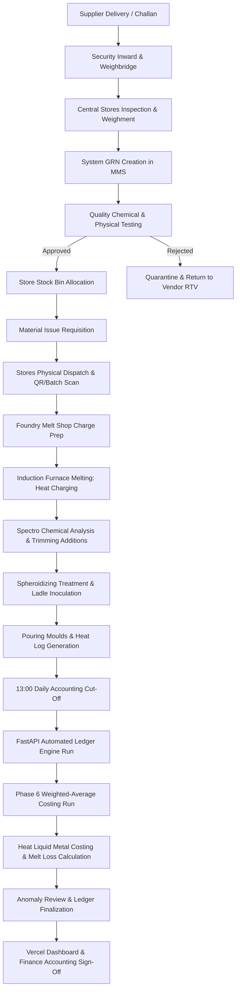
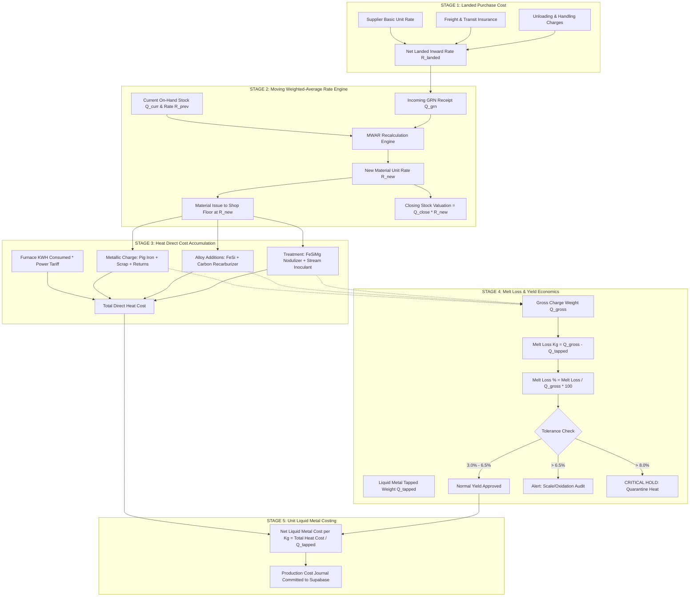

# VIJAY SPHEROIDALS PVT. LTD. (VSPL)
## STANDARD WORK INSTRUCTION & PROJECT FLOW DOCUMENT
**Document ID:** VSPL-WI-MM-001  
**Revision:** 1.0  
**Effective Date:** 26-October-2026  
**Subject:** End-to-End Material Management, Inventory Valuation & Cost Accounting System  
**Units Covered:** Peenya Foundry (Plant 1), Tumkur Machine Shop (Plant 2), Central Stores, Melt Shop, Quality Assurance, Finance & Accounts  

---

## 1. Executive Summary & Purpose

This Standard Work Instruction (WI) defines the operational and technical workflow for Vijay Spheroidals Pvt. Ltd.’s (VSPL) Material Management & Costing System.

The primary objectives of this system and operational protocol are:
1. **Total Material Traceability:** Seamless audit trail from raw material inward goods receipt (GRN) to shop floor issue, furnace charge consumption, heat tap, and finished machined casting.
2. **Standardized Nomenclature:** Strict enforcement of VSPL Material Nomenclature Standard v1.0 across all ERP, supplier delivery challans, and shop-floor tags.
3. **Daily 1 PM – 1 PM Accounting Cycle:** A synchronized, 24-hour continuous rolling cycle that replaces disconnected monthly batches with daily closed-loop accountability.
4. **Automated Weighted-Average Costing & Valuation (Phase 6):** Real-time moving weighted-average inventory valuation, automated heat liquid metal costing, and melt loss tracking.
5. **Zero-Discrepancy Exception Handling:** Immediate anomaly flagging (negative stock, unmapped item aliases, abnormal melt loss $> 8\%$) prior to ledger sign-off.

---

## 2. System Architecture & Tech Stack

```
+-----------------------------------------------------------------------------------------+
|                                    USER INTERFACES                                      |
|  - Stores Tablet / Desktop: GRN, Inward Inspection, Stock Ledger                       |
|  - Melt Shop Terminal: Heat Log, Raw Material & Ferroalloy Charging                     |
|  - Management & Finance Dashboard: Vercel Live Web App (https://frontend-rouge-xi-35.vercel.app/) |
+--------------------------------------------+--------------------------------------------+
                                             | REST API / JSON
                                             v
+-----------------------------------------------------------------------------------------+
|                                 BACKEND SERVICES (FastAPI)                              |
|  - Core Service: FastAPI + Pydantic v2 + SQLAlchemy 2.0 Async                           |
|  - Authentication: Supabase Auth / Dev Auth Engine                                      |
|  - Material Ledger Engine: Append-Only Immutable Transaction Ledger                     |
|  - Phase 6 Cost Engine: Moving Weighted-Average Rate Evolution & Heat Costing Run        |
|  - Exception Engine: Negative Stock, Melt Loss & Inward Discrepancy Detectors           |
+--------------------------------------------+--------------------------------------------+
                                             | Connection Pooler (Port 5432 / SSL)
                                             v
+-----------------------------------------------------------------------------------------+
|                            ENTERPRISE DATABASE (Supabase PostgreSQL)                    |
|  - Relational Schema: 19 Verified Production Tables                                      |
|    * master_departments, master_uoms, master_vendors                                   |
|    * master_material_items, item_aliases                                                |
|    * goods_receipt_notes, goods_receipt_items                                           |
|    * material_issues, material_issue_items                                              |
|    * heat_logs, heat_raw_material_consumptions                                          |
|    * material_inventory_ledger, item_opening_valuations                                 |
|    * item_cost_journal_entries, heat_cost_summaries                                     |
|    * inventory_audits, inventory_waste_logs, material_requests                          |
+-----------------------------------------------------------------------------------------+
```

---

## 3. Nomenclature Standard v1.0

All materials across VSPL must strictly follow the structured coding convention:
$$\mathbf{<UNIT>-<CATEGORY>-<SEQUENCE>}$$

### 3.1 Prefix Definitions
| Category | Prefix Code | Description | Examples |
| :--- | :--- | :--- | :--- |
| **Raw Materials** | `RM` | Primary metallic melting charge | Pig Iron Gr. 1, CRCA Scrap, MS Scrap, Returns |
| **Ferroalloys** | `FA` | Alloy additives for chemistry control | FeSi 70%, FeMn, FeCr, FeMo |
| **Nodulizers & Inoculants**| `NOD` / `INO`| SG Iron treatment & nucleating agents | FeSiMg (9-1.2%), Foundry Grade Inoculant |
| **Consumables & Flux** | `CON` | Melting consumables, fluxes, deslagging | Slag Coagulant, Bentonite, Coal Dust, Recarburizer |
| **Refractories** | `REF` | Furnace lining, ladles, patches | Silica Ramming Mass, Neutral Patch, Castable |
| **Core & Sand Additives** | `SND` | Moulding sand system chemicals | Silica Sand AFS 50-55, Furan Resin, Catalyst |
| **Patterns & Tooling** | `PAT` | Tooling and patterns | Al Matchplates, Core Boxes |
| **Semi-Finished / Castings**| `SFG` | Castings post-shakeout, unmachined | Crankcase Castings, Flywheel Castings |
| **Finished Goods** | `FG` | Fully machined, inspected & packed | Machined Bearing Housings, Manifolds |

### 3.2 Standard Item Registry Sample
- `FDY-RM-001` : Pig Iron Grade 1 (Min 3.8% C, low P/S)
- `FDY-RM-002` : CRCA Steel Scrap (Clean, rust-free stampings)
- `FDY-RM-003` : Foundry Returns (Sprue, runner, risers clean)
- `FDY-FA-001` : Ferro Silicon (FeSi 70-75%)
- `FDY-NOD-001` : FeSiMg Alloy (1-2% RE, 9% Mg)
- `FDY-CON-001` : Petroleum Coke Recarburizer (Carbon 98.5% min)
- `FDY-REF-001` : Silica Ramming Mass (Furnace coil lining)

---

## 4. End-to-End System Project Flow



### 4.1 Step-by-Step Sub-Processes

#### Sub-Process A: Inward Material Receipts (Stores)
1. **Gate Entry:** Truck arrives at Peenya Gate. Physical delivery challan and tare weight are recorded.
2. **Gross Weighment & Unloading:** Unloading into designated bay (Pig Iron Bay, Scrap Yard, Ferroalloy Secure Store).
3. **GRN Processing:** Store Officer opens MMS Dashboard -> **Goods Receipts** tab -> selects Vendor and Item Code. Enters Challan Qty, Received Qty, Purchase Unit Rate, GST, and Inward Heat/Batch No.
4. **Lot Quarantine & QC Release:** QA chemist samples the material. On lab sign-off, GRN status moves to `ACCEPTED`.
5. **Stock Ledger Impact:** An immutable `INWARD_RECEIPT` transaction is registered in `material_inventory_ledger`.

#### Sub-Process B: Material Issue to Foundry (Melt Shop / Moulding)
1. **Requisition:** Foundry Melt Shop supervisor submits material issue request via MMS.
2. **Dispatch:** Stores verifies bin stock availability and executes issue.
3. **Ledger Impact:** System records `ISSUE_PRODUCTION` with negative quantity delta, updating instantaneous stock balance.

#### Sub-Process C: Heat Charging & Melting Logging (Melt Shop)
1. **Furnace Heat Initiation:** Induction Furnace operator logs Heat Number (e.g., `H-20261026-01`, Furnace `FURNACE-A-500KG`, Target Grade `EN-GJS-500-7`).
2. **Charge Consumption Logging:** Records exact weights (Kg) of:
   - Primary Pig Iron (`FDY-RM-001`)
   - CRCA Scrap (`FDY-RM-002`)
   - Internal Foundry Returns (`FDY-RM-003`)
   - Recarburizer, FeSi, FeSiMg nodulizer, and inoculant.
3. **Energy & Process Parameters:** Initial KWH, Final KWH, Tap Temperature ($1480^\circ\text{C}$ to $1510^\circ\text{C}$), Liquid Metal Tapped (Kg).
4. **Melt Loss Detection:** System calculates:
   $$\text{Melt Loss (Kg)} = \sum \text{Charge Materials} - \text{Liquid Metal Tapped}$$
   $$\text{Melt Loss (\%)} = \frac{\text{Melt Loss (Kg)}}{\sum \text{Charge Materials}} \times 100$$
   *Standard Tolerance: $3.0\% - 5.5\%$. Any heat $> 6.5\%$ triggers a yellow alert; $> 8.0\%$ triggers an emergency audit hold.*

---

## 5. The Daily 1 PM – 1 PM Accounting Cycle

VSPL does not operate on an arbitrary midnight-to-midnight cycle. In sync with foundry shift handovers and liquid metal tapping runs, VSPL executes a **13:00 to 13:00** 24-hour continuous cycle.

```mermaid
gantt
    title VSPL Daily 1 PM - 1 PM Material Accounting Cycle
    dateFormat HH:mm
    axisFormat %H:%M
    section Operating Cycle
    Cycle Start (13:00 Day T)           :done, 13:00, 13:05
    24h Real-Time Transaction Capture   :active, 13:05, 12:30
    Pre-Close Sanity Check              :crit, 12:30, 13:00
    section Cut-Off & Accounting
    Hard Cut-Off Window (13:00 Day T+1) :crit, 13:00, 13:05
    Run Cost & Ledger Engine (13:15)    :done, 13:15, 13:20
    Anomaly Clearance Window            :active, 13:20, 14:00
    Final Ledger Sign-off (14:00)       :milestone, 14:00, 14:05
```



### Detailed Timeline:

| Time Slot | Phase | Key Activities & Protocol | Responsible |
| :--- | :--- | :--- | :--- |
| **13:00 (Day T)** | **Cycle Initiation** | Previous cycle closes. Day T cycle officially starts recording. | Stores / Melt Shop |
| **13:00 – 12:30 (Day T+1)** | **24h Active Recording** | - All GRNs logged upon physical receipt.<br>- All issues dispatched against requisitions.<br>- Melt Shop logs every heat immediately upon tapping. | Stores & Foundry Supervisors |
| **12:30 – 13:00** | **Pre-Closing Verification** | - Stores verifies all delivery challans are keyed in.<br>- Melt Shop checks that all heats tapped before 12:30 have complete charge logs.<br>- Pending drafts submitted. | Stores Lead & Foundry Lead |
| **13:00 (Day T+1)** | **HARD CUT-OFF** | System enforces transaction freeze for Cycle T. Any transaction timestamped $> 13:00$ automatically drops into Cycle T+1. | Automated MMS Gate |
| **13:15** | **Cost & Ledger Engine Execution** | FastAPI backend executes `CostEnginePhase6`: <br>1. Calculates weighted-average cost per item.<br>2. Reconstructs opening balance, receipts, issues, and closing balance.<br>3. Computes heat-level net cost per kg. | Automated / Cost Accountant |
| **13:20 – 14:00** | **Anomaly Resolution** | Daily review of flagged exceptions: negative stock, unmapped aliases, melt loss deviations. Corrections logged as audited adjustments. | Plant Head & Cost Accountant |
| **14:00** | **Final Ledger Snapshot** | Formal sign-off. Daily valuation report published to Management & Accounts. | Finance Controller |

---

## 6. End-to-End Calculation Flow & Cost Accounting Engine

The VSPL Material Management & Costing System enforces an exact, deterministic calculation pipeline that connects procurement, inventory moving-average rates, furnace charge consumption, power, melt loss, and finished liquid metal unit costing.



---

### 6.1 Mathematical Formulations by Stage

#### Stage 1: Inward Landed Purchase Rate ($R_{landed}$)
$$R_{landed} = R_{basic} + \frac{\text{Freight Allocated} + \text{Transit Insurance} + \text{Handling Charges}}{\text{Accepted Inward Quantity}}$$
*(Note: Input Tax Credit [GST] is excluded from inventory valuation to prevent cost distortion).*

#### Stage 2: Moving Weighted-Average Rate (MWAR)
Upon posting every accepted Goods Receipt Note (GRN):
$$\bar{R}_{new} = \frac{\left( Q_{existing} \times \bar{R}_{prev} \right) + \left( Q_{receipt} \times R_{landed} \right)}{Q_{existing} + Q_{receipt}}$$

When raw materials are issued to the shop floor:
$$\text{Cost of Issue} = Q_{issued} \times \bar{R}_{current}$$
$$\text{Closing Valuation} = \left( Q_{existing} - Q_{issued} \right) \times \bar{R}_{current}$$
*(Material issues do not alter unit rates; they deplete stock balance at the latest weighted-average rate).*

#### Stage 3: Heat Metallic & Alloy Charge Cost ($\text{Cost}_{RM}$)
For a heat $h$ with $n$ input materials:
$$\text{Cost}_{RM}(h) = \sum_{i=1}^{n} \left( Q_{consumed, i} \times \bar{R}_{i} \right)$$
Where components include:
1. **Primary Metallic Charge:** Pig Iron Grade 1 (`FDY-RM-001`), CRCA Scrap (`FDY-RM-002`), Foundry Internal Returns (`FDY-RM-003`).
2. **Carbon Trimming:** Petroleum Coke Recarburizer (`FDY-CON-001`).
3. **Silicon Adjustment:** Ferro Silicon 70-75% (`FDY-FA-001`).
4. **Nodulizing & Inoculation Treatment:** FeSiMg 9% (`FDY-NOD-001`) and Foundry Inoculant (`FDY-INO-001`).

#### Stage 4: Melting Energy Cost ($\text{Cost}_{Power}$)
$$\text{Energy Consumed (KWH)} = \text{Final KWH Meter} - \text{Initial KWH Meter}$$
$$\text{Specific Power Consumption} = \frac{\text{Energy (KWH)}}{\text{Tapped Metal Weight (MT)}} \quad [\text{Target: } 520 - 580 \text{ KWH/MT}]$$
$$\text{Cost}_{Power}(h) = \text{Energy Consumed (KWH)} \times R_{power\_tariff} \quad [\text{Standard Rate: } ₹8.50/\text{KWH}]$$

#### Stage 5: Melt Loss, Yield & Liquid Metal Unit Cost
$$\text{Gross Charge Weight } (Q_{gross}) = \sum_{i=1}^{n} Q_{consumed, i}$$
$$\text{Melt Loss (Kg)} = Q_{gross} - Q_{tapped}$$
$$\text{Melt Loss (\%)} = \left( \frac{Q_{gross} - Q_{tapped}}{Q_{gross}} \right) \times 100$$
$$\text{Melting Yield (\%)} = 100 - \text{Melt Loss (\%)} = \left( \frac{Q_{tapped}}{Q_{gross}} \right) \times 100$$

$$\text{Total Direct Heat Cost } (C_{total}) = \text{Cost}_{RM}(h) + \text{Cost}_{Power}(h) + \text{Cost}_{Consumables}$$
$$\mathbf{Net\ Liquid\ Metal\ Cost\ per\ Kg} = \frac{C_{total}}{Q_{tapped}}$$

> [!IMPORTANT]
> **Economic Impact of Melt Loss:** Notice that the denominator in the final liquid metal rate is $Q_{tapped}$ (not $Q_{gross}$). Unrecovered metallic weight (oxidation, slag loss) is mathematically absorbed into the good liquid metal yield, correctly reflecting true production economics.

---

### 6.2 Worked Numerical Standard Example (500 Kg Induction Furnace Heat)

**Target Grade:** SG Iron EN-GJS-500-7  
**Furnace:** 500 Kg Medium-Frequency Induction Furnace (Plant 1 - Peenya)

#### 1. Material Charge Consumption Sheet:
| Material SKU | Material Description | Qty Consumed (Kg) | Weighted Rate (₹/Kg) | Total Cost (₹) |
| :--- | :--- | :---: | :---: | :---: |
| `FDY-RM-001` | Pig Iron Grade 1 | 250.00 | ₹44.00 | ₹11,000.00 |
| `FDY-RM-002` | CRCA Steel Scrap | 150.00 | ₹38.00 | ₹5,700.00 |
| `FDY-RM-003` | Foundry Returns (Internal) | 100.00 | ₹36.00 | ₹3,600.00 |
| `FDY-CON-001`| Recarburizer (98.5% C) | 5.00 | ₹65.00 | ₹325.00 |
| `FDY-FA-001` | Ferro Silicon (FeSi 70%) | 4.00 | ₹115.00 | ₹460.00 |
| `FDY-NOD-001`| FeSiMg Nodulizer (9% Mg) | 6.00 | ₹240.00 | ₹1,440.00 |
| `FDY-INO-001`| Foundry Inoculant | 2.00 | ₹180.00 | ₹360.00 |
| **SUBTOTAL** | **Gross Charge Input** | **517.00 Kg** | — | **₹22,885.00** |

#### 2. Process, Energy & Tapping Sheet:
- **Starting KWH Meter:** $14,210.00$
- **Ending KWH Meter:** $14,505.00$
- **Energy Consumed:** $295.00\text{ KWH}$
- **Power Tariff:** $₹8.50 / \text{KWH}$
- **Total Power Cost:** $295 \times 8.50 = \mathbf{₹2,507.50}$
- **Liquid Metal Tapped ($Q_{tapped}$):** $\mathbf{492.00\text{ Kg}}$ (at $1495^\circ\text{C}$)

#### 3. Yield & Melt Loss Valuation:
- $\text{Melt Loss (Kg)} = 517.00 - 492.00 = \mathbf{25.00\text{ Kg}}$
- $\text{Melt Loss (\%)} = \left(\frac{25.00}{517.00}\right) \times 100 = \mathbf{4.835\%}$ *(Normal status: Within $3.0\% - 6.5\%$ tolerance)*
- $\text{Melting Yield} = 100 - 4.835\% = \mathbf{95.165\%}$

#### 4. Final Unit Liquid Metal Cost:
- $\text{Total Direct Heat Cost} = ₹22,885.00\text{ (Materials)} + ₹2,507.50\text{ (Power)} = \mathbf{₹25,392.50}$
- $\text{Net Cost per Kg Liquid Metal} = \frac{₹25,392.50}{492.00\text{ Kg}} = \mathbf{₹51.61\ /\ Kg}$
- $\text{Net Cost per Metric Ton (MT)} = ₹51.61 \times 1,000 = \mathbf{₹51,610.77\ /\ MT}$

---

### 6.3 Foundry Returns Internal Closed-Loop Credit Policy
To prevent inventory cost distortion:
1. **Shakeout Returns:** Sprue, runners, and risers broken off from poured castings are physically weighed before re-entering the scrap yard.
2. **Standard Valuation Rate:** Foundry returns (`FDY-RM-003`) are credited back to the casting cost center at a standardized, market-indexed scrap rate (e.g. ₹36/Kg) rather than virgin pig iron rate.
3. **Closing Loop:** This credit reduces the net casting manufacturing cost while providing low-cost metallic charge for subsequent induction furnace heats.

---

## 7. RACI Governance Matrix

| Functional Activity | Stores | Melt Shop | Quality (QA) | Cost Accounts | Plant Head | IT / Admin |
| :--- | :---: | :---: | :---: | :---: | :---: | :---: |
| Material Inward Entry (GRN) | **R** | I | C | I | I | - |
| Quality Sampling & Release | C | - | **R** | - | A | - |
| Material Issue Requisition | C | **R** | - | - | - | - |
| Heat Charge & Melt Logging | - | **R** | C | I | A | - |
| 13:00 Hard Cut-Off Enforcement | C | C | - | A | A | **R** |
| Costing Run Execution | - | - | - | **R** | A | C |
| Anomaly Investigation & Resolution| C | C | C | **R** | **A** | - |
| Physical Stock Audit Verification | **R** | C | - | C | **A** | - |

*(Legend: **R** = Responsible, **A** = Accountable, **C** = Consulted, **I** = Informed)*

---

## 8. Anomaly Classification & Escalation Matrix

| Anomaly Class | Trigger Condition | Operational Impact | Corrective Action & Escalation |
| :--- | :--- | :--- | :--- |
| **Negative Stock Anomaly** | Calculated balance $< 0$ on any SKU. | Indicates delayed GRN entry or unrecorded physical issue. | Cost run flags item. Stores has 30 mins to enter missing GRN or post reconciliation credit. Escalates to Plant Head at 13:45. |
| **Abnormal Melt Loss** | Heat Melt Loss $> 6.5\%$ (Warning) or $> 8.0\%$ (Critical). | High oxidation, scrap rust contamination, or weighing scale miscalibration. | QA & Melt Lead inspect scale calibration, lining erosion, and scrap cleanliness. Critical heats quarantined from pouring high-grade safety castings. |
| **Unmapped Nomenclature Alias** | Inward challan contains unmapped raw description. | Item cannot be posted to master ledger. | System holds line item in alias pending table. Material Master custodian assigns standardized code (e.g. `FDY-RM-001`). |
| **Power Consumption Spike** | Unit power $> 620\text{ KWH/MT}$ for induction melting. | Furnace refractory lining excessive buildup, low coil efficiency, or extended holding time. | Furnace maintenance alerted; lining patch or relining scheduled. |

---

## 9. Live Application & Dashboard Verification

The complete integrated software suite is operational and accessible to authorized VSPL personnel:

- **Production Cloud Web Application:** `https://frontend-rouge-xi-35.vercel.app/`
- **Primary Dashboard Modules:**
  1. **Stock Overview & Master Inventory:** Live stock levels, reorder alerts, warehouse bin locations.
  2. **Item Cost History & Journal:** Material moving weighted-average unit cost evolution, GRN rate tracking, and ledger valuation.
  3. **Heat Production Costing:** Real-time liquid metal cost breakdown per kg, power consumption tracking, and melt loss analysis across induction furnaces.
  4. **Cost Exceptions & Audit:** Real-time log of negative stock warnings, melt loss variances, and physical audit reconciliation.
  5. **Material Inward & Issues:** Comprehensive record-keeping for GRNs and department dispatch requisitions.

---
**Approved By:**  
Managing Director / Plant Head  
*Vijay Spheroidals Pvt. Ltd.*
