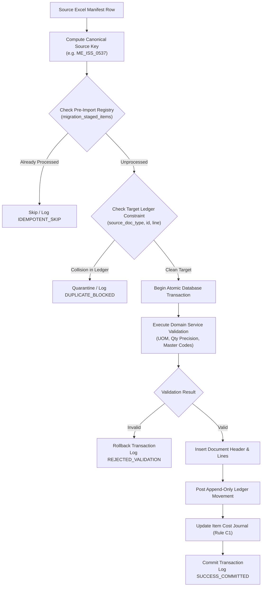

# VSPL Material Management & Costing System — Controlled Historical Import Technical Design

**Document ID:** `DOC-P7-S3A-IMPORT-DESIGN`  
**System:** VSPL Material Management & Costing System  
**Date:** 2026-10-17  
**Governance Scope:** Technical Architecture for Future Authorized Stage 3 Historical Import  
**Execution Status:** **ARCHITECTURAL DESIGN ONLY — EXECUTION STRICTLY UNAUTHORIZED**  

---

## 1. Architectural Objectives & Invariants

This document establishes the technical design for a future, explicitly authorized historical migration into the PostgreSQL database.

### Non-Negotiable Invariants:
1. **Preserve Service Logic:** The import process must route all transactions through the existing domain services (`app.services.grn_service`, `app.services.issue_service`, `app.services.waste_service`), ensuring that validation rules, duplicate checks, and audit trails execute exactly as in live operations. Raw SQL `INSERT` statements bypassing domain validators are strictly prohibited.
2. **Absolute Ledger Idempotency:** Re-running an import batch must never create duplicate stock movements or corrupt moving average valuations.
3. **Strict Separation of Production & Stores:** Furnace heat logs and charge lines must be ingested exclusively via `app.services.heat_service`, maintaining complete isolation from `stock_ledger_entries` (Rule H1).

---

## 2. Idempotent Ingestion Architecture



---

## 3. Core Architectural Mechanisms

### 3.1 Immutable Source Identifiers
Every historical record is permanently keyed by its immutable physical coordinate in the source files:
- **Format:** `{WORKBOOK_PREFIX}_{SHEET_CODE}_{ROW_NUMBER:04d}_{LINE_NUMBER:02d}`
  - Example GRN: `ME_GRN_0003_01` (VSPL_Material_Entry.xlsx, '3. Receipt GRN', Row 3, Line 1)
  - Example Issue: `ME_ISS_0537_01` (VSPL_Material_Entry.xlsx, '4. Issue', Row 537, Line 1)
  - Example Heat: `HL_LOG_0002_01` (VSPL_Foundry_Heat_Log.xlsx, 'Heat Log', Row 2, Heat 072613-2092)

### 3.2 Duplicate Prevention & Ledger Constraint Enforcement
The live append-only inventory ledger enforces structural uniqueness via database index:
```python
op.create_index(
    'ix_stock_ledger_entries_source_ref',
    'stock_ledger_entries',
    ['source_document_type', 'source_document_id', 'source_line_id'],
    unique=True
)
```
- **How Double-Posting is Prevented:** If any script or operator attempts to re-import an already-posted transaction, the database engine immediately throws a unique constraint violation (`IntegrityError`), forcing an instant transaction rollback and preventing ledger corruption.
- **Pre-Import Duplicate Recognition:** Before launching an import batch, the migration runner queries:
  ```sql
  SELECT source_document_type, source_document_id, source_line_id 
  FROM stock_ledger_entries 
  WHERE source_document_type = :doc_type AND source_document_id = :doc_id;
  ```
  Any matching documents are flagged as `ALREADY_POSTED` and bypassed without touching the database.

### 3.3 Transaction Boundaries & Failure Handling
- **Atomic Document Boundary:** Import operations are chunked at the **document boundary** (Header + All associated Line Items).
- **Rollback Guarantee:** If a document contains 10 line items and the 10th line item fails validation (e.g. unknown item code or zero quantity), the entire document rolls back cleanly to savepoint. No orphaned headers or partial line entries can exist in the database.
- **Batch Isolation:** A failure in document 45 does not crash the migration runner; document 45 is written to `migration_failures.csv` with its full error trace, and the runner proceeds to document 46.

### 3.4 Restart Behavior After Interruption
If an import job is interrupted by a power failure, network glitch, or server crash:
1. The migration runner reads `migration_batch_logs` in PostgreSQL to determine the last successfully committed `source_row_id`.
2. The runner resumes execution from `last_committed_id + 1`.
3. Due to the composite unique index on `stock_ledger_entries`, any previously committed row is safely skipped, achieving **zero-loss, zero-duplication recovery**.

---

## 4. Migration Execution Stages (Future Stage 3 Roadmap)

```
┌────────────────────────────────────────────────────────────────────────┐
│               FOUR-STAGE CONTROLLED IMPORT PIPELINE                    │
├────────────────────────────────────────────────────────────────────────┤
│ STAGE 3.1: PRE-IMPORT BASELINE & VERIFICATION GATE                     │
│ • Verify PostgreSQL connectivity, schema version, and backup digest.   │
│ • Confirm all 8 decisions in DEC-001 through DEC-008 are approved.     │
│                                                                        │
│ STAGE 3.2: MASTER DATA & ALIAS INGESTION                               │
│ • Import approved Item Master additions (MNT-CN-001, MCS-CN-002).      │
│ • Ingest verified Material Description Aliases into material_aliases.   │
│                                                                        │
│ STAGE 3.3: CONTROLLED PILOT IMPORT (10 DOCUMENTS)                      │
│ • Ingest a controlled pilot batch of 10 clean Issue documents.         │
│ • Verify stock balances, ledger entries, and audit logs.               │
│ • Require technical auditor clearance before proceeding.              │
│                                                                        │
│ STAGE 3.4: BATCH INGESTION & POST-MIGRATION RECONCILIATION             │
│ • Ingest remaining operational manifest documents in batches of 50.    │
│ • Reconcile imported row counts, ledger movements, and audit records.  │
│ • Lock migration tables and freeze historical database state.          │
└────────────────────────────────────────────────────────────────────────┘
```

### Governing Restraint:
This technical design is an architectural specification. **No migration runner script has been created or executed in this pre-flight stage.**
