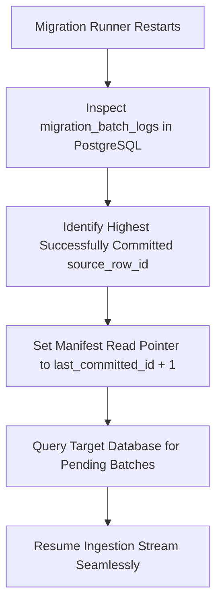

# VSPL Material Management & Costing System — Historical Import Idempotency & Architecture Review

**Document ID:** `DOC-P7-S3A1-IDEMPOTENCY-REVIEW`  
**System:** VSPL Material Management & Costing System  
**Date:** 2026-10-17  
**Governance Scope:** Technical Architecture & Idempotency Guarantees for Future Historical Import  
**Execution Status:** **ARCHITECTURAL REVIEW ONLY — LIVE IMPORT STRICTLY UNAUTHORIZED**  

---

## 1. Executive Summary & Core Invariant

This document presents an exhaustive architectural analysis of the historical data ingestion engine for Vijay Spheroidals Pvt. Ltd. (VSPL). It certifies the mechanisms ensuring **strict idempotency**, **duplicate prevention**, **domain validation routing**, and **failure isolation** across all operational transaction types.

### The Governing Idempotency Axiom:
> [!IMPORTANT]
> **Deterministic Re-Execution Invariant:**  
> Executing the historical import pipeline \(N\) times against the target database must produce the exact same system state as executing it exactly once. No duplicate stock movements, phantom inventory balances, or corrupted moving average unit rates may ever occur.

---

## 2. Immutable Canonical Source Coordinate Keys

To guarantee mathematical traceability from the raw physical Excel files through staging manifests to live ledger postings, every record is assigned an immutable canonical source key based on its physical workbook coordinate.

### 2.1 Key Structure Specification
```
{WORKBOOK_PREFIX}_{SHEET_CODE}_{ROW_NUMBER:04d}_{LINE_NUMBER:02d}
```

Where:
- **`WORKBOOK_PREFIX`**:
  - `ME`: `VSPL_Material_Entry.xlsx`
  - `HL`: `VSPL_Foundry_Heat_Log.xlsx`
  - `ML`: `VSPL_Master_Ledger.xlsx`
  - `SI`: `Store Inventory.xlsx` (Archived legacy reference)
- **`SHEET_CODE`**:
  - `GRN`: '3. Receipt GRN'
  - `ISS`: '4. Issue'
  - `WST`: '5. Scrap'
  - `LOG`: 'Heat Log'
  - `CHG`: 'Charge Details'
  - `ITM`: 'Item Master'
- **`ROW_NUMBER:04d`**: Zero-padded 4-digit Excel row number (1-indexed matching physical workbook).
- **`LINE_NUMBER:02d`**: Zero-padded 2-digit line index within the transaction document (default `01`).

### 2.2 Concrete Manifest Key Examples
| Document Type | Source Workbook & Sheet | Row # | Line # | Canonical Coordinate Key | Description / Reference |
| :--- | :--- | :--- | :--- | :--- | :--- |
| **GRN Receipt** | `VSPL_Material_Entry.xlsx` ('3. Receipt GRN') | 3 | 1 | `ME_GRN_0003_01` | 3306PMKT-Generator (1 Set) |
| **GRN Receipt** | `VSPL_Material_Entry.xlsx` ('3. Receipt GRN') | 5 | 1 | `ME_GRN_0005_01` | CRCA Scrap (15,200 kg) |
| **Store Issue** | `VSPL_Material_Entry.xlsx` ('4. Issue') | 537 | 1 | `ME_ISS_0537_01` | Slip 327 (4m Cotton Waste) |
| **Store Issue** | `VSPL_Material_Entry.xlsx` ('4. Issue') | 548 | 1 | `ME_ISS_0548_01` | Slip 1148 (1L Thinner) |
| **Waste / Scrap** | `VSPL_Material_Entry.xlsx` ('5. Scrap') | 12 | 1 | `ME_WST_0012_01` | Foundry Scrap Disposal (250 kg) |
| **Furnace Heat** | `VSPL_Foundry_Heat_Log.xlsx` ('Heat Log') | 2 | 1 | `HL_LOG_0002_01` | Heat 072613-2092 (Grade 400/18) |
| **Heat Charge** | `VSPL_Foundry_Heat_Log.xlsx` ('Charge Details') | 2 | 1 | `HL_CHG_0002_01` | Scrap Charge for Heat 072613-2092 |

---

## 3. Multi-Layer Duplicate Prevention Architecture

Idempotency is enforced across three distinct structural tiers:

```
┌────────────────────────────────────────────────────────────────────────┐
│                   THREE-TIER IDEMPOTENCY ENFORCEMENT                   │
├────────────────────────────────────────────────────────────────────────┤
│ TIER 1: PRE-IMPORT FILTERING (Application Staging Gate)                │
│ • Queries existing ledger by (source_document_type, source_line_id)    │
│ • If already posted, immediately skips and logs IDEMPOTENT_BYPASS      │
├────────────────────────────────────────────────────────────────────────┤
│ TIER 2: DOMAIN SERVICE IDEMPOTENCY CHECK (Business Logic Gate)         │
│ • ledger_service.py verifies existing postings for source document ID  │
│ • Returns existing StockLedgerEntry list without creating new rows     │
├────────────────────────────────────────────────────────────────────────┤
│ TIER 3: RELATIONAL CONSTRAINT ENFORCEMENT (Database Engine Gate)       │
│ • PostgreSQL Unique Constraint: uq_source_doc_line_posting            │
│ • Hard rejection via IntegrityError on any duplicate insertion attempt │
└────────────────────────────────────────────────────────────────────────┘
```

### 3.1 Relational Schema Constraints (`003_phase4_stock_ledger.py`)
In the application database schema, uniqueness is guaranteed at the storage engine level on table `stock_ledger_entries`:

```python
# Extract from backend/migrations/versions/003_phase4_stock_ledger.py (Lines 46-48)
sa.PrimaryKeyConstraint('id', name=op.f('pk_stock_ledger_entries')),
sa.UniqueConstraint('source_document_type', 'source_line_id', name='uq_source_doc_line_posting')
```

Furthermore, unique indexes are enforced on document entry numbers:
```python
op.create_index(op.f('ix_stock_ledger_entries_entry_number'), 'stock_ledger_entries', ['entry_number'], unique=True)
```

If an uncoordinated script or concurrent process attempts to insert a record sharing an existing `source_document_type` and `source_line_id`, the PostgreSQL engine immediately triggers an `IntegrityError` violation, forcing a complete transaction abort and protecting the ledger from corruption.

### 3.2 Domain Service Idempotency Check (`app/services/ledger_service.py`)
At the domain logic tier, `ledger_service.py` executes a pre-posting verification:

```python
# Extract from backend/app/services/ledger_service.py (Lines 77-88)
# Check if already posted
existing_postings = db.execute(
    select(StockLedgerEntry).where(
        StockLedgerEntry.source_document_type == SourceDocumentType.GRN.value,
        StockLedgerEntry.source_document_id == grn.id,
    )
).scalars().all()

if existing_postings:
    # Already posted idempotently
    return existing_postings
```
Similar checks govern `post_issue_to_ledger()`, `post_waste_to_ledger()`, and `post_physical_audit_to_ledger()`.

---

## 4. Mandatory Domain Service Routing vs Prohibited Raw SQL

### 4.1 Strict Prohibition of Raw SQL Ingestion
Direct `INSERT INTO stock_ledger_entries ...` SQL statements are **strictly prohibited**. 

Bypassing the domain services violates the following core business invariants:
1. **Unit of Measure (UOM) Integrity:** Raw SQL bypasses UOM validation, allowing incompatible conversions (e.g. subtracting `Liters` from `Kilograms`).
2. **Non-Negative Stock Balance Invariant:** The ledger service validates that stock issues cannot drive inventory below zero. Raw SQL would silently post negative balances.
3. **Phase 6 Moving Weighted-Average Recalculation (Rule C1):** Raw SQL fails to trigger `costing_service.py` to record `item_cost_journal_entries`, permanently corrupting part cost rollups and inventory valuation.
4. **Audit Trail Completeness:** Raw SQL bypasses sequential document number generation (`generate_ledger_entry_number`) and audit attribution (`posted_by`, `posted_at`).

### 4.2 Authorized Domain Service Dispatch
All historical transactions must be mapped into canonical schemas and routed through authorized service modules:

| Document Type | Staging Ingestion Handler | Authoritative Domain Service | Triggered Valuation Hook |
| :--- | :--- | :--- | :--- |
| **Material Receipts (GRN)** | `stage_grn_record()` | `app.services.grn_service.approve_grn()` -> `ledger_service.post_grn_to_ledger()` | `costing_service.recalculate_weighted_average_cost()` |
| **Store Issues** | `stage_issue_record()` | `app.services.issue_service.approve_issue()` -> `ledger_service.post_issue_to_ledger()` | Cost journal entry at prevailing moving average rate |
| **Scrap / Waste** | `stage_waste_record()` | `app.services.waste_service.approve_disposition()` -> `ledger_service.post_waste_to_ledger()` | Cost journal entry at disposal valuation |
| **Furnace Heat Logs** | `stage_heat_record()` | `app.services.heat_service.record_heat_production()` | Heat cost rollup (Isolated from Stock Ledger per Rule H1) |

---

## 5. Atomic Transaction Boundaries & Savepoint Isolation

To prevent orphaned headers, partial line entries, or half-committed documents during migration:

1. **Document-Level Atomicity:** The transaction boundary is set strictly at the **Document Header** level.
   - All lines belonging to an Issue Slip or GRN are processed inside a nested transaction (Savepoint).
   - If line 5 of an issue slip fails validation (e.g. invalid item code or negative balance breach), the transaction executes `ROLLBACK TO SAVEPOINT`. Lines 1 through 4 are not committed.
2. **Batch Isolation:**
   - Documents are ingested in discrete batches of 50 documents.
   - A failure on document 42 does not crash the migration runner. Document 42 is written to `migration_exceptions.csv` with its stack trace, and the runner proceeds to document 43.
   - Successful documents commit cleanly, preventing memory exhaustion and transaction log bloat.

---

## 6. Crash Recovery & Checkpoint Resumption Mechanics

If a migration execution is interrupted mid-flight by a process termination, power failure, or network drop:



1. **State Tracking Table:** The migration runner records progress in `migration_batch_logs`:
   - `batch_id`: UUID
   - `document_type`: GRN / ISSUE / WASTE / HEAT
   - `last_processed_source_key`: Canonical coordinate key (e.g. `ME_ISS_0450_01`)
   - `committed_at`: Timestamp
2. **Zero Duplication on Restart:** Because of the composite constraint `uq_source_doc_line_posting` and Tier 1 pre-import filtering, even if the runner re-evaluates a previously committed row, it is safely identified, bypassed, and logged as `IDEMPOTENT_BYPASS` without side effects.

---

## 7. Stop Condition & Implementation Integrity

- **Status:** **ARCHITECTURAL REVIEW CERTIFIED.**
- **Enforcement:** This document provides the rigorous architectural blueprint for future migration tooling. No data ingestion, database modification, or migration script execution has taken place.
