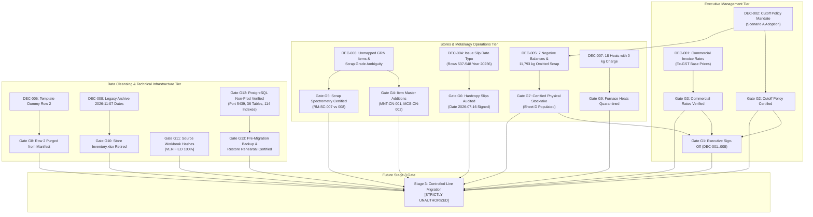

# VSPL Material Management & Costing System — Open Blockers & Cross-Departmental Dependencies

**Document ID:** `DOC-P7-S3A2-BLOCKERS-DEPENDENCIES`  
**System:** VSPL Material Management & Costing System  
**Date:** 2026-10-17  
**Governance Scope:** Comprehensive Mapping of Migration Blockers, Prerequisite Chains & Critical Path  
**Execution Status:** **READ-ONLY ARCHITECTURAL MAPPING — ZERO MUTATING OPERATIONS EXECUTED**  

---

## 1. Executive Summary

This document establishes the comprehensive structural dependency network between the **8 unresolved executive decisions (`DEC-001` through `DEC-008`)** and the **13 Acceptance Gates (`G1` through `G13`)** for Vijay Spheroidals Pvt. Ltd. (VSPL).

### Fundamental Finding:
The migration cannot be treated as an isolated database task. As demonstrated by the dependency analysis, technical execution (Gates `G12`, `G13`, and future live import) is strictly downstream of **Management Policy (DEC-002)**, **Physical Store Verification (DEC-005, G7)**, and **Commercial Rate Certification (DEC-001, G3)**.

---

## 2. Master Prerequisite Dependency Network



---

## 3. Detailed Decision-to-Gate Dependency Matrix

| Decision ID | Directly Impacted Gates | Upstream Prerequisites | Downstream Blockers If Unresolved | Responsible Department |
| :--- | :--- | :--- | :--- | :--- |
| **DEC-001** | `G1`, `G3` | Physical invoice retrieval | Collapses Rule C1 moving average costing to zero; distorts financial COGS | Finance / Purchase |
| **DEC-002** | `G1`, `G2`, `G7` | None (Executive Policy Mandate) | **THE CRITICAL BOTTLENECK:** Carrying July balances across 82-day void creates phantom inventory | Executive Management |
| **DEC-003** | `G1`, `G4`, `G5` | DEC-001 (for item purchase valuation) | Foreign key violations in database; incorrect melt manganese recovery calculations | Stores & Foundry Lab |
| **DEC-004** | `G1`, `G6` | Physical store slip archive retrieval | Automated date parser crash; chronological ledger sorting corrupted | Stores & QA Lead |
| **DEC-005** | `G1`, `G7` | **DEC-002 (Cutoff Policy)** | Deducting charges from zero balance causes negative stock; ledger service rejects transactions | Stores & Plant Head |
| **DEC-006** | `G1`, `G8` | Manifest generator script update | Test/sample data pollutes live inventory ledger; audit disqualification | Systems Architect & QA |
| **DEC-007** | `G1`, `G9` | Melt deck paper sheet retrieval | Missing material charge weights prevents liquid metal batch costing | Foundry Operations |
| **DEC-008** | `G1`, `G10`| IT policy sign-off | Post-dated records (2026-11-07) contaminate inventory audit trail | IT & Lead Auditor |

---

## 4. The Critical Path to Migration Readiness

The critical path represents the longest sequence of dependent activities that must be completed before Stage 3 can be authorized:

```
[DEC-002: Executive Cutoff Policy Mandate]
                 │
                 ▼
[PHYSICAL_STOCKTAKE_PROTOCOL Execution (12-Oct Cutoff)]
                 │
                 ▼
[DEC-005: Physical Stocktake Certified on Sheet D]
                 │
                 ▼
[DEC-001: Commercial Purchase Invoice Rates Certified]
                 │
                 ▼
[G1: Executive Management Sign-Off Package Executed]
                 │
                 ▼
[G12: PostgreSQL 16 Verified on Isolated Port 5439]
                 │
                 ▼
[G13: Pre-Migration Backup & Restore Rehearsal Certified]
                 │
                 ▼
[FINAL ACCEPTANCE GATE CLEARED -> STAGE 3 AUTHORIZED]
```

### Critical Path Bottleneck Analysis:
1. **Bottleneck 1: Executive Cutoff Mandate (DEC-002).** Until the Managing Director formally approves Scenario A, all physical stocktake results lack legal/audit authority to establish opening stock.
2. **Bottleneck 2: Certified Physical Stocktake (DEC-005 / Gate G7).** Because source records stop on 22-Jul-2026 and contain 7 negative balances, live inventory cannot open without physical counts.
3. **Bottleneck 3: Commercial Rates (DEC-001 / Gate G3).** Under Phase 6 Rule C1, inventory valuation and part costing cannot initialize without verified ex-GST purchase rates.

---

## 5. Risk Escalation Triggers & Fallback Protocols

| Risk Event | Severity | Detection Trigger | Fallback Protocol |
| :--- | :--- | :--- | :--- |
| **Supplier Invoices Unretrievable** | High | Finance cannot locate original invoices for GRN rows 3–5 within 14 business days | Finance Head and Managing Director convene an extraordinary valuation committee to certify fair market value (FMV) or baseline cost under written waiver. |
| **Scrap Sample Out of Bounds** | High | Spectrometer test on CRCA scrap shows manganese between 0.26% and 0.34% (boundary overlap) | Foundry Metallurgist re-samples scrap heap; if still ambiguous, classify into conservative grade with documented chemistry waiver. |
| **Store Issue Slips Missing** | Medium | Hardcopy dockets for slips 327–1148 missing from physical warehouse archive | Reconstruct issue authorization via indentor departmental issue registers; require Plant Head countersignature for date normalization. |
| **Physical Count Variances > 5%** | Critical | Physical stocktake counts on raw material yard deviate by > 5% from book expectations | Immediate stocktake recount with independent counting team; quarantine unexplained variances in Sheet B pending investigation. |
| **Port 5439 Unavailability** | Low | Local port 5439 is unexpectedly claimed by an external process | Increment port to next verified available socket (e.g. `5440`), update `docker-compose.nonprod.yml`, and verify zero host collision. |

---

## 6. Recommended Non-Mutating Sequential Next Steps

To methodically advance migration readiness without violating project safety constraints:

1. **Step 1 (Management):** Present [`READINESS_REMEDIATION_PLAN.md`](file:///C:/VSPL_MM/Material%20managment%20system/docs/reports/phase7_stage3a1/READINESS_REMEDIATION_PLAN.md) and [`DEPARTMENT_EVIDENCE_CHECKLISTS.md`](file:///C:/VSPL_MM/Material%20managment%20system/docs/reports/phase7_stage3a2/DEPARTMENT_EVIDENCE_CHECKLISTS.md) to the Managing Director and Department Heads.
2. **Step 2 (Executive):** Obtain signed executive mandate for **Scenario A Cutoff Policy (DEC-002)**.
3. **Step 3 (Finance):** Retrieve and verify vendor tax invoices for GRN entries (DEC-001).
4. **Step 4 (Stores/Foundry):** Execute certified physical stocktake per protocol (DEC-005 / Gate G7) and scrap spectrometry (DEC-003 / Gate G5).
5. **Step 5 (IT/DBA):** When authorized, deploy isolated PostgreSQL instance on port `5439` (Gate G12) and execute backup rehearsal (Gate G13).
6. **Step 6 (Sign-Off):** Present completed evidence package for final Acceptance Gate clearance prior to proposing any Stage 3 live import scripts.

---

## 7. Stop Condition Attestation

- **Status:** **DEPENDENCY & BLOCKER MAPPING COMPLETE.**
- **Attestation:** Strictly read-only analysis. No database mutations, no code changes, no live imports, and no data repairs executed.
