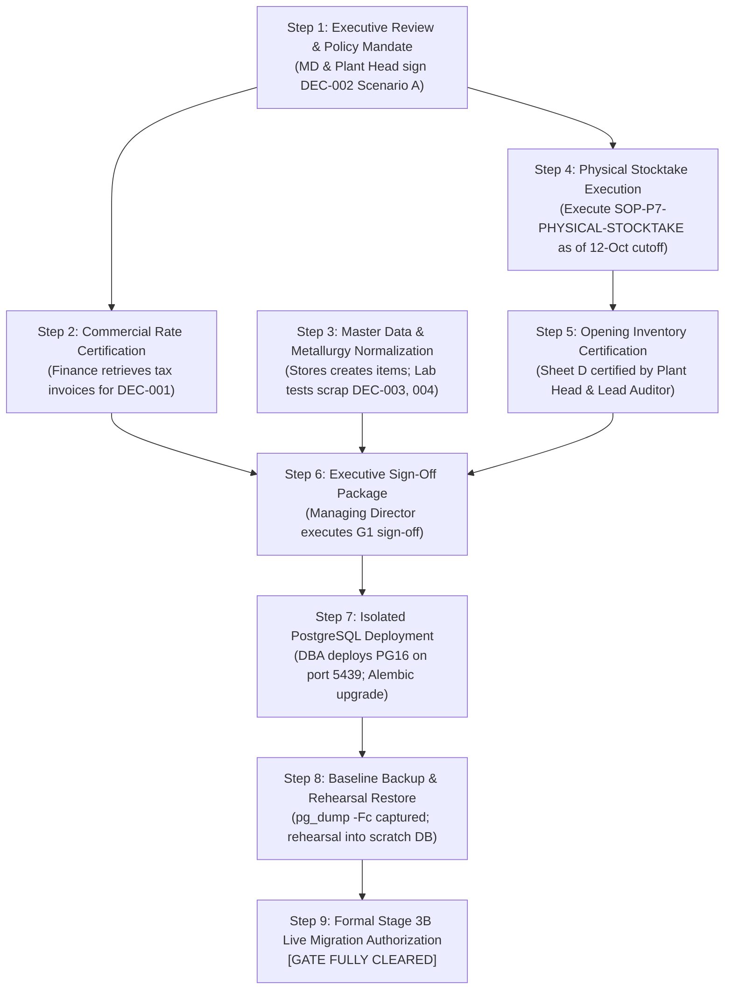

# VSPL Material Management & Costing System — Evidence Closure & Gate Readiness (Stage 3A.3)

**Document ID:** `DOC-P7-S3A3-CLOSURE-READINESS`  
**System:** VSPL Material Management & Costing System  
**Date:** 2026-10-22  
**Governance Scope:** Actionable Closure Package for Outstanding Decisions DEC-001–DEC-008 and Acceptance Gates G1–G13  
**Execution Status:** **READ-ONLY EVIDENCE MANAGEMENT & PLANNING — ZERO MUTATIONS EXECUTED**  

---

## 1. Executive Summary & Baseline Verification

This document constitutes the authoritative **Phase 7 Stage 3A.3: Evidence Closure & Gate Readiness** package for Vijay Spheroidals Pvt. Ltd. (VSPL). It builds directly upon the pre-flight assessment (Stage 3A), remediation planning (Stage 3A.1), and evidence preparation (Stage 3A.2).

The core purpose of Stage 3A.3 is to establish an actionable, audit-defensible closure roadmap that resolves the 8 pending migration decisions (`DEC-001` through `DEC-008`) and satisfies the 13 Acceptance Gates (`G1` through `G13`), with primary emphasis on **Executive Cutoff Authorization (DEC-002)** and **Physical Stocktake Execution**.

### 1.1 Technical & Cryptographic Baseline Verification
Prior to compiling this package, the repository state and underlying evidentiary workbooks were independently verified:

- **Repository Branch:** `master`
- **Git HEAD Commit:** `dd85bcc64e1da9268075077159ccd2abf6a94f0b` (Verified intact)
- **Working Tree State:** Clean; zero uncommitted modifications to application code, migrations, or existing reports.
- **Automated Regression Suite:** **68 of 68 tests passing** in 5.62 seconds (Executed in isolated, in-memory SQLite `StaticPool`).

#### Cryptographic Hash Verification (All 6 Primary Evidence Artifacts):
| Evidence Artifact | Physical Location on Disk | Baseline SHA-256 Fingerprint | Verified SHA-256 Digest | Match Status |
| :--- | :--- | :--- | :--- | :--- |
| **ITEM_MASTER** | `C:\VSPL_MM\VSPL_MM_Data\inputs\VSPL_Item_Master.xlsx` | `6005441b7b022cc8b6e4e65b2d2563ca4462e2448eb3c66d5fdf40552c6e8ccd` | `6005441b7b022cc8b6e4e65b2d2563ca4462e2448eb3c66d5fdf40552c6e8ccd` | **VERIFIED (100%)** |
| **MATERIAL_ENTRY** | `C:\VSPL_MM\VSPL_MM_Data\inputs\VSPL_Material_Entry.xlsx` | `97c6448db72fa65bdc09ec0956c9dbb7d645de7a854cf5c20d072b3df8376cb4` | `97c6448db72fa65bdc09ec0956c9dbb7d645de7a854cf5c20d072b3df8376cb4` | **VERIFIED (100%)** |
| **HEAT_LOG** | `C:\VSPL_MM\VSPL_MM_Data\inputs\VSPL_Foundry_Heat_Log.xlsx` | `356e8c536a3c3cb853869804d65dd2381df7e7ec3731e798b7b26be2345f881d` | `356e8c536a3c3cb853869804d65dd2381df7e7ec3731e798b7b26be2345f881d` | **VERIFIED (100%)** |
| **MASTER_LEDGER** | `C:\VSPL_MM\VSPL_MM_Data\ledger\VSPL_Master_Ledger.xlsx` | `7cb034054d5b4c4e471558b6e1c52b4c0ec7dc786d9b9a555aed42193d984600` | `7cb034054d5b4c4e471558b6e1c52b4c0ec7dc786d9b9a555aed42193d984600` | **VERIFIED (100%)** |
| **STORE_INVENTORY**| `C:\VSPL_MM\_legacy_archive\Store Inventory.xlsx` | `40194dcf05ea29efb42f61aae7c25787a6f0ad482bca4b2bdfa777c7a6874b6d` | `40194dcf05ea29efb42f61aae7c25787a6f0ad482bca4b2bdfa777c7a6874b6d` | **VERIFIED (100%)** |
| **FREEZE_ARCHIVE** | `C:\VSPL_MM\VSPL_Phase7_Stage2_1_Evidence_Freeze_20261013.zip` | `033684d8b26dc65e9c67b569e48991b07c0d0909c2cc37717b5d3485d922c5c5` | `033684d8b26dc65e9c67b569e48991b07c0d0909c2cc37717b5d3485d922c5c5` | **VERIFIED (100%)** |

### 1.2 Core Status Summary
- **Acceptance Gate Readiness:** **1 of 13 Gates Satisfied** (Gate `G11` is Verified; Gates `G1`–`G10` and `G12`–`G13` remain **BLOCKED**).
- **Decision Resolution Status:** **0 of 8 Decisions Approved** (`DEC-001` through `DEC-008` remain strictly `PENDING_REVIEW`).
- **PostgreSQL Infrastructure:** Non-production instance on port `5439` is **DOCUMENTED IN DESIGN ONLY**; zero Docker containers have been launched.
- **Governing Invariant:** Stage 3 Live Historical Migration (Stage 3B) remains **STRICTLY UNAUTHORIZED**.

---

## 2. Decision-by-Decision Evidence Collection Tracker

The following tracker specifies the exact physical artifacts, responsible roles, acceptance criteria, dependencies, and next actions required to bring `DEC-001` through `DEC-008` to audit closure:

| Decision ID | Decision Title | Current Status | Exact Evidence Required | Responsible Role | Primary Evidence Location / Source | Acceptance Criteria | Dependencies | Safest Next Action |
| :--- | :--- | :--- | :--- | :--- | :--- | :--- | :--- | :--- |
| **DEC-001** | Missing Historical GRN Commercial Rates | `PENDING_REVIEW` | Original vendor tax invoices with ex-GST unit rates and GST breakdown; signed commercial rate certification schedule | Finance Head / Purchase Head | Physical Accounts Archive (PO & Invoice files); Supplier ledger statements | 1. Legitimate tax invoice matching GRN date and vendor. 2. Ex-GST unit rate explicitly identified. 3. Signed by Finance Head and Purchase Head. | None | Finance team locates physical invoices for GRN rows 2–5; extracts ex-GST rates into `commercial_rates_staging.csv`. |
| **DEC-002** | 82-Day Operational Void & Costing Cutoff | `PENDING_REVIEW` | Signed Executive Policy Memorandum formally adopting **Scenario A** (Historical Audit Archive & Certified Physical Cutoff) | Managing Director / Plant Head | Executive Management Office; Board minute records | Formally signed memorandum mandating that July 2026 records serve as read-only historical archive, while 12-Oct-2026 physical counts establish live opening inventory. | None (Root Governance Mandate) | Present the 6-point Executive Review Agenda to MD and Plant Head for formal policy determination. |
| **DEC-003** | Unmapped GRN Items & Ambiguous Scrap Grade | `PENDING_REVIEW` | 1. Approved Phase 2 Item Request forms for `MNT-CN-001` and `MCS-CN-002`. 2. Optical Emission Spectrometry (OES) lab test certificate for 15,200 kg CRCA scrap | Stores Manager / Foundry Metallurgist | Stores Catalog Archive; Foundry Quality Control Laboratory Logbook | 1. Canonical codes created in master with verified UOMs. 2. Spectrometer report certifying %Mn: **0.15–0.25%** (`RM-SC-007`) vs **0.35–0.50%** (`RM-SC-008`). | DEC-001 (for item valuation) | Stores Manager submits item requests; Foundry Quality Lab conducts OES test on scrap sample. |
| **DEC-004** | Suspected Issue Date Typo (Year 20236) | `PENDING_REVIEW` | Physical paper store issue slips 327, 910, 325, 1149, 326, 2725, 1148 retrieved from store archive; signed Date Normalization Certificate | Stores Manager / Lead QA Auditor | Central Warehouse Paper Archive (Box 'Issues July 2026') | 1. Physical inspection confirms slips were executed on calendar date `16-07-2026`. 2. Dual-signed certificate by Stores Manager and QA Auditor authorizing mapping to `2026-07-16`. | None | Stores supervisor inspects physical paper slips 327–1148, photographs dockets, and signs normalization certificate. |
| **DEC-005** | Seven Negative Stock Balances & 11,793 kg Omitted Scrap | `PENDING_REVIEW` | Certified Physical Stocktake Register (`VSPL_Physical_Stocktake_Register.xlsx` Sheet D); weighbridge reconciliation dockets | Plant Head / Lead Inventory Auditor | Foundry Raw Material Yard; Central Stores; Weighbridge Logbook | Double-blind physical count executed as of 12-Oct-2026 cutoff; Sheet D fully approved; variance investigation memo signed for scrap variances. | **DEC-002** (Requires Cutoff Policy Mandate) | Schedule and execute plant-wide physical stocktake under `SOP-P7-PHYSICAL-STOCKTAKE`. |
| **DEC-006** | Template Dummy Rows Purged (Row 2 across Sheets) | `PENDING_REVIEW` | Manifest generator script updated to filter `row_number != 2`; QA verification memo certifying staging manifest reduced from 616 to 613 rows | Systems Architect / Lead QA Auditor | Git repository (`scripts/phase7_stage2_manifest_generator.py`); QA Test Log | Verification that sample records (FDY-CN-003 receipt, issue, scrap) are excluded from operational staging with zero impact on legitimate data. | None | Update manifest generator script with explicit row 2 filter and re-verify manifest row count. |
| **DEC-007** | Furnace Charge Mass-Balance Deficit (18 Heats with 0 Charge) | `PENDING_REVIEW` | Physical paper furnace heat log sheets retrieved from melt deck; OR signed quarantine order holding 18 heats in staging preview | Foundry Head / Chief Metallurgist | Furnace Control Room Deck Log; Melt Supervisor Logbook | 1. If physical sheets found: charge lines transcribed into staging. 2. If unretrievable: formal signed order quarantining all 18 heats from live production tables. | None | Foundry supervisor searches melt deck archive for paper charge sheets; staging pipeline configured to hold uncharged heats in quarantine. |
| **DEC-008** | Legacy Archive Future Dates (2026-11-07 in Store Inventory) | `PENDING_REVIEW` | Formal IT and Internal Audit memorandum classifying `Store Inventory.xlsx` as an obsolete legacy archive; ETL pipeline exclusion config | IT Head / Lead Auditor | IT Department Systems Policy File; ETL Pipeline Configuration | Signed policy document retiring the legacy workbook from operational migration scope; ETL runner permanently configured to exclude legacy file. | None | IT Head and Lead Auditor sign formal archive retirement memo; verify file permissions set to read-only archive. |

---

## 3. Critical Path Prioritization: DEC-002 & Physical Stocktake

A rigorous dependency audit reveals that **Executive Decision DEC-002** and the **Physical Stocktake** form the absolute critical path of the entire migration project.

```
┌────────────────────────────────────────────────────────────────────────┐
│                   THE MIGRATION CRITICAL PATH                          │
├────────────────────────────────────────────────────────────────────────┤
│ 1. DEC-002: Executive Cutoff Policy Mandate                           │
│    • Managing Director & Plant Head formally adopt Scenario A.         │
│    • Establishes legal & audit authority for 12-Oct-2026 cutoff.       │
│                               │                                        │
│                               ▼                                        │
│ 2. SOP-P7-PHYSICAL-STOCKTAKE Execution                                 │
│    • Double-blind count across Yard, Stores, and Melt Deck.            │
│    • Solves 7 negative raw material balances (-500 to -2 kg).          │
│    • Reconciles 11,793 kg of omitted historical scrap issues.          │
│                               │                                        │
│                               ▼                                        │
│ 3. Sheet D Opening Inventory Certification                             │
│    • Populates certified opening balance quantities into ledger.       │
│    • Establishes baseline inventory valuation under Phase 6 Rule C1.   │
│                               │                                        │
│                               ▼                                        │
│ 4. Executive Sign-Off (G1) & Technical Clearance (G12, G13)            │
│    • Unlocks request for future live Stage 3 migration.                │
└────────────────────────────────────────────────────────────────────────┘
```

### 3.1 The 82-Day Operational Void (22-Jul-2026 to 12-Oct-2026)
- Digital data entry in `VSPL_Material_Entry.xlsx` and `VSPL_Foundry_Heat_Log.xlsx` ceased abruptly on **22-Jul-2026**.
- The planned go-live and costing baseline date is **12-Oct-2026**.
- During these **82 calendar days**, the foundry operated continuously: raw materials were delivered, induction furnaces were charged, castings were poured, and store supplies were consumed—all without electronic logging in the primary workbooks.
- **The Operational Consequence:** It is mathematically impossible to reconstruct daily moving average unit costs or perpetual inventory balances across this 82-day void without complete paper reconstruction.

### 3.2 The Seven Negative Balances in the Interim Ledger
In `VSPL_Master_Ledger.xlsx`, the spreadsheet maintainer subtracted furnace heat charges (specifically heat `H-260714-01`) directly from a **zero opening stock balance**, creating severe negative book balances:
1. `RM-SC-001` (Mild Steel Scrap): **-500.00 kg**
2. `RM-SC-003` (Foundry Returns / Gatings): **-300.00 kg**
3. `RM-SC-005` (Cast Iron Scrap): **-100.00 kg**
4. `RM-FA-001` (Ferro Silicon): **-10.00 kg**
5. `RM-FA-002` (Ferro Manganese): **-4.00 kg**
6. `RM-FA-003` (Ferro Chrome): **-4.00 kg**
7. `RM-TR-002` (Inoculant): **-2.00 kg**

Simultaneously, `VSPL_Master_Ledger.xlsx` completely omitted **11,793.00 kg** of scrap issues that were physically recorded on store issue slips.

### 3.3 Explicit Governance Clarification:
> [!IMPORTANT]
> **No Presumed Approval or Completion:**  
> Neither **DEC-002** nor the **Physical Stocktake** has been executed, signed, or approved. They are documented here solely as the governing critical-path prerequisites that executive management and operations must complete before technical migration can proceed.

---

## 4. Physical Stocktake Readiness Checklist (`SOP-P7-PHYSICAL-STOCKTAKE`)

To ensure that the upcoming physical stocktake yields legally defensible opening inventory figures, plant operations must satisfy the following checklist based on [`PHYSICAL_STOCKTAKE_PROTOCOL.md`](file:///C:/VSPL_MM/Material%20managment%20system/docs/reports/phase7_stocktake_preparation/PHYSICAL_STOCKTAKE_PROTOCOL.md):

### 4.1 Item-Master Reconciliation & Scope Definition
- [ ] **Item Catalog Freeze:** Item master frozen with 391 verified items; zero unmapped items allowed during counting.
- [ ] **New Items Added:** Canonical codes `MNT-CN-001` (Generator Set) and `MCS-CN-002` (Tool Post) formally provisioned in staging catalogs to receive physical count figures.
- [ ] **Departmental Scoping:** Complete count coverage mapped across Foundry (`FDY`), Machine Shop (`MSP`), Pattern Shop (`PAT`), Quality (`QAL`), Maintenance (`MNT`), and Central Stores (`STR`).

### 4.2 Two-Part Perforated Tag Control System
- [ ] **Tag Serialization:** Pre-printed, serialized count tag books issued under sign-out log (`TAG-20261012-0001` to `TAG-20261012-0600`).
- [ ] **Part A Placement:** Part A securely wired or taped to every physical bin, pallet, drum, or yard quadrant immediately upon physical count completion.
- [ ] **Part B Custody:** Part B detached by independent verifier and handed directly to the Lead Inventory Auditor at the central control desk.
- [ ] **Tag Reconciliation:** 100% accounting of all tag numbers (Used, Unused, Voided/Damaged); zero missing tags permitted.

### 4.3 Measurement Methodologies & Unit of Measure (UOM) Integrity
- [ ] **Weighbridge Calibration (Bulk Scrap & Pig Iron):** 50-tonne static weighbridge calibrated and certified by stamped weights-and-measures authority for weighing raw material bays (`BAY-RM-01` through `BAY-RM-06`).
- [ ] **Platform Scale Calibration (Alloys & Chemicals):** 500-kg electronic platform scales calibrated (precision: $\pm 0.05$ kg) for ferro-alloys, inoculants, and heavy consumables.
- [ ] **Precision Lab Balance (Treatment & Inoculants):** 30-kg precision balance calibrated (precision: $\pm 0.001$ kg) for high-value alloying additions and magnesium treatment alloys.
- [ ] **Liquid & Linear Conversions:** Pre-calibrated dipsticks for diesel, core oils, and thinner tanks; physical tape measurements for cables and hoses; conversion to canonical UOM verified.

### 4.4 Plant Storage Locations & Movement Freeze
- [ ] **Cutoff Timestamp Enforced:** Cutoff strictly set to **12 October 2026, 23:59:59 IST**.
- [ ] **Physical Movement Halt:** Zero material movements permitted during the count period; all internal material issues, warehouse transfers, and shop-floor returns paused.
- [ ] **Incoming Quarantine Established:** Dedicated holding bay (`LOC-QUARANTINE-OCT26`) physically cordoned off and locked for deliveries arriving during the stocktake; all such deliveries tagged as post-cutoff receipts and excluded from opening stock.

### 4.5 Discrepancy Investigation & Recount Thresholds
- [ ] **Mandatory Recount Trigger 1 (Bulk Materials):** Any variance exceeding **$\pm 2.0\%$** between physical count and estimated book balance on scrap or pig iron triggers immediate blind recount by a secondary team.
- [ ] **Mandatory Recount Trigger 2 (Controlled Alloys):** Any variance exceeding **$\pm 0.0\%$** on high-value ferro-alloys, inoculants, or magnesium ferrosilicon triggers immediate re-weighment.
- [ ] **Mandatory Recount Trigger 3 (Spares & Tooling):** Any non-zero count variance on capital spares, machine tooling, or maintenance assemblies triggers physical search and investigation.
- [ ] **Variance Investigation Register:** All variances documented in Sheet B of `VSPL_Physical_Stocktake_Register.xlsx` with hypothesized root cause, investigator name, and corrective action proposal.

### 4.6 Witness Sign-Off & Evidence Preservation
- [ ] **Dual Counting Signatures:** Every physical tally sheet signed by Primary Counter and Independent Verifier.
- [ ] **Departmental Head Verification:** Stores Manager and Plant Head sign summary tally sheets for each plant area.
- [ ] **Independent Auditor Sign-Off:** Lead Inventory Auditor certifies Sheet D of `VSPL_Physical_Stocktake_Register.xlsx`.
- [ ] **Evidence Preservation:** Physical tally sheets, tag stubs (Part B), and weighbridge printouts boxed, sealed, labeled, and placed in permanent company archive.

---

## 5. Executive Review Agenda for DEC-002 (Managing Director & Plant Head)

To resolve the core governance bottleneck, the following formal review agenda must be presented to the **Managing Director** and **Plant Head**. 

> [!IMPORTANT]
> **Open Executive Decision Points:**  
> The following items are structured as **formal policy questions to decide**, NOT as pre-approved outcomes. Management must deliberate, select the appropriate policy path, and affix physical signatures.

---

### Agenda Item 1: Operational Cutoff Date Determination
- **Context:** Primary workbooks end on 22-Jul-2026; live ERP go-live is scheduled for October 2026.
- **Questions for Decision:**
  1. Does executive management formally designate **12 October 2026, 23:59:59 IST** as the definitive, plant-wide operational cutoff timestamp?
  2. If an alternative cutoff date is chosen, what are the specific resource and operational impacts on ongoing manufacturing?

---

### Agenda Item 2: Legal & Audit Treatment of the 82-Day Void (23-Jul-2026 to 11-Oct-2026)
- **Context:** Approximately 82 days of shop-floor issues, receipts, and melt charges were recorded on paper slips or unlogged during ERP transition.
- **Policy Alternatives:**
  - **Scenario A (Recommended):** Classify July 2026 workbooks as a **Historical Audit Archive**. Do not attempt retrospective ledger reconstruction. Treat 12-Oct-2026 certified physical stocktake counts as the definitive opening balance (`MovementType.OPENING_BALANCE`).
  - **Scenario B:** Undertake a full retrospective manual reconstruction of all paper slips across the 82-day void (estimated delay: 6–8 weeks, substantial audit cost, high risk of missing paper slips).
  - **Scenario C:** Post July 2026 closing balances directly as October opening balances without physical counts (High risk: injects phantom stock, carries forward 7 negative balances, guarantees immediate audit qualification).
- **Questions for Decision:**
  1. Does management formally authorize **Scenario A** as company policy?
  2. Does management approve the permanent archival of July records solely for historical reference and statutory tax audit?

---

### Agenda Item 3: Metallurgical Treatment of Scrap & Negative Interim Balances
- **Context:** Interim spreadsheets report -500 kg mild steel scrap, -300 kg foundry returns, and -100 kg cast iron scrap due to charging induction furnaces without recording scrap receipts. Furthermore, 11,793 kg of scrap issues were omitted.
- **Questions for Decision:**
  1. Does management mandate that the physical weighbridge stocktake of the scrap yard supersedes all historical negative spreadsheet numbers?
  2. Does management approve writing off historical unrecorded variances upon establishment of the certified physical opening stock?

---

### Agenda Item 4: Legal Authority to Establish Opening Inventory
- **Context:** The live database enforces strict non-negative stock invariants. Items cannot be issued until an authoritative opening balance is created.
- **Questions for Decision:**
  1. Who among executive leadership holds the legal authority to sign off on the initial opening inventory quantities?
  2. Is authority delegated jointly to the **Plant Head** and **Finance Head**, with final countersignature by the **Managing Director**?

---

### Agenda Item 5: Financial Valuation & Cost Accounting Integration (Rule C1)
- **Context:** Under Phase 6 Rule C1, inventory must possess a valid unit valuation ($\text{Price} > 0$) to compute moving weighted-average costs and casting cost sheets.
- **Questions for Decision:**
  1. What valuation methodology shall apply to opening stock items where historical purchase invoices are absent?
  2. Does Finance authorize using verified ex-GST purchase rates from the latest supplier tax invoices, or will a formal Fair Market Valuation (FMV) schedule be established?
  3. How will the variance between physical stocktake valuation and the general ledger inventory balance be accounted for in the financial accounts (e.g. Inventory Adjustment / P&L reserve)?

---

### Agenda Item 6: Form & Execution of Required Sign-Offs
- **Context:** External auditors require unambiguous, dated, physical or cryptographic evidence of executive decision-making.
- **Questions for Decision:**
  1. Will executive leadership execute the formal sign-offs utilizing [`MANAGEMENT_SIGNOFF_TEMPLATE.md`](file:///C:/VSPL_MM/Material%20managment%20system/docs/reports/phase7_management_signoff/MANAGEMENT_SIGNOFF_TEMPLATE.md)?
  2. What is the target calendar date for convening the executive review session and completing signatures?

---

## 6. Departmental Missing Documentary Evidence Audit

A rigorous cross-departmental audit confirms the exact documentary evidence that remains missing and uncollected:

```
┌────────────────────────────────────────────────────────────────────────┐
│                   MISSING DOCUMENTARY EVIDENCE AUDIT                   │
├────────────────────────────────────────────────────────────────────────┤
│ 1. PURCHASE / FINANCE                                                  │
│    • Physical vendor tax invoices for GRN rows 2, 3, 4, and 5.         │
│    • Certified ex-GST base unit purchase rate schedule.                │
│    • Statutory GST breakdown (CGST, SGST, IGST) and ITC eligibility.   │
│    • Relevant Purchase Orders and Goods Inward Delivery Challans.      │
├────────────────────────────────────────────────────────────────────────┤
│ 2. STORES                                                              │
│    • Signed physical stocktake tally sheets for 12-Oct-2026 cutoff.    │
│    • Certified Sheet D of VSPL_Physical_Stocktake_Register.xlsx.       │
│    • Physical hardcopy store issue slips 327, 910, 325, 1149, 326,     │
│      2725, and 1148 confirming execution on 2026-07-16.               │
│    • Signed Date Normalization Certificate for slips 327–1148.         │
├────────────────────────────────────────────────────────────────────────┤
│ 3. FOUNDRY / QUALITY                                                   │
│    • Optical emission spectrometry (OES) chemical test certificate     │
│      for 15,200 kg CRCA scrap (%Mn: 0.15-0.25% vs 0.35-0.50%).         │
│    • Physical paper furnace heat log sheets for 22-Jul (heats 2-20).   │
│    • Written quarantine authorization order if melt sheets missing.    │
├────────────────────────────────────────────────────────────────────────┤
│ 4. MASTER DATA OWNER                                                   │
│    • Approved Phase 2 Item Request workflows for MNT-CN-001 & MCS-CN-002.│
│    • Signed master catalog approval sheet with verified UOMs.          │
│    • Staging manifest generator update excluding template dummy row 2. │
├────────────────────────────────────────────────────────────────────────┤
│ 5. EXECUTIVE MANAGEMENT                                                │
│    • Signed Executive Policy Memorandum formally adopting Scenario A.  │
│    • Formally executed MANAGEMENT_SIGNOFF_TEMPLATE.md (DEC-001..008).  │
│    • Signed opening inventory financial authorization.                 │
├────────────────────────────────────────────────────────────────────────┤
│ 6. IT & DATABASE OPERATIONS                                            │
│    • Signed retirement memorandum for Store Inventory.xlsx.            │
│    • Isolated PostgreSQL 16 container running on port 5439 (Post-G1).  │
│    • Baseline pg_dump snapshot and restore rehearsal certificate.      │
└────────────────────────────────────────────────────────────────────────┘
```

---

## 7. PostgreSQL Infrastructure Reality Review (Planned vs Realized)

To maintain absolute fidelity and avoid conflating documentation with operational reality, the database infrastructure is explicitly audited below:

| Architectural Component | Planned Specification (`POSTGRESQL_NONPROD_SETUP_PLAN.md`) | Verified Reality on Workstation | Discrepancy & Status |
| :--- | :--- | :--- | :--- |
| **Host Network Port** | Dedicated port `5439` on `127.0.0.1` | Port `5432` occupied by OMS container `backend-db-1`; Port `5439` is free | **PLANNED SPECIFICATION ONLY** (Port 5439 verified unallocated; no service bound) |
| **Container Engine** | Docker Compose service `vspl_mm_postgres_nonprod` running `postgres:16-alpine` | Container does not exist; Docker image not pulled | **PLANNED SPECIFICATION ONLY** (Zero containers launched) |
| **Storage Isolation** | Isolated named Docker volume `vspl_mm_pg16_nonprod_data` | Volume does not exist in Docker engine | **PLANNED SPECIFICATION ONLY** (No disk allocation) |
| **Database & User Role**| `vspl_material_management` owned by unprivileged role `vspl_app` | Role and database do not exist | **PLANNED SPECIFICATION ONLY** |
| **Alembic Schema Chain**| 5 revisions (001–005) applied to head `005_cost_history` (36 tables, 114 indexes) | Migration Python scripts verified on disk; **zero tables created in PostgreSQL** | **UNREALIZED ON POSTGRESQL** (Scripts verified; database unmigrated) |
| **Regression Test Suite**| 68 automated tests passing against live PostgreSQL 16 dialect | 68/68 tests passing **strictly in in-memory SQLite (`StaticPool`)** | **SQLITE VERIFIED; POSTGRESQL UNTESTED** |
| **Pre-Migration Backup** | Binary custom archive `vspl_mm_baseline_{TIMESTAMP}.dump` via `pg_dump -Fc` | No PostgreSQL database exists to snapshot | **BLOCKED ON DEPLOYMENT** |
| **Restore Rehearsal** | Automated restoration and verification in `vspl_mm_restore_test` | Scratch database does not exist | **BLOCKED ON BACKUP** |

### Critical Technical Distinction:
Passing 68 backend tests in SQLite verifies business logic contracts (such as non-negative stock balance enforcement, Rule H1 isolation, and Rule C1 weighted-average calculations). However, **it provides zero proof of PostgreSQL readiness**. Dialect-specific behaviors (such as PostgreSQL timezone-aware timestamps, foreign key deferral, and composite unique constraint indexing) remain unverified until an authorized deployment on port `5439` occurs.

---

## 8. Reconciliation of Acceptance Gates G1–G13

Every acceptance gate defined in `FINAL_DRY_RUN_ACCEPTANCE_GATE.md` has been re-evaluated against the actual evidence currently on disk:

| Gate ID | Gate Area | Current Status | Evidence Currently Present in Repository | Missing Documentary / Technical Evidence | Responsible Role | Pass Criterion |
| :--- | :--- | :--- | :--- | :--- | :--- | :--- |
| **G1** | Executive Decision Sign-Off | **BLOCKED** | `MANAGEMENT_SIGNOFF_TEMPLATE.md` drafted; Decision register documented | Physical/digital signatures of MD, Plant Head, and Finance Head on all 8 decision cards | Managing Director | All 8 decisions formally approved and signed with zero unapproved items. |
| **G2** | Cutoff Policy Authorization | **BLOCKED** | Trade-off analysis of Scenarios A, B, and C documented in pre-flight reports | Formally signed Executive Policy Memorandum adopting Scenario A and certifying 82-day void | Plant Head | Executive memorandum on file adopting Scenario A as company policy. |
| **G3** | Commercial Purchase Rates | **BLOCKED** | Stage 2.1 pricing exception register identifying unrated GRN rows | Certified vendor tax invoices with ex-GST unit rates for GRN rows 2–5; signed rate schedule | Finance Head | 100% of historical GRN items have certified ex-GST purchase rates on file. |
| **G4** | Item Master Additions | **BLOCKED** | Identification of unmapped items `3306PMKT-Generator` and `Tool Post` in staging | Approved Phase 2 Item Request workflows and canonical catalog records for `MNT-CN-001` and `MCS-CN-002` | Stores Manager | Items created in master with verified categories, UOMs, and specifications. |
| **G5** | Scrap Metallurgy Certification | **BLOCKED** | Stage 2.1 chemistry specification comparison for `RM-SC-007` vs `RM-SC-008` | Optical emission spectrometry laboratory test certificate from Foundry Quality Lab | Foundry Metallurgist | Signed lab report definitively classifying 15,200 kg scrap into grade 007 or 008. |
| **G6** | Issue Date Typo Authorization | **BLOCKED** | Date discrepancy report identifying string `7-16-20236` across issue rows 537–548 | Physical hardcopy store issue slips 327–1148; signed Date Normalization Certificate | Stores Manager | Signed certificate confirming physical dockets show calendar date 16-07-2026. |
| **G7** | Certified Physical Stocktake | **BLOCKED** | `PHYSICAL_STOCKTAKE_PROTOCOL.md` and `VSPL_Physical_Stocktake_Register.xlsx` created | Certified physical count results on Sheet D of stocktake register; signed count sheets | Plant Head | Sheet D fully populated with double-blind counts and certified by Plant Head. |
| **G8** | Template Dummy Rows Purged | **BLOCKED** | Identification of Read Me cell A14 instructing row 2 is a sample entry | Manifest generator script updated with row 2 filter; verified manifest with 613 rows | Systems Architect | Manifest contains zero sample development rows; candidate count reduced to 613. |
| **G9** | Furnace Heat Log Quarantine | **BLOCKED** | Identification of 18 heats on 22-Jul-2026 with 0 kg charge in heat log workbook | Physical paper melt deck log sheets retrieved OR formal signed quarantine order | Foundry Head | Zero heats with 0 kg charge post to live production tables; quarantine order on file. |
| **G10** | Legacy Archive Formally Retired | **BLOCKED** | Analysis of 113 future-dated rows (2026-11-07) in `Store Inventory.xlsx` | Formal IT and Audit retirement memorandum; ETL config permanently excluding legacy file | IT Head | Signed IT memorandum retiring legacy file; file excluded from active ETL pipelines. |
| **G11** | Source Hashes Re-Verified | **VERIFIED** | All 5 primary workbooks and freeze ZIP match baseline SHA-256 digests 100% | None (All 6 primary evidentiary assets cryptographically verified) | Lead QA Auditor | 100% match on all 5 source workbook digests and freeze archive hash (`033684d...c5c5`). |
| **G12** | PostgreSQL Non-Prod Verification | **BLOCKED** | `POSTGRESQL_NONPROD_SETUP_PLAN.md` specification on port 5439; compose spec | Live PostgreSQL 16 container running on port 5439; Alembic 001–005 applied; test suite passing on PG | Lead DBA | PostgreSQL 16 active on port 5439; 36 tables verified; 68/68 tests passing on PG. |
| **G13** | Backup Rehearsal Certified | **BLOCKED** | `BACKUP_RESTORE_VERIFICATION_PLAN.md` specification for `pg_dump -Fc` | Executed pre-migration binary dump; SHA-256 digest; completed restore rehearsal into scratch DB | Systems Architect | Pre-migration dump captured; restore rehearsal into scratch DB verified with 36 tables. |

---

## 9. Dependency-Ordered Next-Action Plan & Prerequisites for Stage 3B

To transition the project from readiness planning to write-enabled execution without regulatory or data integrity risks, the following sequential prerequisite chain must be strictly followed:



### Exact Mandatory Prerequisites for Stage 3B Request:
Stage 3B (Write-Enabled Historical Ingestion) can **ONLY** be formally requested when:
1. **Executive Mandate (DEC-002):** Scenario A is authorized in writing by the Managing Director.
2. **Physical Stocktake Certified (Gate G7):** Sheet D of `VSPL_Physical_Stocktake_Register.xlsx` is completed and signed, eliminating all 7 negative balances.
3. **Commercial Invoices on File (Gate G3):** Ex-GST purchase rates are certified for 100% of incoming GRN items.
4. **All 8 Decisions Signed (Gate G1):** `MANAGEMENT_SIGNOFF_TEMPLATE.md` bears physical signatures for DEC-001 through DEC-008.
5. **PostgreSQL Realized (Gate G12):** Isolated database on port `5439` has 36 tables and passes all 68 tests.
6. **Backup Rehearsal Certified (Gate G13):** Pre-migration `.dump` is created, hashed, and successfully restored to `vspl_mm_restore_test`.

---

## 10. Safety Attestation & Stop Conditions

### Operational Attestation:
- **Strictly Read-Only:** This document represents an evidence reconciliation and readiness closure package.
- **Zero Database Operations:** Zero database records were inserted, modified, or deleted. Zero stock ledger movements or opening balances were created.
- **Zero Infrastructure Mutations:** No Docker containers were launched, stopped, or modified. Port 5432 and host services remain untouched.
- **Zero Source Modifications:** All five source workbooks and the freeze ZIP archive remain unedited, with SHA-256 fingerprints 100% intact.
- **Prohibition Enforced:** **Stage 3A.3 is complete. Stage 3B remains strictly unauthorized until all 13 Acceptance Gates are certified in writing.**
