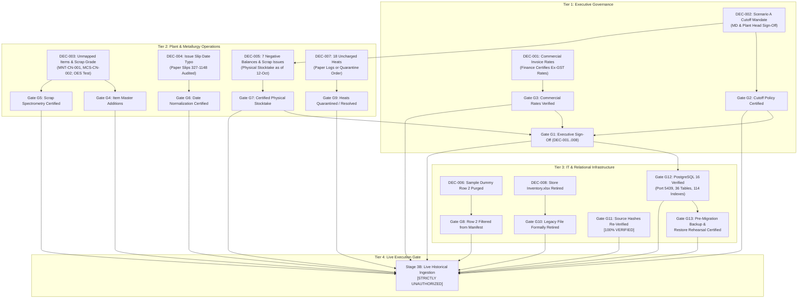

# VSPL Material Management & Costing System — Next Actions & Dependency Architecture

**Document ID:** `DOC-P7-S3A6-NEXT-ACTIONS`  
**System:** VSPL Material Management & Costing System  
**Date:** 2026-10-22  
**Governance Scope:** Dependency-Ordered Sequential Roadmap Leading to Future Live Migration Request  
**Execution Authority:** **READ-ONLY ARCHITECTURAL SPECIFICATION — STAGE 3B STRICTLY UNAUTHORIZED**  

---

## 1. Executive Summary

This document synthesizes the operational, metallurgical, financial, and technical dependencies that govern the Phase 7 migration lifecycle for Vijay Spheroidals Pvt. Ltd. (VSPL). It defines the exact, non-negotiable prerequisite milestones that must be achieved before any request for write-enabled Stage 3 migration can be proposed to executive leadership.

---

## 2. Master Prerequisite Dependency Network



---

## 3. The Critical Path to Migration Readiness

The critical path represents the minimum sequence of dependent tasks that dictates the timeline to achieving 100% readiness:

```
[1. DEC-002: Executive Cutoff Policy Mandate Signed (Scenario A)]
                               │
                               ▼
[2. SOP-P7-PHYSICAL-STOCKTAKE Execution as of 12-Oct Cutoff]
                               │
                               ▼
[3. DEC-005: Sheet D Certified Opening Inventory Realized]
                               │
                               ▼
[4. DEC-001: Commercial Invoice Rates Certified by Finance]
                               │
                               ▼
[5. Gate G1: Executive Management Sign-Off Package Executed]
                               │
                               ▼
[6. Gate G12: Isolated PostgreSQL Deployed on Port 5439]
                               │
                               ▼
[7. Gate G13: Pre-Migration Backup & Restore Rehearsal Passed]
                               │
                               ▼
[ALL 13 GATES SATISFIED -> STAGE 3B FORMAL AUTHORIZATION REQUEST]
```

### Critical Path Bottleneck Analysis:
1. **The Executive Mandate (DEC-002):** Without signed executive policy adopting Scenario A, plant operations cannot legally freeze stock or establish a 12-Oct-2026 cutoff baseline.
2. **The Physical Count (DEC-005 / Gate G7):** Without double-blind physical counts, live inventory cannot open due to 7 negative balances (-500 to -2 kg) and 11,793 kg of omitted scrap issues in historical spreadsheets.
3. **The Commercial Rates (DEC-001 / Gate G3):** Without ex-GST rates from original supplier tax invoices, opening inventory cannot be valued under Rule C1, collapsing moving average unit costs to zero.

---

## 4. Exact Conditions Required Before Requesting Stage 3B

Stage 3B (Write-Enabled Historical Data Ingestion) can **ONLY** be formally requested when all of the following non-negotiable conditions are certified in writing:

| Condition Code | Prerequisite Description | Required Verifying Artifact | Responsible Lead |
| :--- | :--- | :--- | :--- |
| **COND-01** | Formal Executive Cutoff Mandate | Signed Executive Policy Memorandum adopting Scenario A | Managing Director / Plant Head |
| **COND-02** | 100% Decision Card Approval | Signed `MANAGEMENT_SIGNOFF_TEMPLATE.md` across DEC-001 through DEC-008 | Managing Director |
| **COND-03** | Commercial Purchase Rates Certified | Signed `commercial_rates_staging.csv` with ex-GST rates for GRN rows 2–5 | Finance Head / Purchase Head |
| **COND-04** | Scrap Chemistry Certified | Laboratory OES chemical test certificate classifying scrap manganese % | Foundry Metallurgist |
| **COND-05** | Issue Slip Dates Verified | Signed Date Normalization Certificate for store slips 327–1148 | Stores Manager / Lead QA Auditor |
| **COND-06** | Certified Physical Opening Stock | Certified Sheet D of `VSPL_Physical_Stocktake_Register.xlsx` | Plant Head / Lead Inventory Auditor |
| **COND-07** | Staging Manifest Cleansed | Manifest generator script verified filtering sample dummy row 2 | Systems Architect |
| **COND-08** | Uncharged Heats Quarantined | Signed quarantine order holding 18 incomplete heats in staging | Foundry Head |
| **COND-09** | Legacy Workbook Formally Retired | Signed IT policy memorandum archiving `Store Inventory.xlsx` | IT Head / Lead Auditor |
| **COND-10** | Source File Hashes Verified | 100% SHA-256 match immediately prior to execution (Gate G11) | Lead QA Auditor |
| **COND-11** | Isolated PostgreSQL Realized | PostgreSQL 16 container running on port 5439 with 36 tables / 114 indexes | Lead DBA |
| **COND-12** | Live Test Suite Certified | 68/68 regression tests passing against live PostgreSQL dialect | Lead QA Auditor |
| **COND-13** | Pre-Migration Backup Rehearsed | Binary dump (`pg_dump -Fc`) restored into scratch DB with parity verified | Systems Architect |

---

## 5. Next Three Safe Actions

To methodically advance migration readiness without operational risk:

1. **Convene Executive Cutoff Briefing on DEC-002:** The **Managing Director** and **Plant Head** review [`DEC002_EXECUTIVE_DECISION_BRIEF.md`](file:///C:/VSPL_MM/Material%20managment%20system/docs/reports/phase7_stage3a4/DEC002_EXECUTIVE_DECISION_BRIEF.md) and execute the formal Decision Record Template to unblock **Gate G2**.
2. **Mobilize Departmental Document Retrieval:**
   - Finance pulls original vendor tax invoices for GRN rows 2–5 to unblock **DEC-001 (Gate G3)**.
   - Stores inspects physical paper issue slips 327–1148 to unblock **DEC-004 (Gate G6)**.
   - Foundry Quality Lab tests scrap sample on OES spectrometer to unblock **DEC-003 (Gate G5)**.
3. **Execute Physical Stocktake Preparations:** Stores and Foundry leadership complete pre-count preparations (two-part tag printing, weighbridge/scale calibrations, scrap bay marking) per [`PHYSICAL_STOCKTAKE_PROTOCOL.md`](file:///C:/VSPL_MM/Material%20managment%20system/docs/reports/phase7_stocktake_preparation/PHYSICAL_STOCKTAKE_PROTOCOL.md).

---

## 6. Safety Attestation & Stop Conditions

- **Strictly Read-Only:** Zero application database records were inserted, modified, or deleted. Zero stock ledger movements or opening balances were created.
- **Zero Infrastructure Changes:** No Docker containers were started, stopped, or altered. Host port 5432 and external services remain untouched.
- **Stage 3B Remains Strictly Unauthorized:** No live import scripts may be created or executed until all 13 Acceptance Gates are certified in writing.
