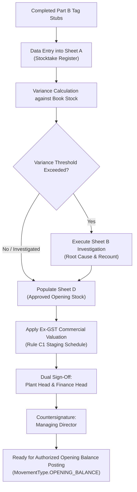

# VSPL Material Management & Costing System — Physical Stocktake Prerequisites & Verification Framework

**Document ID:** `DOC-P7-S3A7-STOCKTAKE-PREREQ`  
**System:** VSPL Material Management & Costing System  
**Company:** Vijay Spheroidals Pvt. Ltd., Peenya Industrial Area, Bangalore  
**Operational Framework:** Review of `PHYSICAL_STOCKTAKE_PROTOCOL.md` (`SOP-P7-PHYSICAL-STOCKTAKE`)  
**Target Cutoff Timestamp:** 12 October 2026, 23:59:59 IST  
**Governance Scope:** Mandatory Pre-Conditions, Equipment Calibrations, Tag Discipline & Opening Inventory Controls  
**Execution Authority:** **READ-ONLY AUDIT & PLANNING — ZERO OPENING BALANCES POSTED — STAGE 3B UNAUTHORIZED**  

---

## 1. Executive Purpose & Governance Invariants

This document establishes the rigorous prerequisite verification framework that must be certified by plant leadership, stores administration, and independent auditors before any physical counts can be recorded or relied upon to initialize the live inventory ledger for Vijay Spheroidals Pvt. Ltd. (VSPL).

### Fundamental Audit Rules:
1. **No Retrospective Ledger Substitution:** The physical count does not reconstruct historical transactions between July and October 2026; it establishes an audited, legally defensible opening balance under **DEC-002 Scenario A**.
2. **Zero Inferred Balances:** No opening balance quantity may be established from memory, purchase order estimates, or spreadsheet extrapolations. Every opening stock figure must derive directly from a verified physical count tag (`TAG-YYYYMMDD-XXXX`).
3. **Execution Prohibition:** In accordance with Phase 7 boundaries, this document establishes prerequisites only. **No opening inventory entries have been posted to any database or ledger.**

---

## 2. Cutoff-Date Authorization Prerequisite (DEC-002)

Before counting teams can be mobilized or plant operations halted, executive leadership must formally authorize the cutoff mandate:

```
┌────────────────────────────────────────────────────────────────────────┐
│                   CUTOFF AUTHORIZATION PREREQUISITE                    │
├────────────────────────────────────────────────────────────────────────┤
│ REQUIREMENT: Formal adoption of Scenario A by Managing Director.       │
│ MANDATED CUTOFF TIMESTAMP: 12 October 2026, 23:59:59 IST.              │
│ GOVERNING DOCUMENT: DEC002_EXECUTIVE_DECISION_BRIEF.md                 │
│ CURRENT STATUS: PENDING_REVIEW (Awaiting formal executive sign-off).   │
└────────────────────────────────────────────────────────────────────────┘
```

### Pre-Count Verification Criteria:
- [ ] Signed Executive Policy Memorandum adopting Scenario A filed in project archive.
- [ ] Plant-wide operational notice issued freezing internal store issues and production transfers during count hours.
- [ ] Dedicated physical quarantine bay (`LOC-QUARANTINE-OCT26`) cordoned off, locked, and labeled for receipts arriving post-cutoff.

---

## 3. Item Identity & Unit-of-Measure (UOM) Integrity Checks

To prevent catalog mismatch errors and foreign key violations during opening balance ingestion:

### 3.1 Item Master Catalog Freeze
- **Catalog Population:** The Item Master catalog must be frozen with exactly **391 canonical items** plus **2 newly authorized items**:
  - `MNT-CN-001`: 3306PMKT-Generator (Base UOM: `SET`) — *Capital Spares / Maintenance*.
  - `MCS-CN-002`: Tool Post (Base UOM: `NOS`) — *Capital Spares / Machine Shop*.
- **Catalog Verification:** Every physical material counted must resolve to an active canonical item code. Unmapped items, vendor brand names, or local shop-floor nicknames are strictly prohibited on count tags.

### 3.2 Canonical Unit-of-Measure Rules
In accordance with `backend/app/models/uom.py` and `backend/app/services/decimal_validator.py`:
- **Raw Materials & Scrap:** Must be counted strictly in **Kilograms (`KG`)**. Weighbridge prints in metric tonnes (`MT`) must be converted to `KG` ($\times 1,000$) with zero decimal ambiguity.
- **Ferro-Alloys & Inoculants:** Must be weighed strictly in **Kilograms (`KG`)** to two decimal places ($\pm 0.05$ kg).
- **Countable Units (`NOS`, `PCS`, `SET`):** Fractional quantities are strictly prohibited at the database schema layer. Fractional counts on discrete units trigger immediate validation failure.
- **Liquids (`LTR`):** Measured in **Liters (`LTR`)** via calibrated tank dipsticks. Temperature-corrected density tables must be applied for bulk diesel and heavy oils.

---

## 4. Weighing-Equipment Calibration Standards

All physical weight measurements must be performed on calibrated, stamped instruments:

| Equipment Identifier | Plant Location | Rated Capacity & Resolution | Calibration Requirement | Verifying Artifact | Verification Status |
| :--- | :--- | :--- | :--- | :--- | :--- |
| **WB-50T** | Factory Main Gate / Scrap Yard | 50,000 kg / $\pm 10$ kg | Legal metrology annual stamping; gross/tare zero calibration check | Stamped Legal Metrology Calibration Certificate | [ ] Stamped Cert on File<br>[ ] Pre-Count Tare Check |
| **PF-500-STR** | Central Stores Receiving | 500 kg / $\pm 0.05$ kg | Certified standard test weights check (50 kg, 100 kg, 200 kg) | Internal Calibration Log signed by QA Lead | [ ] Calibrated<br>[ ] Test Weights Verified |
| **PF-500-ALY** | Foundry Alloy Storage Room | 500 kg / $\pm 0.05$ kg | Certified standard test weights check (50 kg, 100 kg, 200 kg) | Internal Calibration Log signed by QA Lead | [ ] Calibrated<br>[ ] Test Weights Verified |
| **LAB-30-BAL** | Foundry Quality Control Lab | 30 kg / $\pm 0.001$ kg | Electronic laboratory balance calibration certificate | NABL-traceable Calibration Certificate | [ ] Certified<br>[ ] Lab Log Signed |

---

## 5. Two-Part Count Tag Discipline & Independent Verification

Physical count control is enforced through uniquely numbered, two-part perforated count tags:

```
┌────────────────────────────────────────────────────────────────────────┐
│  VIJAY SPHEROIDALS PVT. LTD. — PHYSICAL STOCKTAKE TAG                  │
│  Tag No: TAG-20261012-0482                            Location: BAY-04 │
├────────────────────────────────────────────────────────────────────────┤
│  Item Code: FDY-RM-008         Description: CRC Scrap Low MN           │
│  Base UOM: KG                  Category: Raw Materials                │
│                                                                        │
│  PART A: LOCATION COPY (Affixed to physical bin, pallet, or bay)       │
│  Counted Quantity: ______________ kg    Date & Time: _________________ │
│  Counter Name: _________________        Verifier Name: _______________ │
│                                                                        │
│  - - - - - - - - - - [PERFORATION CUT LINE] - - - - - - - - - - - - - -│
│                                                                        │
│  PART B: AUDIT CONTROL DESK COPY (Submitted directly to Audit Desk)    │
│  Tag No: TAG-20261012-0482                            Location: BAY-04 │
│  Item Code: FDY-RM-008         Counted Qty: __________________ kg      │
│  Counter Signature: ____________        Verifier Signature: __________ │
└────────────────────────────────────────────────────────────────────────┘
```

### Tagging & Verification Rules:
1. **Serial Accounting:** Pre-printed tag books (`TAG-20261012-0001` through `TAG-20261012-0600`) issued under serial control log by the Lead Inventory Auditor.
2. **Double-Blind Counting:** Counter 1 (Stores personnel) and Verifier 2 (Independent Audit/Engineering staff) count simultaneously without reference to historical book balances.
3. **Location Attachment:** Part A remains physically attached to the bin, pallet, or bay. Material is **physically frozen** upon attachment.
4. **Audit Control Desk Custody:** Part B is submitted directly to the Lead Inventory Auditor for data entry into Sheet A of `VSPL_Physical_Stocktake_Register.xlsx`.
5. **100% Tag Accounting:** Every tag number must be accounted for (Used, Unused, Voided/Spoiled). Zero missing tags permitted.

---

## 6. Treatment of Non-Standard Material Categories

Specific handling protocols apply to non-standard or high-risk materials discovered during the count:

### 6.1 Unidentified Material
- Any material lacking canonical identification or clear provenance must **NOT** be forced into an existing item code.
- Must be tagged with a bright red **"HOLD / UNIDENTIFIED"** tag, moved to `LOC-QUARANTINE-OCT26`, and logged in Sheet B (Variance Investigation) pending metallurgical or commercial identification.

### 6.2 Damaged or Degraded Stock
- Damaged patterns, oxidized alloying additions, spoiled sand binders, or expired chemical resins must be counted separately.
- Must be logged with condition code `DAMAGED` and proposed for scrap write-off or technical disposition under Phase 4 Waste workflows (`waste_service.py`).

### 6.3 Mixed Scrap & Foundry Yard Segregation
- The foundry raw material yard contains bulk scrap heaps. To eliminate the 7 negative stock balances (-500 to -2 kg), the yard must be segregated into distinct bays with clear physical boundaries:
  - `BAY-RM-01`: Mild Steel Scrap (`RM-SC-001`)
  - `BAY-RM-02`: Foundry Returns / Gatings & Runners (`RM-SC-003`)
  - `BAY-RM-03`: Cast Iron Scrap (`RM-SC-005`)
  - `BAY-RM-04`: CRC Scrap Low MN (`RM-SC-007`)
  - `BAY-RM-05`: CRC Scrap Low High MN (`RM-SC-008`)
  - `BAY-RM-06`: Pig Iron Foundry Grade (`RM-SC-009`)
- Mixed or unsegregated scrap must be held in `BAY-RM-HOLD` and re-sorted before final weighbridge gross weighment.

---

## 7. Discrepancy Investigation & Recount Thresholds

In accordance with `PHYSICAL_STOCKTAKE_PROTOCOL.md` Section 6, the following recount triggers are mandatory:

```
+------------------------------------+---------------------+---------------------------------------------------------+
| Material Category                  | Variance Threshold  | Mandatory Corrective Protocol                           |
+------------------------------------+---------------------+---------------------------------------------------------+
| Bulk Raw Materials (Scrap/Pig Iron)| Exceeds +/- 2.0 %   | Immediate blind recount by a secondary independent team;|
|                                    |                     | Gross and tare weighbridge re-check.                    |
+------------------------------------+---------------------+---------------------------------------------------------+
| Controlled Alloys & Inoculants     | Exceeds +/- 0.0 %   | 100% re-weighment on calibrated platform scale;         |
|                                    | (Any non-zero var)  | Audit of alloy consumption logs in melt deck.           |
+------------------------------------+---------------------+---------------------------------------------------------+
| Capital Spares & Tooling           | Exceeds +/- 0.0 %   | Physical search across Machine Shop & Maintenance;      |
|                                    | (Any unit variance) | Indentor issue slip cross-reconciliation.               |
+------------------------------------+---------------------+---------------------------------------------------------+
| Consumables, Paints, Oils          | Exceeds +/- 5.0 %   | Tank dipstick re-measurement; store issue slip audit.   |
+------------------------------------+---------------------+---------------------------------------------------------+
```

---

## 8. Opening-Balance Approval & Audit-Trail Realization

Once all physical counts are verified and variances investigated, opening balances must be formally realized under strict audit controls:



### Mandated Sign-Off Attestation:
- **Sheet D Certification:** Plant Head and Finance Head certify that Sheet D quantities represent the verified physical inventory of VSPL as of 12 October 2026.
- **Zero Direct Ledger Edits:** Opening balances will be ingested strictly via `opening_balance_service.py`, creating immutable `StockLedgerEntry` records (`movement_type = "OPENING_BALANCE"`), establishing unalterable audit trails.

---

## 9. Safety Attestation & Stop Conditions

- **Prerequisites Only:** This document defines the verification standards. No physical stocktake has been executed; no opening balances have been created; no database tables have been populated.
- **Prohibition Enforced:** **Stage 3B live migration remains strictly unauthorized until all stocktake prerequisites are certified in writing.**
