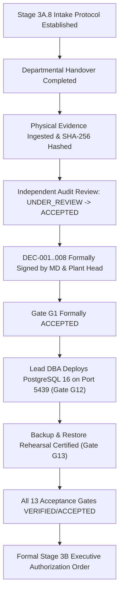

# VSPL Material Management & Costing System
## Phase 7 — Stage 3A.8: Authorization Boundaries & Governance Demarcation

**Document ID:** `VSPL-P7-S3A8-AUTH-001`  
**Security Classification:** Authoritative Governance Policy  
**Effective Date:** October 2026  
**Auditor:** Data Migration Audit Team & Senior Manufacturing ERP Specialist  
**Governing Protocol:** [STAGE3A8_EVIDENCE_INTAKE_PROTOCOL.md](file:///c:/VSPL_MM/Material%20managment%20system/docs/reports/phase7_stage3a8/STAGE3A8_EVIDENCE_INTAKE_PROTOCOL.md)  
**Handover Reference:** [DEPARTMENT_HANDOVER_CHECKLIST.md](file:///c:/VSPL_MM/Material%20managment%20system/docs/reports/phase7_stage3a8/DEPARTMENT_HANDOVER_CHECKLIST.md)  

---

### 1. Executive Purpose & Architectural Principles

This document establishes the binding authorization boundaries governing Phase 7 of the VSPL Material Management & Costing System. It resolves critical ambiguities in operational execution, strictly separates corporate governance from technical implementation, demarcates human versus automated agent responsibilities, and establishes non-negotiable hard stop criteria.

#### Core Governance Principles
1. **Separation of Policy from Execution:** No technical implementation script may be altered, nor database container deployed, until the underlying business policy decision has been formally authorized and cryptographically archived.
2. **Strict Demarcation of Human vs System Authority:** Software agents and technical engineers are strictly prohibited from making business policy determinations, inventing inventory valuations, certifying physical stock, or approving date normalizations.
3. **No Synthetic Backfilling:** The 82-day void between historical spreadsheet records (27-Jul-2026) and operational go-live cutoff (18-Oct-2026) must never be filled with synthetic transactions, interpolated consumption, or estimated balances.
4. **Port Isolation:** Port `5432` is permanently allocated to the production Order Management System (`backend-db-1`). Non-production PostgreSQL testing and migration rehearsals are strictly confined to dedicated port `5439`.

---

### 2. Disentangling Action Register Inconsistencies

During Stage 3A.7 review, two conflated actions in `HUMAN_ACTION_REGISTER.csv` were identified and must be formally disentangled:

```
+----------------------------------------------------------------------------------------------------+
|                                ACTION DISENTANGLEMENT MATRIX                                       |
+----------------------------------------------------------------------------------------------------+
| Inconsistent Prior Definition                   | Formally Disentangled Architecture               |
+-------------------------------------------------+--------------------------------------------------+
| ACT-07: Premature Code Change                   | Phase A: Human Authorization (Governance)        |
| - Conflated policy decision DEC-006 with        |   Systems Architect & QA Lead execute formal     |
|   committing code edits to manifest generator   |   Template Exclusion Directive.                  |
|   during a read-only audit stage.               | Phase B: Technical Implementation (Engineering)  |
|                                                 |   Post-governance update to manifest script.     |
+-------------------------------------------------+--------------------------------------------------+
| ACT-10: Premature Infrastructure Deployment     | Phase A: Executive Corporate Sign-Off (G1)       |
| - Conflated executive approval (MD/Plant Head   |   Managing Director & Plant Head execute         |
|   signing MANAGEMENT_SIGNOFF_TEMPLATE.md) with  |   MANAGEMENT_SIGNOFF_TEMPLATE.md.                |
|   DBA container deployment on port 5439.        | Phase B: Technical DBA Deployment (G12/G13)      |
|                                                 |   Lead DBA deploys PostgreSQL 16 on port 5439.   |
+-------------------------------------------------+--------------------------------------------------+
```

#### Detailed Disentanglement Analysis

#### A. Resolution of `ACT-07` (Template Exclusion)
* **The Error:** Prior planning treated `ACT-07` as "commit script update to `phase7_stage2_manifest_generator.py`". Modifying code during Stage 3A violates the read-only mandate of the audit phase and bypasses formal architectural authorization.
* **The Disentangled Boundary:**
  1. **Phase A (Human Business Governance):** Systems Architect and Quality Assurance Lead review `VSPL_Material_Entry.xlsx` Read Me cell A14 ("Row 2 is sample entry") and formally execute the **Template Exclusion Directive**. This satisfies the human decision requirement for `DEC-006`.
  2. **Phase B (Downstream Engineering Implementation):** Only *after* the directive is formally recorded and archived may the technical migration engineer modify `scripts/phase7_stage2_manifest_generator.py` to add `df.iloc[1:]` row 2 filtering, reducing candidate migration records from 617 to 613.

#### B. Resolution of `ACT-10` (Executive Sign-Off vs Container Deployment)
* **The Error:** Prior documentation coupled executive corporate sign-off (`MANAGEMENT_SIGNOFF_TEMPLATE.md` unblocking Gate `G1`) with technical infrastructure deployment (running a PostgreSQL container on port 5439 unblocking Gate `G12`). This conflated corporate executive governance with system administration.
* **The Disentangled Boundary:**
  1. **Phase A (Executive Corporate Governance — Gate `G1`):** Managing Director, Plant Head, and Finance Head review the completed evidence intake package and execute `MANAGEMENT_SIGNOFF_TEMPLATE.md`. This represents corporate business acceptance of decisions `DEC-001` through `DEC-008`.
  2. **Phase B (Technical DBA Deployment — Gate `G12`):** Strictly downstream of Gate `G1` acceptance, the Lead DBA initializes the isolated PostgreSQL 16 container on port `5439`, applies Alembic migrations `001` through `005`, and conducts automated database verification.

---

### 3. Demarcation of Human Staff vs Technical Migration Agent

| Functional Domain | Human Operational Staff Authority | Technical Migration Agent / AI Boundary |
| :--- | :--- | :--- |
| **Material Valuation (`DEC-001`)** | **Exclusive:** Finance Head retrieves original vendor tax invoices and certifies ex-GST purchase rates. | **Strictly Prohibited:** Cannot invent, estimate, or impute material prices. May only ingest certified rate files. |
| **Cutoff & Void Policy (`DEC-002`)** | **Exclusive:** Managing Director signs executive policy memo establishing cutoff date and void treatment. | **Strictly Prohibited:** Cannot assume cutoff dates or generate synthetic transactions to bridge voids. |
| **Catalog Taxonomy (`DEC-003`)** | **Exclusive:** Stores Manager and Plant Metallurgist approve item classifications, specifications, and UOMs. | **Read-Only / Verification:** May validate syntax and schema compatibility of item definitions. |
| **Chemical Analysis (`DEC-003`)** | **Exclusive:** Foundry Metallurgist executes OES laboratory spectrometry and signs chemical analysis. | **Strictly Prohibited:** Cannot guess scrap metallurgy or alloy grade distribution. |
| **Docket Inspection (`DEC-004`)** | **Exclusive:** Stores Supervisor physically inspects paper dockets 327–1148 and executes Date Certificate. | **Verification Only:** Audits text pattern in spreadsheet; cannot declare typo resolved without physical proof. |
| **Physical Stocktake (`DEC-005`)** | **Exclusive:** Plant Head and External Auditor execute double-blind count and certify Sheet D opening stock. | **Verification Only:** Verifies mathematical balance and stocktake checksums; cannot alter counts. |
| **Template Rules (`DEC-006`)** | **Exclusive:** Systems Architect and QA Lead authorize dummy template exclusion directive. | **Implementation Only:** Updates generator script only after human directive is formally on file. |
| **Furnace Operations (`DEC-007`)** | **Exclusive:** Foundry Head retrieves physical furnace charge sheets or issues Furnace Quarantine Order. | **Enforcement Only:** Enforces mass-balance constraint; blocks uncharged heats from live posting. |
| **Legacy Archives (`DEC-008`)** | **Exclusive:** IT Head signs retirement memorandum and revokes Windows NTFS file write permissions. | **Configuration Only:** Configures ETL pipelines to permanently omit legacy files from ingestion. |
| **Infrastructure (`G12`, `G13`)** | **Supervisory:** Lead DBA approves container deployment parameters and verifies backup archives. | **Operational:** Executes container orchestration scripts and migration runs only after Gate G1 approval. |

---

### 4. Non-Negotiable Hard Stop Conditions

The technical migration agent and all project personnel must immediately halt execution upon encountering any of the following conditions:

```
[!] HARD STOP 1: MISSING EXECUTIVE SIGNATURES (GATE G1)
    Under no circumstances may database population, transaction migration, or live
    opening balance creation proceed without physical/cryptographic signatures of
    the Managing Director and Plant Head on MANAGEMENT_SIGNOFF_TEMPLATE.md.

[!] HARD STOP 2: PORT 5432 INTERFERENCE
    Under no circumstances may any Docker container, service, or test runner bind
    to port 5432. Port 5432 is dedicated exclusively to the production Order Management
    System (backend-db-1). All migration activity is confined to port 5439.

[!] HARD STOP 3: UNVERIFIED PHYSICAL STOCKTAKE (GATE G7)
    Under no circumstances may stock ledger opening balances be created from
    spreadsheet closing balances or mathematical extrapolations. Opening balances
    must originate exclusively from certified Sheet D double-blind physical counts.

[!] HARD STOP 4: SYNTHETIC DATA GENERATION (DEC-002)
    Under no circumstances may simulated, interpolated, or backfilled inventory or
    heat transactions be introduced into the 82-day void period.

[!] HARD STOP 5: UNRESOLVED ZERO-RATE COMMERCIAL ITEMS (GATE G3)
    Under no circumstances may raw material receipts with zero or null purchase rates
    be posted to production tables, as this causes catastrophic costing exceptions
    (HTTP 422 / InsufficientMeltDataError).
```

---

### 5. Formal Resumption Triggers (Path to Stage 3B)

Stage 3B (Target Database Provisioning & Operational Migration Execution) remains **STRICTLY UNAUTHORIZED**. Resumption is permitted only when all of the following sequential conditions are met:



#### Verification Checklist for Resumption
1. **Intake Register Audit:** Every action item in [EVIDENCE_INTAKE_REGISTER.csv](file:///c:/VSPL_MM/Material%20managment%20system/docs/reports/phase7_stage3a8/EVIDENCE_INTAKE_REGISTER.csv) has progressed from `NOT_RECEIVED` through `UNDER_REVIEW` to `ACCEPTED`.
2. **Reconciliation Audit:** Every decision in [DECISION_AND_GATE_RECONCILIATION.csv](file:///c:/VSPL_MM/Material%20managment%20system/docs/reports/phase7_stage3a8/DECISION_AND_GATE_RECONCILIATION.csv) is marked `APPROVED`.
3. **Acceptance Gates:** Gates `G1` through `G13` are 100% verified and accepted.
4. **Executive Order:** Managing Director and Plant Head sign a formal **Stage 3B Authorization Order**.
