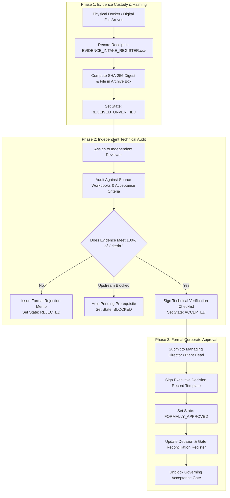

# VSPL Material Management & Costing System — Evidence Intake & Reconciliation Protocol (Stage 3A.8)

**Document ID:** `DOC-P7-S3A8-INTAKE-PROTOCOL`  
**System:** VSPL Material Management & Costing System  
**Company:** Vijay Spheroidals Pvt. Ltd., Peenya Industrial Area, Bangalore  
**Operational Scope:** Controlled Evidence-Driven Intake, Lifecycle State Engine & Action Inconsistency Resolution  
**Governance Status:** **ACTIVE PROTOCOL — ZERO OPERATIONAL MUTATIONS — STAGE 3B STRICTLY UNAUTHORIZED**  
**Execution Authority:** **READ-ONLY AUDIT & PROTOCOL SPECIFICATION**  

---

## 1. Executive Purpose & Governance Scope

This document establishes the authoritative standard operating procedure (SOP) for the **controlled evidence-driven intake process** governing the ten human action items defined in [`HUMAN_ACTION_REGISTER.csv`](file:///C:/VSPL_MM/Material%20managment%20system/docs/reports/phase7_stage3a7/HUMAN_ACTION_REGISTER.csv).

As the project transitions from automated repository audits to human-led departmental investigation, a rigorous intake gate is mandatory to ensure that incoming paper dockets, supplier tax invoices, chemical lab reports, physical stocktake count tally sheets, and board policy resolutions are methodically cataloged, cryptographically hashed, independently reviewed, and formally authorized before touching any application database or migration runner.

### Non-Negotiable Governance Invariants:
1. **Intake Gatekeeper Separation:** Evidence collection (Custodian) must be strictly decoupled from evidence validation (Independent Reviewer) and corporate approval (Managing Director / Plant Head).
2. **Zero Informal Intake:** No verbal statements, uncertified email text, unverified spreadsheet snippets, or handwritten notes on scrap paper may be recognized as evidence.
3. **Preservation of Repository Immutability:** Ingesting evidence into the audit archive does **not** grant authorization to alter primary source workbooks, execute database writes, or trigger Stage 3B live migration.

---

## 2. Evidence Lifecycle State Engine

Every evidence submission assigned under actions `ACT-01` through `ACT-10` must progress through an explicit, formal state machine:

```
┌────────────────────────────────────────────────────────────────────────┐
│                   EVIDENCE LIFECYCLE STATE MACHINE                     │
├────────────────────────────────────────────────────────────────────────┤
│                                                                        │
│  [ NOT_RECEIVED ] ──> (Physical or digital artifact delivered to desk) │
│          │                                                             │
│          ▼                                                             │
│  [ RECEIVED_UNVERIFIED ] ──> (Cryptographic SHA-256 computed & logged) │
│          │                                                             │
│          ▼                                                             │
│  [ UNDER_REVIEW ] ──> (Independent verification of rates/specs/dockets)│
│          │                                                             │
│          ├──> Fails validation ──> [ REJECTED ] (Returned with RCA)    │
│          │                                                             │
│          ├──> Upstream blocker ──> [ BLOCKED ]  (Held pending prereq)  │
│          │                                                             │
│          ▼ Passes all criteria                                         │
│  [ ACCEPTED ]                                                          │
│          │                                                             │
│          ▼ (Formal business determination by Executive Signatory)      │
│  [ FORMALLY_APPROVED ] (Unblocks governing Decision / Gate)            │
│                                                                        │
└────────────────────────────────────────────────────────────────────────┘
```

### 2.1 State Definitions & Transition Criteria

| Lifecycle State | Technical Definition | Entry Criteria | Exit Criteria |
| :--- | :--- | :--- | :--- |
| **`NOT_RECEIVED`** | Action item is active, but no physical document or digital file has arrived at the audit intake desk. | Initial state for all pending actions. | Custodian deposits physical docket or uploads digital file to intake folder. |
| **`RECEIVED_UNVERIFIED`** | Physical docket or digital file has arrived; chain-of-custody established; contents uninspected. | Physical file logged in receipt desk binder OR digital scan deposited. | File integrity verified; SHA-256 hash computed and recorded in intake register. |
| **`UNDER_REVIEW`** | Independent reviewer is actively auditing numbers, signatures, legal GST validity, or chemical tolerances. | Hash recorded; assignment to designated Independent Reviewer. | Reviewer completes verification audit against source workbooks and rules. |
| **`REJECTED`** | Evidence fails validation criteria (e.g., illegible date, unrated invoice, out-of-spec scrap chemistry, fractional count on discrete UOM). | Reviewer identifies non-compliance with statutory or technical standards. | Returned to Custodian with formal Rejection Memo detailing required corrective action. |
| **`BLOCKED`** | Evidence cannot be evaluated because an upstream dependency has not cleared (e.g. stocktake results cannot be accepted before cutoff policy approval). | Reviewer flags dependency block. | Upstream decision or gate achieves `FORMALLY_APPROVED` status. |
| **`ACCEPTED`** | Independent reviewer certifies in writing that evidence satisfies 100% of defined technical and accounting criteria. | Formal sign-off on review checklist by designated Independent Reviewer. | Handed over to Managing Director or Plant Head for formal corporate sign-off. |
| **`FORMALLY_APPROVED`** | Accountable corporate decision-maker signs the governing Decision Record Template. | Physical or cryptographic signature of Managing Director / Plant Head. | Governing decision transitions from `PENDING_REVIEW` to `APPROVED`; unblocks Gate. |

---

## 3. Strict Distinction: Receipt vs Acceptance vs Approval

A critical flaw in legacy spreadsheet management is conflating document possession with legal authorization. The VSPL ERP implementation enforces strict boundaries:

```
┌───────────────────────────────────────────────────────────────────────────────────────────────────┐
│              THREE-TIER GOVERNANCE SEPARATION: RECEIPT vs ACCEPTANCE vs APPROVAL                   │
├───────────────────────────────────┬───────────────────────────────────┬───────────────────────────┤
│ 1. EVIDENCE RECEIPT               │ 2. TECHNICAL ACCEPTANCE           │ 3. BUSINESS APPROVAL      │
├───────────────────────────────────┼───────────────────────────────────┼───────────────────────────┤
│ • Performed by: Custodian         │ • Performed by: Independent       │ • Performed by: Managing  │
│   (Stores Officer / Purchase Asst)│   Reviewer (Finance Head / QA)    │   Director / Plant Head   │
│ • Focus: Physical possession &    │ • Focus: Numerical accuracy,      │ • Focus: Legal policy,    │
│   chain of custody.               │   statutory GST validity,         │   costing impact, balance │
│ • Artifact: High-resolution PDF   │   metallurgical chemical match.   │   sheet risk allocation.  │
│   scan & SHA-256 digest.          │ • Artifact: Signed Review Memo    │ • Artifact: Signed Exec   │
│ • State: RECEIVED_UNVERIFIED      │   & completed packet checklist.   │   Decision Record (G1).   │
│                                   │ • State: ACCEPTED                 │ • State: FORMALLY_APPROVED│
└───────────────────────────────────┴───────────────────────────────────┴───────────────────────────┘
```

> [!IMPORTANT]
> **Operational Rule:**  
> A supplier tax invoice physically resting in the accounts cabinet is merely **Received**. It becomes **Accepted** only when the Finance Head certifies that the ex-GST base rate and GST breakdown reconcile to purchase orders and weighbridge receipts. It becomes **Approved** only when the Managing Director signs DEC-001 authorizing that rate for Rule C1 inventory valuation.

---

## 4. Chain of Custody & Hash Registration Protocol

To satisfy statutory tax auditors and external financial accounting standards, all submitted evidence must adhere to tamper-evident tracking:

### 4.1 Digital Evidence Protocol (Scans, CSVs, Spreadsheets)
1. **Intake Storage Location:** Digital artifacts must be placed in `docs/reports/phase7_stage3a8/evidence/` under standardized naming:
   `EVID_{ACTION_ID}_{YYYYMMDD}_{DOCUMENT_TYPE}.[pdf|csv|xlsx]`
2. **Immediate Digest Computation:** Upon arrival, the intake officer computes the SHA-256 checksum:
   ```powershell
   Get-FileHash -Path "docs\reports\phase7_stage3a8\evidence\EVID_ACT02_20261023_GRN_INVOICES.pdf" -Algorithm SHA256
   ```
3. **Digest Persistence:** The computed 64-character hexadecimal digest is recorded in `EVIDENCE_INTAKE_REGISTER.csv`.

### 4.2 Physical Hardcopy Evidence Protocol (Paper Slips, Logbooks, Tag Stubs)
1. **Physical Tagging:** Every physical docket is tagged with a serialized archival barcode/label:
   `PHYS-VSPL-{ACTION_ID}-{SERIAL:04d}`
2. **Archival Filing:** Stored in the fireproof engineering archive in designated boxes (e.g. `'Box P7-Issues-July2026'`).
3. **Digital Surrogate:** Hardcopy dockets must be scanned at $\ge 300\text{ DPI}$ in full color, converted to PDF/A, and hashed per Section 4.1.

---

## 5. Audit & Resolution of Inconsistencies in `HUMAN_ACTION_REGISTER.csv`

A rigorous examination of [`HUMAN_ACTION_REGISTER.csv`](file:///C:/VSPL_MM/Material%20managment%20system/docs/reports/phase7_stage3a7/HUMAN_ACTION_REGISTER.csv) identified two significant governance inconsistencies that must be corrected:

### 5.1 Inconsistency 1: Premature Code/Script Modification in `ACT-07`
- **Current Text in `ACT-07`:** *"Committed script update to phase7_stage2_manifest_generator.py filtering template dummy row 2 across all sheets."*
- **Audit Defect:** This description proposes modifying application code and committing a Git change *before* executive decision `DEC-006` has been formally authorized!
- **Correction:** In accordance with read-only boundaries, the software engineering agent cannot alter Git-tracked scripts during an audit phase. `ACT-07` is restructured into two distinct phases:
  1. **Phase 1 (Human Governance):** The Systems Architect and QA Lead execute the `DEC-006` Decision Record Template, formally authorizing the business rule to filter row 2.
  2. **Phase 2 (Authorized Technical Implementation):** Only after `DEC-006` reaches `FORMALLY_APPROVED` status may the script update be staged, tested in an isolated worktree, and committed under formal change control.

### 5.2 Inconsistency 2: Conflation of Corporate Governance and Infrastructure in `ACT-10`
- **Current Text in `ACT-10`:** *"Execution of MANAGEMENT_SIGNOFF_TEMPLATE.md followed by isolated PostgreSQL 16 container deployment on port 5439."*
- **Audit Defect:** This combines corporate executive determination (unblocking Gate G1) with technical infrastructure deployment (unblocking Gate G12). These belong to completely different roles (Managing Director vs Lead DBA) with distinct prerequisite chains.
- **Correction:** In the intake protocol, `ACT-10` is strictly segregated:
  1. `ACT-10A` (**Corporate Governance clearance**): Managing Director signs `MANAGEMENT_SIGNOFF_TEMPLATE.md`, unblocking Gate G1.
  2. `ACT-10B` (**Technical Database Provisioning**): Lead DBA deploys PostgreSQL 16 on port 5439, applies Alembic migrations, and runs pytest, unblocking Gate G12. G12 is strictly downstream of G1.

---

## 6. End-to-End Ingestion & Verification Workflow



---

## 7. Safety Attestation & Operational Stop Conditions

- **Protocol Only:** This document establishes intake standards. No evidence has been marked accepted or approved; zero database records were created.
- **Prohibition Enforced:** **Stage 3B live historical migration remains strictly unauthorized until all 10 intake actions achieve `FORMALLY_APPROVED` status and all 13 Acceptance Gates are certified in writing.**
