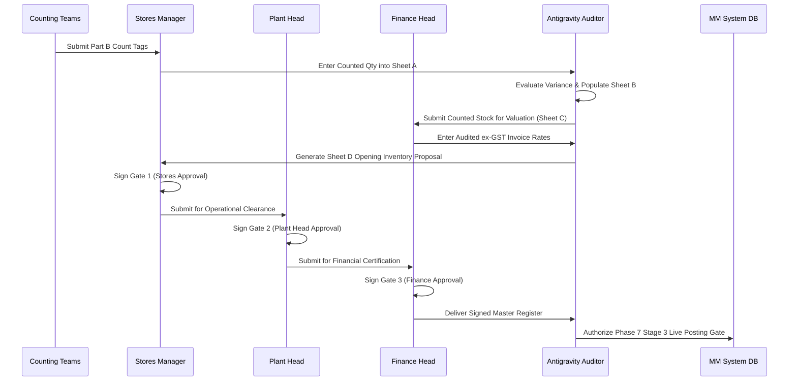

# VSPL Material Management & Costing System — Physical Stocktake Protocol (SOP)

**Document ID:** `SOP-P7-PHYSICAL-STOCKTAKE`  
**System:** VSPL Material Management & Costing System  
**Company:** Vijay Spheroidals Pvt. Ltd., Peenya Industrial Area, Bangalore  
**Operational Scope:** Plant-Wide Physical Stocktake & Opening Inventory Verification  
**Target Cutoff Timestamp:** 12 October 2026, 23:59:59 IST  
**Version:** 1.0 (Audit-Controlled Preparation)  

---

## 1. Purpose & Guiding Principles

This Standard Operating Procedure (SOP) governs the execution of a comprehensive physical inventory stocktake across all production, stores, and holding areas at Vijay Spheroidals Pvt. Ltd. (VSPL).

### Core Principles:
1. **Double-Blind Verification:** Every physical item must be counted by an independent counter and verified by an independent checker. Neither party may rely on historical spreadsheet figures.
2. **Defensible Cutoff Discipline:** The stocktake captures the physical reality as of **12 October 2026, 23:59:59 IST**. Any material received or issued after this timestamp must be physically quarantined and excluded from opening stock.
3. **No Retrospective Ledger Substitution:** The physical count does not attempt to reconstruct historical transactions between July and October 2026; it establishes an audited, defensible baseline for go-live under **DEC-002 Scenario A**.

---

## 2. Pre-Count Preparation & Housekeeping (T-48h to T-0h)

### 2.1 Physical Store Organization
- **Material Consolidation:** Stores personnel must consolidate fragmented lots of the same item into designated primary bins or pallet racks.
- **Scrap Yard Segregation:** The foundry raw material yard must segregate distinct scrap categories (CRC Scrap Low MN, CRC Scrap Low High MN, Mild Steel Scrap, Foundry Gatings/Runners, Pig Iron) into physically separated bays with clear boundary markings.
- **Quarantine Area Setup:** Establish a locked, marked physical quarantine bay (`LOC-QUARANTINE-OCT26`) for incoming deliveries arriving after the cutoff time.

### 2.2 Weighing Equipment Calibration
All weighing instruments must be calibrated and stamped by certified weights-and-measures technicians prior to count commencement:
1. **50-Tonne In-Motion / Static Weighbridge:** Calibrated for gross and tare weighments of scrap and pig iron trucks/hoppers.
2. **500-kg Platform Scales (Stores & Alloy Room):** Calibrated for ferro-alloys, inoculants, and ingot weighment (sensitivity: ±0.05 kg).
3. **30-kg Precision Balance (Foundry Lab):** Calibrated for high-value alloying additions and lab standards (sensitivity: ±0.001 kg).

---

## 3. Two-Part Count Tag Control System

Every physical bin, rack, pallet, barrel, or bulk bay must receive a uniquely numbered, two-part perforated count tag before counting begins.

```
┌────────────────────────────────────────────────────────────────────────┐
│  VIJAY SPHEROIDALS PVT. LTD. — PHYSICAL STOCKTAKE TAG                  │
│  Tag No: TAG-20261012-0482                            Location: BAY-RM-04│
├────────────────────────────────────────────────────────────────────────┤
│  Item Code: FDY-RM-008         Description: CRC Scrap-Low MN           │
│  UOM: Kg                       Category: Raw Material                  │
│                                                                        │
│  PART A: LOCATION COPY (Attach to physical bin or pallet)              │
│  Counted Qty: __________________   Date & Time: _____________________  │
│  Counter Name: _________________   Verifier Name: ___________________  │
└────────────────────────────────────────────────────────────────────────┘
  ✂ ✂ ✂ ✂ ✂ ✂ ✂ ✂ ✂ ✂ [PERFORATION CUT LINE] ✂ ✂ ✂ ✂ ✂ ✂ ✂ ✂ ✂ ✂ ✂ ✂ ✂ ✂
┌────────────────────────────────────────────────────────────────────────┐
│  PART B: AUDIT CONTROL DESK COPY (Submit directly to Stores Desk)      │
│  Tag No: TAG-20261012-0482                            Item: FDY-RM-008 │
│  Counted Qty: __________________   UOM: Kg                             │
│  Counter Signature: ____________   Verifier Signature: ______________  │
└────────────────────────────────────────────────────────────────────────┘
```

### Tagging Rules:
- All tag books are logged and issued under serial control by the Lead Inventory Auditor.
- Missing, damaged, or voided tags must be returned and recorded in the tag register.
- Once Part B is detached, the material in that bin/bay is **physically frozen** and must not be moved until final recount clearance.

---

## 4. Specific Measurement Methodologies by Material Category

### 4.1 Category 1: Bulk Foundry Raw Materials
- **Materials:** Pig Iron (`FDY-RM-019`), CRC Scrap Low MN (`FDY-RM-008`), CRC Scrap Low High MN (`FDY-RM-007`), Borings (`FDY-RM-002` to `005`), Return Gatings (`FDY-RM-011`).
- **Methodology:**
  1. *Transfer & Weigh:* Where feasible, transfer material via front-end loader into tared tipper trucks and pass over the certified weighbridge.
  2. *Bulk Bay Survey:* For immoveable massive stockpiles, perform geometric cross-sectional volume profiling combined with measured bulk compaction density ($t/m^3$) verified by three core samples.
  3. *Chemical Spectrometry Check:* For scrap piles of uncertain manganese content (e.g. `crca scrap` ambiguity under DEC-003), the foundry metallurgist must draw 5 representative coupons from the scrap bay and verify chemistry via optical emission spectrometer before assigning the canonical code.

### 4.2 Category 2: Ferro-Alloys, Inoculants & Treatment Agents
- **Materials:** Pure Magnesium (`FDY-RM-016`), Inoculant 15 (`FDY-RM-014`), Inoculant 16 (`FDY-RM-015`), Ferro-Silicon (`FDY-RM-020`), Ferro-Manganese (`FDY-RM-017`).
- **Methodology:**
  1. *Sealed Drums:* Count factory-sealed drums; verify manufacturer tare weight stamped on drum body; sample 1 in 10 drums for gross weighment.
  2. *Opened Drums / Active Floor Stock:* Transfer entire contents to tared plastic containers and weigh on 500-kg calibrated digital platform scales. Record weight to 3 decimal places (kg).
  3. *Alloy Crib Lockout:* The alloy storage room must be locked during counting. Key held exclusively by the Inventory Auditor.

### 4.3 Category 3: Foundry Consumables, Refractory & Binders
- **Materials:** Furnace Lining Material, Holcote-100 coating (`FDY-MD-003`), Mould Sealing Rope (`FDY-CN-002`), Bentonite, Core Sand Binders.
- **Methodology:**
  1. *Bagged Goods:* Pallet count multiplied by bag weight standard (e.g., 25 kg or 50 kg bags). Count loose unsealed bags individually; weigh partial bags.
  2. *Coating Drums:* Dipstick fluid level check on 200-L drums, converted via specific gravity chart ($kg = L \times \rho$).

### 4.4 Category 4: Cutting Tools, Inserts & Tooling Crib
- **Materials:** Tenryu TCT Circular Saw Blades (`MCS-CB-009`), Power Hax Blades (`MCS-CB-005`), Grinding Wheels (`FDY-CN-013`), Tool Posts (`MCS-CN-002`), Carbide Inserts.
- **Methodology:**
  1. *Piece Count:* 100% discrete physical piece count across all crib drawers, tool racks, and CNC machine staging areas.
  2. *Segregation of Used / Worn Tools:* Dull or regrind tools must be physically separated from fresh new stock and tagged as `SCRAP / REGRIND` to avoid inflating active asset values.

### 4.5 Category 5: Oils, Lubricants & Process Fluids
- **Materials:** Hydraulic Oils, Quenching Oils, Gear Oils, Compressor Lubricants.
- **Methodology:**
  1. Sealed standard 210-litre drums counted by drum unit.
  2. Opened dispenser drums measured via calibrated dip gauge. Partial volumes recorded in Litres (`Ltr`).

---

## 5. Cutoff Enforcement & Movement Freeze Protocol

```
                        CUTOFF DEADLINE: 12-OCT-2026, 23:59:59 IST
  ──────────────────────────────────────────┬──────────────────────────────────────────
  PRE-CUTOFF MOVEMENTS                      │ POST-CUTOFF MOVEMENTS
  - Normal plant consumption up to 23:59:59  │ - Plant freeze: NO store issues permitted
  - All paper slips dated 12-Oct or earlier  │ - Incoming vendor deliveries routed to:
    must be entered into pre-count logs.     │   "PHYSICAL QUARANTINE BAY"
  - Cutoff status: ELIGIBLE FOR COUNT.       │ - Inward delivery dockets stamped:
                                             │   "POST-CUTOFF RECEIPT - NOT IN COUNT"
                                             │ - Live posting deferred to Day 1 go-live.
```

### Movement Rules:
1. **Stores Freeze:** From 00:00:00 IST on 13-Oct-2026 until final tag reconciliation, zero material may be issued from stores to foundry, machine shop, or maintenance.
2. **Emergency Maintenance Spares:** If plant safety requires emergency parts issue during the freeze, the Stores Manager, Plant Head, and Auditor must co-sign a triple-authorized `EMERGENCY STOCK BREAK SLIP` recording tag number, item, and quantity deducted before the part leaves the crib.
3. **Vendor Receipts in Transit:** Trucks arriving after cutoff are weighed on the weighbridge for gate entry, but materials are offloaded into the quarantine holding bay. They are strictly excluded from the count sheets.

---

## 6. Count Sheet Reconciliation & Variance Investigation

### 6.1 Data Entry into `VSPL_Physical_Stocktake_Register.xlsx`
1. Part B count tags are collected at the Audit Control Desk in batches by department.
2. Two independent data entry operators enter quantities into Worksheet A (`A. Stocktake Register`, Col F `Physical Counted Qty`).
3. Excel formula automatically computes:
   $$\text{Quantity Variance} = \text{Counted Qty} - \text{Book Qty}$$

### 6.2 Variance Investigation Thresholds (Worksheet B)
An item must be transferred to Worksheet B (`B. Variance Investigation`) for formal inquiry under the following criteria:

| Severity Level | Variance Criteria | Mandatory Action | Accountable Lead |
| :--- | :--- | :--- | :--- |
| **High** | Any negative book balance (e.g. 7 raw materials)<br>Any missing rate or unmapped candidate code | Immediate root-cause inquiry; weighbridge recount; check invoice | Plant Head & Finance Head |
| **Medium** | Variance $> \pm 1.0\%$ for bulk raw materials ($> 100\text{ kg}$)<br>Variance $> \pm 2$ pieces for discrete tooling | Immediate joint recount with verifier and shop supervisor | Stores Manager |
| **Low** | Variance $\le \pm 1.0\%$ on bulk consumables<br>Variance $= 0$ | Accepted into Sheet C for commercial valuation | Inventory Auditor |

---

## 7. Audit Trail, Sign-off Hierarchy & Transition to Go-Live



### Final Governance Sign-Off:
Until all three gates (Stores, Plant Head, Finance Head) are physically signed with verified dates on Sheet D of `VSPL_Physical_Stocktake_Register.xlsx`:
- **The database remains disconnected.**
- **The live inventory ledger remains zero-posted.**
- **The core ERP engine maintains complete transactional isolation.**
