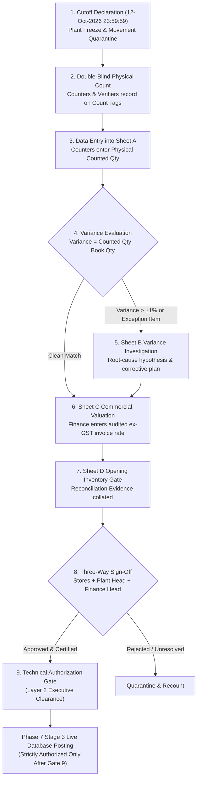

# VSPL Material Management & Costing System — Physical Stocktake Preparation Package

**Document ID:** `DOC-P7-STOCKTAKE-PREPARATION-README`  
**System:** VSPL Material Management & Costing System  
**Company:** Vijay Spheroidals Pvt. Ltd., Peenya Industrial Area, Bangalore  
**Target Cutoff Date:** 12 October 2026, 23:59:59 IST  
**Audit & Preparation Date:** 13 October 2026  
**Governance Status:** **CONTROLLED AUDIT PREPARATION — ZERO APPLICATION POSTINGS AUTHORIZED**  

---

## 1. Executive Purpose

This package establishes an auditable, controlled physical stocktake and opening-inventory reconciliation framework for Vijay Spheroidals Pvt. Ltd. (VSPL). It bridges the operational divide between historical spreadsheet records (which terminated in late July 2026) and the live system go-live on 12 October 2026.

### Core Governance Boundaries:
1. **The 82-Day Operational Void:** Electronic spreadsheet transaction records cease on 22-Jul-2026. The live system cutoff is 12-Oct-2026. Because plant operations ran continuously during August and September 2026 without digital logging, July spreadsheet balances **cannot and must not** be assumed to represent October inventory.
2. **Read-Only Stocktake Preparation:** This preparation package creates zero database records, posts zero inventory movements, and generates zero opening balances. Phase 7 Stage 3 live database import remains **strictly unauthorized**.
3. **No Automated Resolution of Deficits:** Known historical defects (including the 7 negative raw material balances, 11,793 kg of omitted issues, and unvalued GRNs) are explicitly flagged for investigation rather than being artificially cleared.

---

## 2. Package Structure & Deliverables

The preparation package is organized within `docs/reports/phase7_stocktake_preparation/`:

```
docs/reports/phase7_stocktake_preparation/
├── VSPL_Physical_Stocktake_Register.xlsx     # Controlled 4-worksheet master audit workbook
├── PHYSICAL_STOCKTAKE_PROTOCOL.md             # Standard Operating Procedure for physical count
├── EXCEPTION_RECONCILIATION_REGISTER.md       # Root-cause analysis & resolution paths for 7 key anomalies
└── README.md                                  # This document (Workflow, roles, and sign-off gates)
```

---

## 3. Stocktake Workbook Architecture (`VSPL_Physical_Stocktake_Register.xlsx`)

The master workbook contains four interconnected worksheets structured to maintain strict segregation of duties:

| Worksheet | Tab Name | Scope & Contents | Key Formula / Control |
| :--- | :--- | :--- | :--- |
| **A** | `A. Stocktake Register` | 407 items (391 canonical Item Master items + 16 candidate items from `2. New Items`). Captures double-blind physical counts. | `=IF(ISBLANK(F6),"",IF(ISNUMBER(E6),F6-E6,"PENDING_BOOK_QTY"))`<br>Only 8 items with interim ledger transactions have book values; 383 items remain blank due to the 82-day void. |
| **B** | `B. Variance Investigation` | 20 pre-populated historical exception records (7 negative balances, omitted issues, unmapped codes, date typo, dummy sample rows, incomplete heats, legacy dates). | `=IF(ISBLANK(C6),"",IF(ISNUMBER(B6),C6-B6,""))`<br>Mandates hypothesis-based root cause identification and proposed corrective actions. |
| **C** | `C. Valuation Register` | Financial valuation register under Phase 6 Rule C1 (Moving Weighted Average). All 407 items are marked `EXPLICITLY_UNVALUED`. | `=IF(OR(ISBLANK(E6),ISBLANK('A. Stocktake Register'!F6)),"",'A. Stocktake Register'!F6*E6)`<br>Zero estimated rates permitted. Rates require verified purchase invoices. |
| **D** | `D. Opening Inventory Approval` | Master authorization register. Pulls counted quantities from Sheet A and certified values from Sheet C. | **All approval columns (Stores, Plant Head, Finance, Final Authorization) remain strictly blank.** |

---

## 4. Roles, Responsibilities & Governance Hierarchy

A successful, auditable stocktake requires clear division of responsibilities across plant departments:

```
                                  ┌─────────────────────────────┐
                                  │      MANAGING DIRECTOR      │
                                  │  Executive Decision Sponsor │
                                  └──────────────┬──────────────┘
                                                 │
                   ┌─────────────────────────────┴─────────────────────────────┐
                   │                                                           │
                   ▼                                                           ▼
     ┌───────────────────────────┐                               ┌───────────────────────────┐
     │        PLANT HEAD         │                               │       FINANCE HEAD        │
     │ Operational Cutoff Leader │                               │  Commercial Rate Auditor  │
     └─────────────┬─────────────┘                               └─────────────┬─────────────┘
                   │                                                           │
     ┌─────────────┴─────────────┐                                             │
     │                           │                                             │
     ▼                           ▼                                             ▼
┌──────────────┐          ┌──────────────┐                              ┌──────────────┐
│STORES MANAGER│          │ FOUNDRY HEAD │                              │COST ACCOUNT- │
│Count Control │          │Weighbridge & │                              │     ANT      │
│ & Stock Crib │          │Alloy Yard    │                              │Valuation Cert│
└──────────────┘          └──────────────┘                              └──────────────┘
```

### Accountable Roles:
1. **Managing Director:** Executive sign-off on Cutoff Policy (DEC-002 Scenario A) and live migration authorization.
2. **Plant Head:** Overall stocktake director. Declares factory shutdown/freeze at 12-Oct-2026 23:59:59. Signs Sheet D operational approval.
3. **Finance Head / Purchase Head:** Commercial valuation authority. Audits vendor tax invoices and purchase orders to provide verified ex-GST unit rates for Sheet C (DEC-001). Signs Sheet D financial approval.
4. **Stores Manager:** Operational count organizer. Controls physical count tags, manages double-blind counting teams, investigates crib variances.
5. **Foundry Head & Metallurgist:** Bulk weighbridge supervisor for pig iron, scrap yards, gating returns (DEC-005), and alloy spectrometry (DEC-003). Retrieves paper heat logs for 22-Jul-2026 (DEC-007).
6. **Lead Systems Architect & Auditor (Antigravity):** Quality assurance lead. Verifies formula integrity, data crosswalks, immutable archives, and ensures zero premature database writes.

---

## 5. End-to-End Stocktake Execution Workflow



---

## 6. Three-Way Approval Gates (Sheet D)

Live database posting is blocked by a three-key cryptographic and managerial authorization mechanism:

1. **Gate 1: Stores Operational Certification (Stores Manager)**
   - Confirms every storage location (Main Store, Raw Material Yard, Alloy Room, Tooling Crib, Pattern Shop, Maintenance Yard) has been physically counted and tagged.
   - Certifies that post-cutoff deliveries (received after 12-Oct-2026 23:59:59) are sequestered in physical quarantine.
2. **Gate 2: Plant Operational Certification (Plant Head)**
   - Confirms metallurgical classifications (e.g. CRC Scrap Low MN vs Low High MN resolved via spectrometry).
   - Confirms scrap yard and gating return weighments are accurate.
   - Reconciles furnace charge deficits and confirms physical count as true factory inventory.
3. **Gate 3: Financial & Commercial Certification (Finance Head)**
   - Confirms that every unit rate in Sheet C is derived from a verified ex-GST purchase invoice or purchase order.
   - Confirms that extended valuations comply with weighted-average inventory accounting principles (Phase 6 Rule C1).
   - Confirms that no estimated, placeholder, or historical spreadsheet rates were utilized.

---

## 7. Next Actions & Stop Condition

- **Current State:** Stocktake preparation artifacts completed and verified.
- **Immediate Next Step:** Management review of `EXECUTIVE_DECISION_BRIEF.md`, `PHYSICAL_STOCKTAKE_PROTOCOL.md`, and `EXCEPTION_RECONCILIATION_REGISTER.md`.
- **Mandatory Stop Condition:** Await executive authorization and formal physical count execution. **Phase 7 Stage 3 remains strictly unauthorized.**
